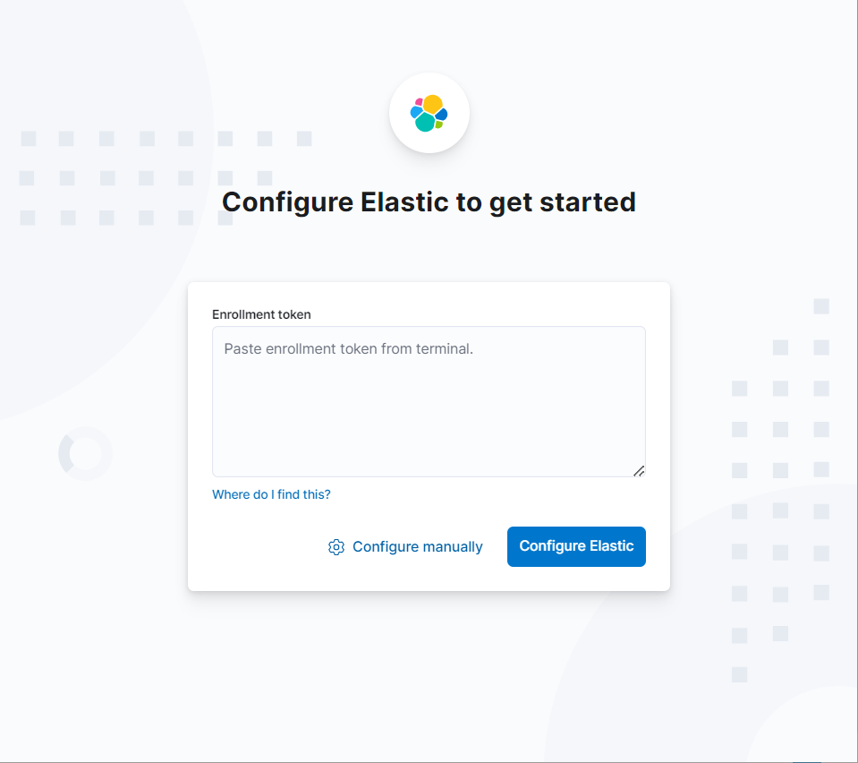
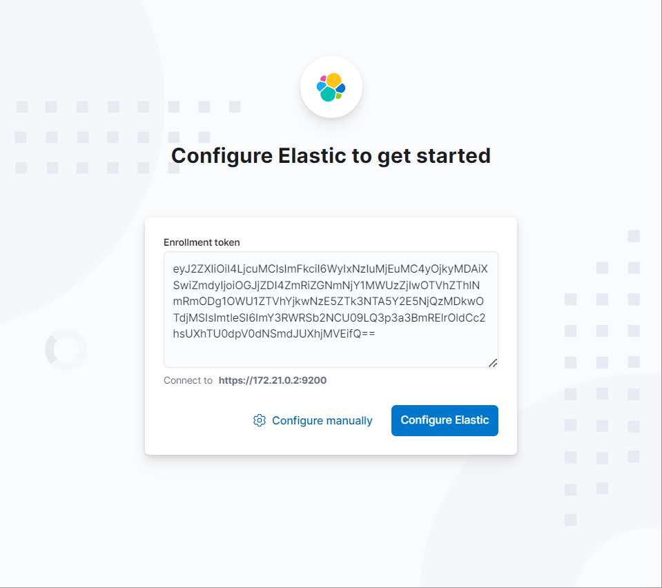
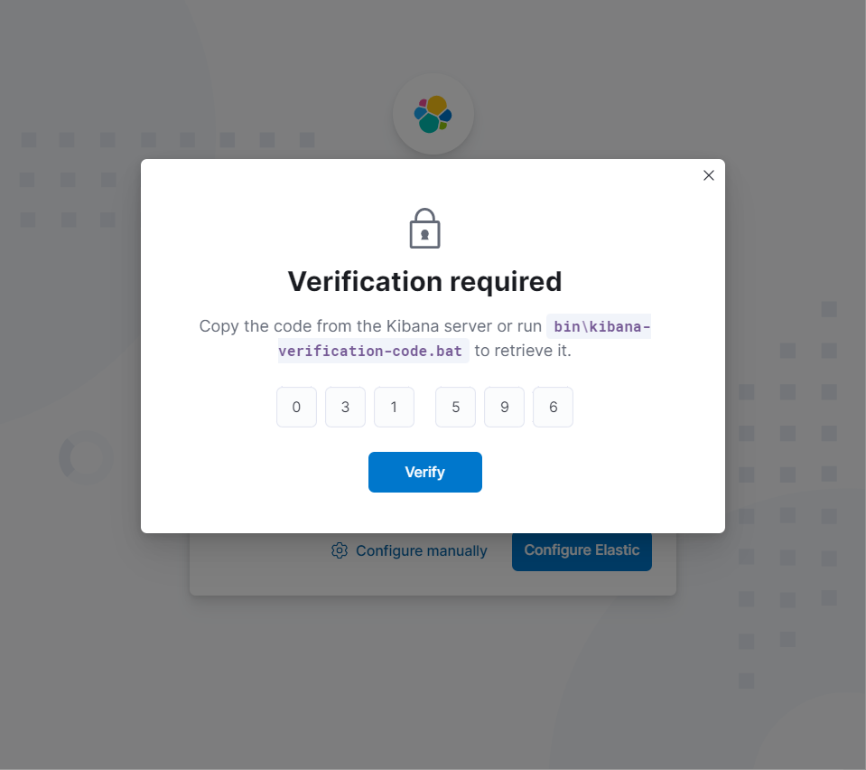
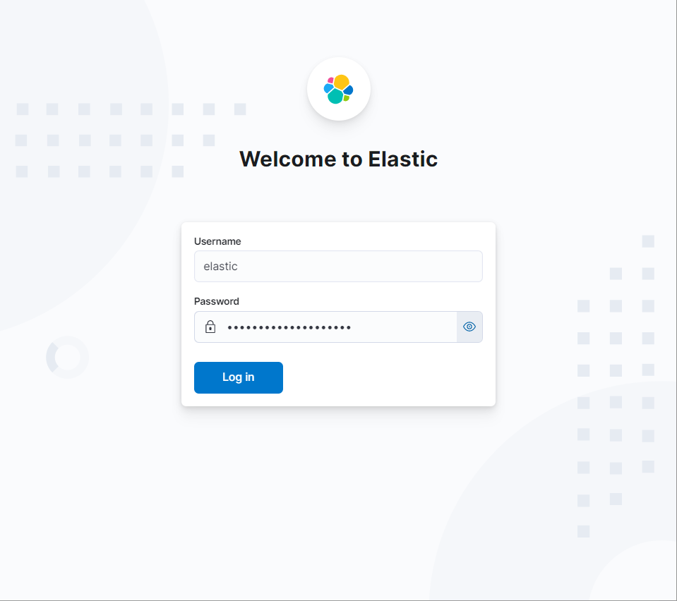
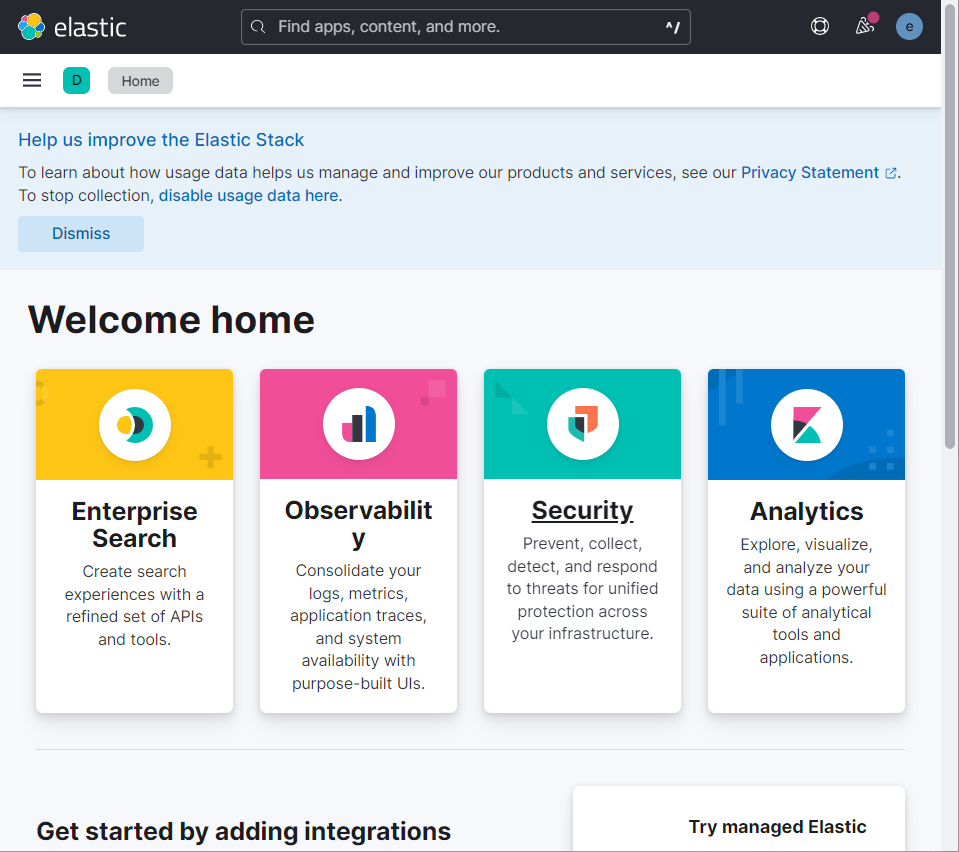

# Docker 部署 Elasticsearch
参考 https://www.elastic.co/guide/en/elasticsearch/reference/8.7/docker.html
## Elasticsearch 部署

```Bash
# 拉取镜像
docker pull docker.elastic.co/elasticsearch/elasticsearch:8.7.0

# 创建网络环境
docker network create elastic

# 创建并运行容器镜像（单节点模式）
docker run --name es01 --net elastic -p 9200:9200 -e "discovery.type=single-node" -e "ES_JAVA_OPTS=-Xms64m -Xmx512m" -it docker.elastic.co/elasticsearch/elasticsearch:8.7.0

# 重置用户密码
docker exec -it es01 /usr/share/elasticsearch/bin/elasticsearch-reset-password  -u elastic

WARNING: Owner of file [/usr/share/elasticsearch/config/users] used to be [root], but now is [elasticsearch]
WARNING: Owner of file [/usr/share/elasticsearch/config/users_roles] used to be [root], but now is [elasticsearch]
This tool will reset the password of the [elastic] user to an autogenerated value.
The password will be printed in the console.
Please confirm that you would like to continue [y/N]y


Password for the [elastic] user successfully reset.
New value: z7DKAZ-9+ZmesnrqCpDB

# 获取 enrollment-token
docker exec -it es01 /usr/share/elasticsearch/bin/elasticsearch-create-enrollment-token -s kibana

eyJ2ZXIiOiI4LjcuMCIsImFkciI6WyIxNzIuMjEuMC4yOjkyMDAiXSwiZmdyIjoiOGJjZDI4ZmRiZGNmNjY1MWUzZjIwOTVhZThlNmRmODg1OWU1ZTVhYjkwNzE5ZTk3NTA5Y2E5NjQzMDkwOTdjMSIsImtleSI6Imc3RWtSb2NCU09LQ3p3a3B6ekpvOnQtb1FNcnd1UjNtZFRtUURYdHByUGcifQ==
```

命令行工具：https://www.elastic.co/guide/en/elasticsearch/reference/current/commands.html

## Kibana 部署

```Bash
# 拉取镜像
docker pull docker.elastic.co/kibana/kibana:8.7.0

# 创建并运行容器镜像
docker run --name kibana --net elastic -p 5601:5601 docker.elastic.co/kibana/kibana:8.7.0

[2023-04-03T07:54:22.542+00:00][INFO ][node] Kibana process configured with roles: [background_tasks, ui]
[2023-04-03T07:54:29.175+00:00][INFO ][plugins-service] Plugin "cloudChat" is disabled.
[2023-04-03T07:54:29.176+00:00][INFO ][plugins-service] Plugin "cloudExperiments" is disabled.
[2023-04-03T07:54:29.176+00:00][INFO ][plugins-service] Plugin "cloudFullStory" is disabled.
[2023-04-03T07:54:29.176+00:00][INFO ][plugins-service] Plugin "cloudGainsight" is disabled.
[2023-04-03T07:54:29.183+00:00][INFO ][plugins-service] Plugin "profiling" is disabled.
[2023-04-03T07:54:29.239+00:00][INFO ][http.server.Preboot] http server running at http://0.0.0.0:5601
[2023-04-03T07:54:29.271+00:00][INFO ][plugins-system.preboot] Setting up [1] plugins: [interactiveSetup]
[2023-04-03T07:54:29.273+00:00][INFO ][preboot] "interactiveSetup" plugin is holding setup: Validating Elasticsearch connection configuration…
[2023-04-03T07:54:29.297+00:00][INFO ][root] Holding setup until preboot stage is completed.


i Kibana has not been configured.

Go to http://0.0.0.0:5601/?code=031596 to get started.
```

## Kibana 登录及使用
**访问网页**：[http://localhost:5601/](http://localhost:5601/)


**输入 enrollment-token：**



**输入验证码：**


**输入用户名密码：**


**登陆成功：**


## Elasticsearch 导入数据（待补充）
