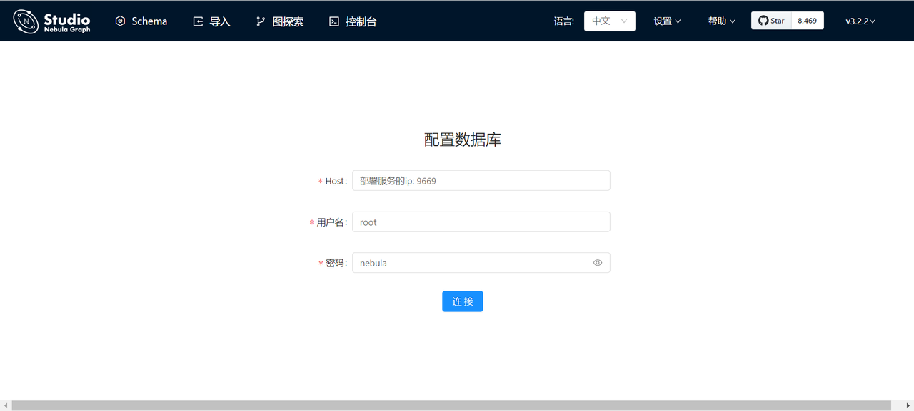

· 参考 [https://docs.nebula-graph.com.cn/3.0.0](https://docs.nebula-graph.com.cn/3.0.0)，新版本不支持在Graph Studio中进行图探索。

# Docker 部署 Nebula 图数据库
## Nebula 环境依赖

-   主机上安装如下应用程序。
    
|应用程序|推荐版本|官方安装参考|
|:-:|:-:|:-:|
|Docker|最新版本|[Install Docker Engine](https://docs.docker.com/engine/install/)|
|Docker Compose|最新版本|[Install Docker Compose](https://docs.docker.com/compose/install/)|
|Git|最新版本|[Download Git](https://git-scm.com/download/)|

## Nebula Graph Database 部署

参考：[https://docs.nebula-graph.com.cn/3.0.0/4.deployment-and-installation/2.compile-and-install-nebula-graph/3.deploy-nebula-graph-with-docker-compose/](https://docs.nebula-graph.com.cn/3.0.0/4.deployment-and-installation/2.compile-and-install-nebula-graph/3.deploy-nebula-graph-with-docker-compose/)

1.  通过 Git 克隆`nebula-docker-compose`仓库的`3.0.0`分支到主机。
    

```Plaintext
$ git clone -b v3.0.0 https://github.com/vesoft-inc/nebula-docker-compose.git
```

2.  切换至目录`nebula-docker-compose`。
    

```Plaintext
$ cd nebula-docker-compose/
```

3.  执行如下命令启动 Nebula Graph 服务。
    

```Plaintext
[nebula-docker-compose]$ docker-compose up -d
```

## Nebula Graph Studio 部署

参考：https://docs.nebula-graph.com.cn/3.0.0/4.deployment-and-installation/2.compile-and-install-nebula-graph/3.deploy-nebula-graph-with-docker-compose/

1.  下载 Studio 的部署配置文件。
    

|安装包|Nebula Graph 版本|
|:-:|:-:|
|[nebula-graph-studio-v3.2.2.tar.gz](https://oss-cdn.nebula-graph.com.cn/nebula-graph-studio/3.2.2/nebula-graph-studio-v3.2.2.tar.gz)|3.0.0|

2.  创建`nebula-graph-studio-v3.2.2`目录，并将安装包解压至目录中。
    

```Plaintext
mkdir nebula-graph-studio-v3.2.2 && tar -zxvf nebula-graph-studio-v3.2.2.tar.gz -C nebula-graph-studio-v3.2.2
```

3.  解压后进入 `nebula-graph-studio-v3.2.2` 目录。
    

```Plaintext
cd nebula-graph-studio-v3.2.2
```

4.  拉取 Studio 的 Docker 镜像。
    

```Plaintext
docker-compose pull
```

5.  构建并启动 Studio 服务。其中，`-d` 表示在后台运行服务容器。
    

```Plaintext
docker-compose up -d
```

6.  当屏幕返回以下信息时，表示 Docker 版 Studio 已经成功启动。
    

```Plaintext
Creating docker_web_1      ... done
```

## Nebula Graph Studio 登录及使用

用户名：root

密码：nebula




## Nebula Graph 接口调用

参考：https://docs.nebula-graph.com.cn/3.3.0/14.client/1.nebula-client/

### python

```Python
import time
import json

from nebula3.gclient.net import ConnectionPool

from nebula3.Config import Config
from nebula3.common import *

if __name__ == '__main__':
    client = None
    try:
        config = Config()
        config.max_connection_pool_size = 2
        # init connection pool
        connection_pool = ConnectionPool()
        assert connection_pool.init([('192.168.72.136', 9669)], config)

        # get session from the pool
        client = connection_pool.get_session('root', 'nebula')
        assert client is not None

        # get the result in json format
        resp_json = client.execute_json("USE Li_carkg_demo;")
        json_obj = json.loads(resp_json)
        print(json.dumps(json_obj, indent=2, sort_keys=True))

        # client.execute(
        #     'CREATE SPACE IF NOT EXISTS test(vid_type=FIXED_STRING(30)); USE test;'
        #     'CREATE TAG IF NOT EXISTS person(name string, age int);'
        #     'CREATE EDGE like (likeness double);'
        # )

        # # insert data need to sleep after create schema
        # time.sleep(6)

        # # insert vertex
        # resp = client.execute(
        #     'INSERT VERTEX person(name, age) VALUES "Bob":("Bob", 10), "Lily":("Lily", 9)'
        # )
        # assert resp.is_succeeded(), resp.error_msg()

        # # insert edges
        # resp = client.execute('INSERT EDGE like(likeness) VALUES "Bob"->"Lily":(80.0);')
        # assert resp.is_succeeded(), resp.error_msg()

        # resp = client.execute('FETCH PROP ON person "Bob" YIELD vertex as node')
        # assert resp.is_succeeded(), resp.error_msg()
        # print_resp(resp)

        # resp = client.execute('FETCH PROP ON like "Bob"->"Lily" YIELD edge as e')
        # assert resp.is_succeeded(), resp.error_msg()
        # print_resp(resp)

        # # drop space
        # resp = client.execute('DROP SPACE test')
        # assert resp.is_succeeded(), resp.error_msg()

        # print("Example finished")

        resp = client.execute_json(r'MATCH (v1:DEVICE{name:"座椅"})-[e1:qa]->(v2:ANSWER) WHERE v1.DEVICE.position == "" RETURN e1.standard_question AS Standard, v1.DEVICE.position;')
        json_obj = json.loads(resp)
        pass
    except Exception as x:
        import traceback

        print(traceback.format_exc())
        if client is not None:
            client.release()
        exit(1)
```

### C++（待补充）
```
```