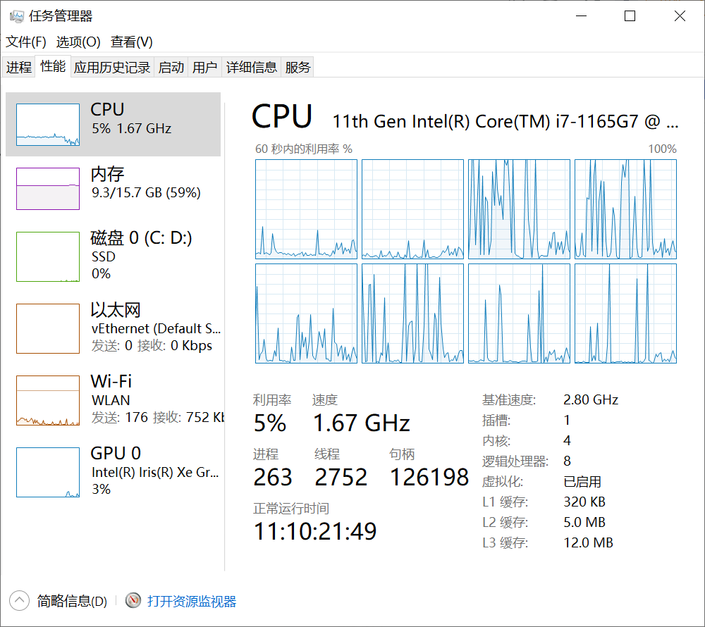
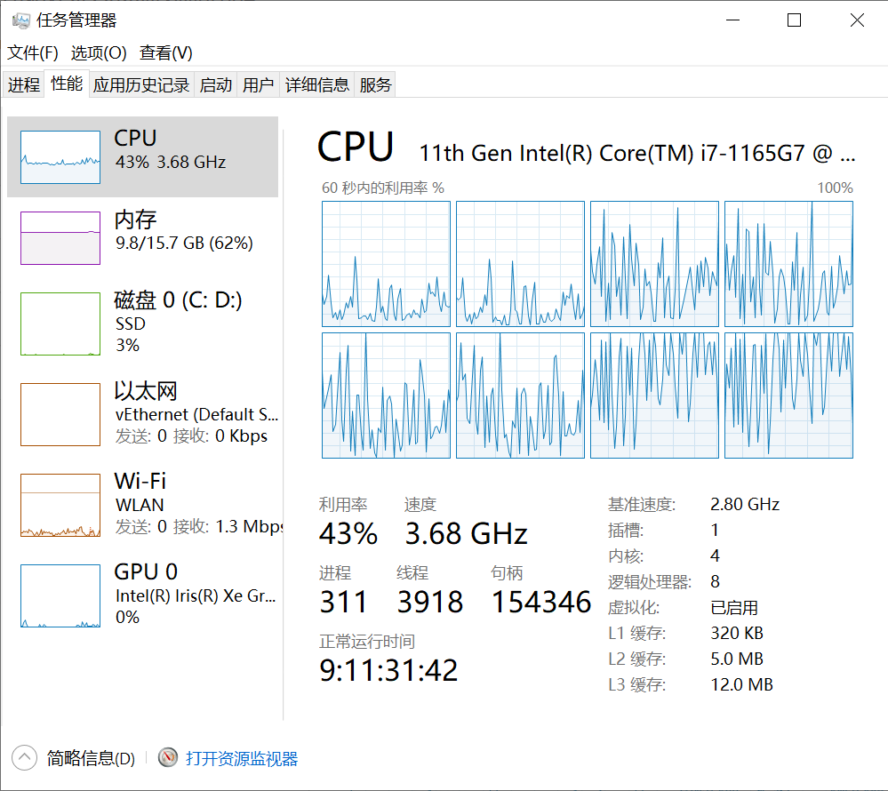
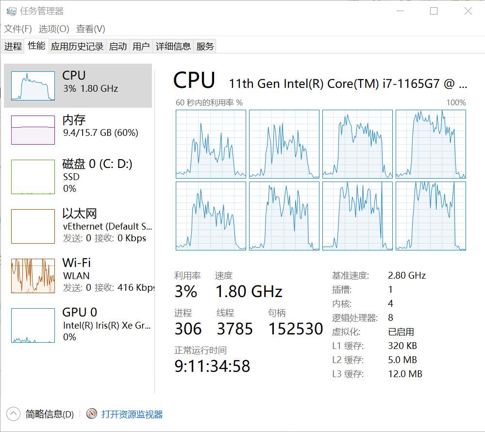
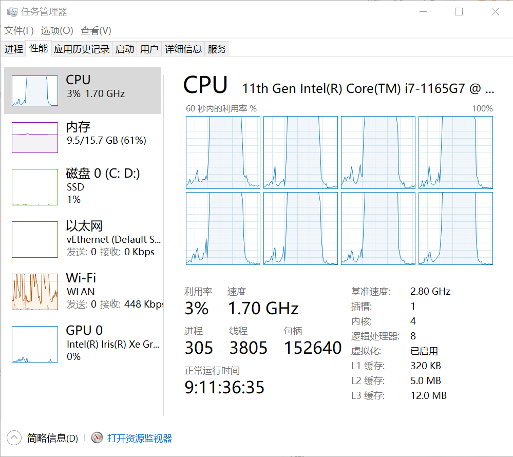
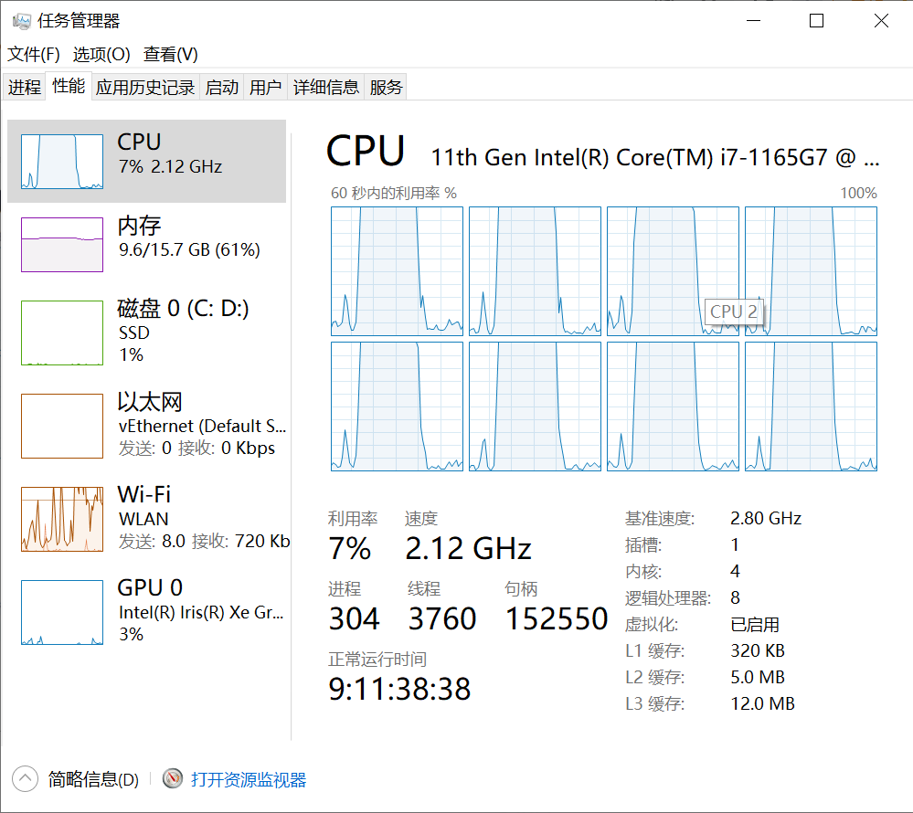

# Python 多进程

**参考：**

1. https://www.shouxicto.com/article/1313.html
2. https://www.maxlist.xyz/2020/03/20/multi-processing-pool/
3. https://zhuanlan.zhihu.com/p/104919288

# 多进程实验

## 测试脚本

```python
from multiprocessing import Pool
import time
def func():
    sum(range(0, 50000000))
if __name__ == '__main__':
    file_dir = 'test.txt'
    p = Pool(8)
    start = time.time()
    with open(file_dir, 'r', encoding='utf-8') as input_file:
        for line in input_file:
            p.apply_async(func, ())
    p.close()
    p.join()
    print(int(time.time()-start), 's')
```

**说明：**

1. `apply(func[, args=()])`会阻塞主进程，无法实现主进程循环子进程。
2. `apply_async(func[, args=()])`不会阻塞主进程，可以实现主进程循环子进程。
3. `p.close()`会阻止进程池继续添加新的任务。
4. `p.join()`会阻塞主进程等待进程池中的任务全部进行完，该方法必须在`p.close()`之后运行。
5. 注意`(func[, args=()])`中的`func`传入的是函数名，参数在后面传入。

## 本地实验

**实验环境：**i7-1165G7(4 cores, 8 threads)

| 进程池大小 | 运行时间 |
| --- | --- |
| 1 | 79s |
| 2 | 77s |
| 4 | 37s |
| 8 | 28s |
| 16 | 28s |

**进程池大小 = 1**



**进程池大小 = 2**



**进程池大小 = 4**



**进程池大小 = 8**



**进程池大小 = 16**



## 结论

1. 当线程池数量与CPU逻辑处理器数量 X（4核X线程）相同时，CPU可以满载运行。
2. 当线程池数量 = kX 时，程序运行速度没有可观提升，将线程池数量设置为 X 即可。

```python
>>> from multiprocessing import cpu_count
>>> cpu_count()
8
```

# 多进程加锁

锁对象：https://docs.python.org/zh-cn/3/library/threading.html#lock-objects

- 原始锁处于 "锁定" 或者 "非锁定" 两种状态之一。它被创建时为非锁定状态。它有两个基本方法， [`acquire()`](https://docs.python.org/zh-cn/3/library/threading.html#threading.Lock.acquire "threading.Lock.acquire") 和 [`release()`](https://docs.python.org/zh-cn/3/library/threading.html#threading.Lock.release "threading.Lock.release") 。当状态为非锁定时， [`acquire()`](https://docs.python.org/zh-cn/3/library/threading.html#threading.Lock.acquire "threading.Lock.acquire") 将状态改为 锁定 并立即返回。当状态是锁定时， [`acquire()`](https://docs.python.org/zh-cn/3/library/threading.html#threading.Lock.acquire "threading.Lock.acquire") 将阻塞至其他线程调用 [`release()`](https://docs.python.org/zh-cn/3/library/threading.html#threading.Lock.release "threading.Lock.release") 将其改为非锁定状态，然后 [`acquire()`](https://docs.python.org/zh-cn/3/library/threading.html#threading.Lock.acquire "threading.Lock.acquire") 调用重置其为锁定状态并返回。 [`release()`](https://docs.python.org/zh-cn/3/library/threading.html#threading.Lock.release "threading.Lock.release") 只在锁定状态下调用； 它将状态改为非锁定并立即返回。如果尝试释放一个非锁定的锁，则会引发 [`RuntimeError`](https://docs.python.org/zh-cn/3/library/exceptions.html#RuntimeError "RuntimeError")  异常。

- 锁同样支持 [上下文管理协议](https://docs.python.org/zh-cn/3/library/threading.html#with-locks)。

- 当多个线程在 [`acquire()`](https://docs.python.org/zh-cn/3/library/threading.html#threading.Lock.acquire "threading.Lock.acquire") 等待状态转变为未锁定被阻塞，然后 [`release()`](https://docs.python.org/zh-cn/3/library/threading.html#threading.Lock.release "threading.Lock.release") 重置状态为未锁定时，只有一个线程能继续执行；至于哪个等待线程继续执行没有定义，并且会根据实现而不同。

- 所有方法的执行都是原子性的。

```python
from multiprocessing import Pool, Lock
import time
def func(lock, count):
    sum(range(0, 50000000))
    lock.acquire()
    with open():
        file.write()
    lock.release()
    count.value = count.value + 1
if __name__ == '__main__':
    file_dir = 'test.txt'
    p = Pool(8)
    type_str = 'int'
    count = multiprocessing.Value(type_str, 0)
    lock = Lock()
    start = time.time()
    with open(file_dir, 'r', encoding='utf-8') as input_file:
        for line in input_file:
            p.apply_async(func, args=(lock, count))
    p.close()
    p.join()
    print(int(time.time()-start), 's')
```

不加锁会输出乱码，原因是并行执行时出现多个核心同时操作同一文件的情况发生。

加锁会和单进程一样慢，原因是加锁后只有一个进程可以执行（官方文档）。

想要不乱码且高速需要使用Queue。

# 独立文件IO

运行开始分割数据集，将不同数据集交给不同进程。

文件A in - 进程A - 文件A out

文件B in - 进程B - 文件B out

...

文件C in - 进程C - 文件A out

运行结束后合并文件

## 本地实验

**实验环境：**i7-1165G7(4 cores, 8 threads)

|  | 运行时间 | CPU占用率 | 输出文件大小 (反映运行速度) |
| --- | --- | --- | --- |
| 单进程 | 5min | 30%-40% | 136MB (* 1.00) |
| 8进程 | 5min | 80% | 302MB (* 2.22) |

## 服务器在线实验

**实验环境：**48 cores, 96 threads