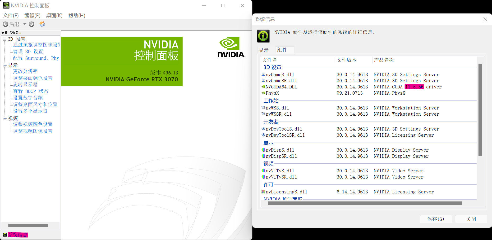
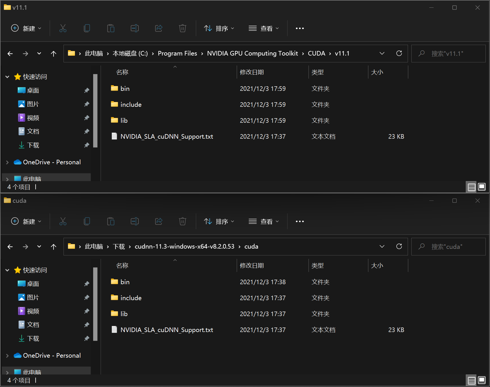

# Pytorch环境配置

硬件环境：AMD5900X+NVIDIA3070

软件环境配置：windows11+python3.7+pytorch1.8+cuda11.1+cudnn8.2

## Python3.7安装

python3.7.9 官方下载链接：[https://www.python.org/ftp/python/3.7.9/python-3.7.9-amd64.exe](https://www.python.org/ftp/python/3.7.9/python-3.7.9-amd64.exe)

安装时记得勾选 `add python3.7 to path`

命令行中输入 `python` 得到如下回显即为成功：

```markdown
PS C:\Users\circle> python
Python 3.7.9 (tags/v3.7.9:13c94747c7, Aug 17 2020, 18:58:18) [MSC v.1900 64 bit (AMD64)] on win32
Type "help", "copyright", "credits" or "license" for more information.
>>>
```

## cuda11.1+cudnn8.2安装

cuda版本可以查阅：NVIDIA控制面板-系统信息-组件

理论上安装的cuda版本要低于NVIDIA控制面板显示值并根据pytorch支持的情况进行选择。



cuda 安装列表：[https://developer.nvidia.com/cuda-toolkit-archive](https://developer.nvidia.com/cuda-toolkit-archive)

cuda11.1 官方下载链接：[https://developer.download.nvidia.com/compute/cuda/11.1.0/local_installers/cuda_11.1.0_456.43_win10.exe](https://developer.download.nvidia.com/compute/cuda/11.1.0/local_installers/cuda_11.1.0_456.43_win10.exe)

cudnn版本可以根据cudnn安装列表按照cuda版本进行安装，cudnn下载可能需要注册并登录NVIDIA官网。

cudnn 安装列表：[https://developer.nvidia.com/rdp/cudnn-archive](https://developer.nvidia.com/rdp/cudnn-archive)

cudnn8.2 for cuda11.x 官方下载链接：[https://developer.nvidia.com/compute/machine-learning/cudnn/secure/8.2.0.53/11.3_04222021/cudnn-11.3-windows-x64-v8.2.0.53.zip](https://developer.nvidia.com/compute/machine-learning/cudnn/secure/8.2.0.53/11.3_04222021/cudnn-11.3-windows-x64-v8.2.0.53.zip)

将cudnn解压后得到的文件复制到cuda根目录下即可。



命令行中输入 `nvidia-smi` 得到如下回显即为成功：

```markdown
PS C:\Users\circle> nvidia-smi
Fri Dec  3 18:38:11 2021
+-----------------------------------------------------------------------------+
| NVIDIA-SMI 496.13       Driver Version: 496.13       CUDA Version: 11.5     |
|-------------------------------+----------------------+----------------------+
| GPU  Name            TCC/WDDM | Bus-Id        Disp.A | Volatile Uncorr. ECC |
| Fan  Temp  Perf  Pwr:Usage/Cap|         Memory-Usage | GPU-Util  Compute M. |
|                               |                      |               MIG M. |
|===============================+======================+======================|
|   0  NVIDIA GeForce ... WDDM  | 00000000:0A:00.0  On |                  N/A |
|  0%   40C    P8     9W / 220W |   1327MiB /  8192MiB |      3%      Default |
|                               |                      |                  N/A |
+-------------------------------+----------------------+----------------------+
```

cuda版本建议安装11.1，其他版本有可能和pytorch兼容性差导致无法正常调用pytorch函数库。

## Pytorch1.8安装

命令行输入 `pip install torch==1.8.0+cu111 torchvision==0.9.0+cu111 torchaudio==0.8.0 -f https://download.pytorch.org/whl/torch_stable.html`

安装成功后，命令行执行如下指令：

```markdown
PS C:\Users\circle> python
Python 3.7.9 (tags/v3.7.9:13c94747c7, Aug 17 2020, 18:58:18) [MSC v.1900 64 bit (AMD64)] on win32
Type "help", "copyright", "credits" or "license" for more information.
>>> import torch
>>> torch.cuda.get_device_name(0)
'NVIDIA GeForce RTX 3070'
>>>
```

显卡名称正常回显即为成功安装pytorch。
