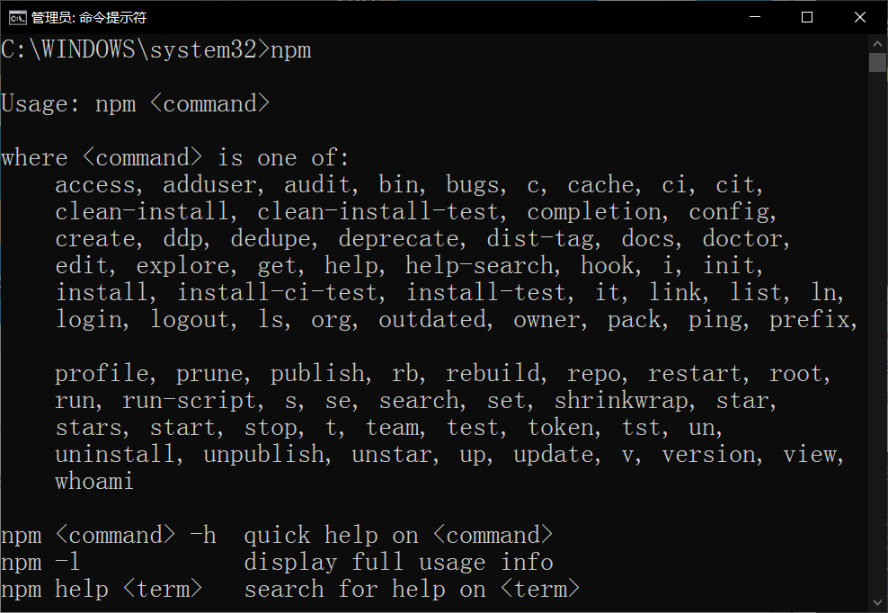
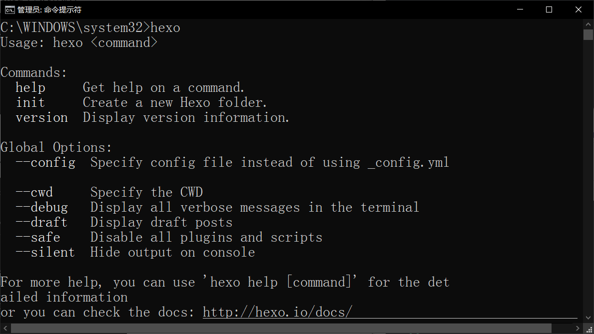

# github.io+Hexo实现博客托管
## 1 准备工作
### 1.1 安装Node.js [Node.js安装地址](https://nodejs.org/)
**过程**：全程无脑下一步
***不要check让你安装额外组件的框框**

**目的**：是为了进一步使用npm进行Hexo的安装。
**验证**：命令行输入npm后回显正常（如下图所示）



### 1.2 安装Hexo博客框架
**过程**：命令行输入
```
npm install hexo -g
```
**目的**：安装Hexo框架
**验证**：命令行输入hexo之后回显正常（如下图所示）



### 1.3 Hexo的本地初始化
**过程**：命令行进入你想要存放Hexo的位置，输入hexo init在指定位置初始化，输入hexo s启动本地服务，默认位置是 [http://localhost:4000](http://localhost:4000)。
```
hexo init
hexo s
```
**目的**：为Hexo初始化，创建本地地址。
**验证**：访问 [http://localhost:4000](http://localhost:4000)。

### 1.4 GitHub账号注册
**过程**：自行注册免费版的GitHub账号，需要注意的是免费版的个人空间只有500MB。

### 1.5 Gitpage的初始化
#### 1.5.1 域名初始化
**过程**：新建一个 **Github用户名.github.io** 的repository。
**目的**：这样你可以直接通过 **Github用户名.github.io** 访问你的博客。

#### 1.5.2 SSH配置
**过程**：
下载Git for Windows [https://gitforwindows.org/](https://gitforwindows.org/)。
在Git Bash中输入
```
cd ~/.ssh
```
检查是否使用过ssh，如果是第一次使用则会返回 **No such file or directory**。

在命令行中输入
```
ssh-keygen -t rsa -C "Github注册使用的邮箱"
```
连续回车三次，在 **C:\Users\你的电脑用户名\.ssh** 中找到 **id_rsa.pub**，用记事本复制其中内容。
打开Github主页，进入Settings-SSH and GPG keys-New SSH key，写好Title，并将复制的内容粘贴到Key中。

验证是否连接成功

```
ssh -T git@github.com
```

**目的**：为了方便将本地的页面推送到云端，github提供了ssh服务以节省输入用户名密码的时间。

#### 1.5.3 Hexo配置
首先，命令行输入
```
npm install hexo-deployer-git
```
安装Hexo的github部署器。

在Hexo根目录下的_config.yml文件中修改
```json
deploy:
  type: git
  repo: 
    github: git@github.com:Github用户名/Github用户名.github.io
  branch: master
```
之后就可以直接上传到GitHub的指定位置了。

## 2 Gitpage的文件上传
在进行完上述准备工作后，命令行进入Hexo根目录，运行
```
Hexo g
Hexo d
```
生成html文件并部署到云端。
之后我们就可以直接访问 **Github用户名.github.io** 查看我们的博客了。

## 3 主题切换
将网上开源的主题包打包下载后放置到Hexo/themes的位置，并在根目录下的_config.yml文件中修改
```json
theme: 你下载的主题包名称
```
主题中很多部分可能用了各种开源插件，想要在原作者基础上自定义需要细心查找相关插件的文档说明，理解作者写的layout代码，并对照主题原作者的代码进行自定义修改。