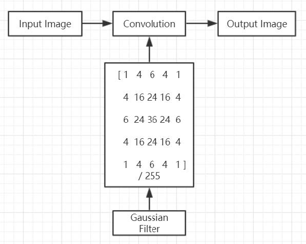
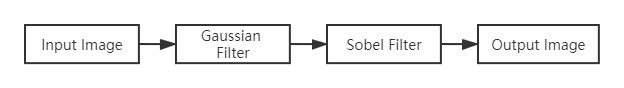
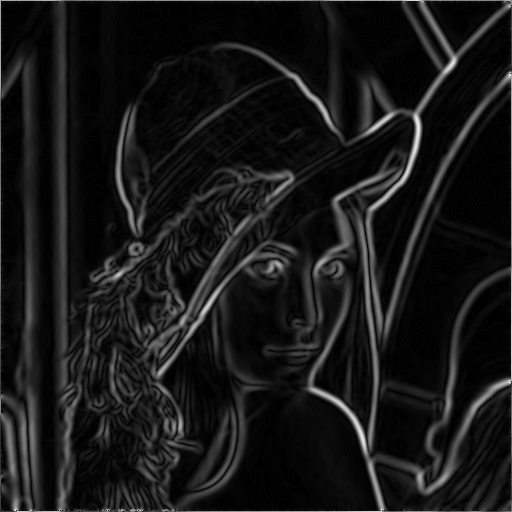
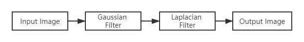
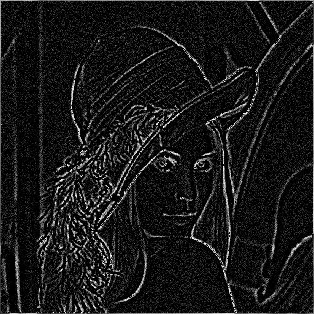
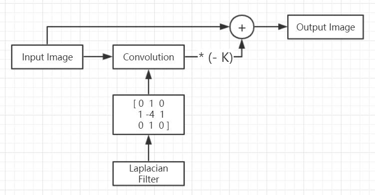

# 1 opencv C++ 环境配置
## 1.1 C++环境安装
visual studio 2019 community version 下载地址： [https://visualstudio.microsoft.com/zh-hans/vs/community/](https://visualstudio.microsoft.com/zh-hans/vs/community/)

双击安装包进入安装界面，选择C++开发包之后点击安装，等待程序安装完成。

> [!warning] 原图床图片已失效（`visual`）
> 原链接 `https://s2.ax1x.com/2020/02/12/1Hjlh6.png` 已被图床删除。

## 1.2 opencv环境配置
### 1.2.1 opencv 下载
安装包 下载地址：[https://sourceforge.net/projects/opencvlibrary/files/4.2.0/opencv-4.2.0-vc14_vc15.exe/download](https://sourceforge.net/projects/opencvlibrary/files/4.2.0/opencv-4.2.0-vc14_vc15.exe/download)

双击安装包进入安装界面，并将其安装到一个方便你找到的文件夹中。比如：**C:\opencv**，之后的opencv目录将以该目录作为安装根目录为例。

### 1.2.2 环境变量配置
1 打开控制面板 - 所有控制面板项 - 系统。

2 点击左侧的高级系统设置。

3 选择右下的环境变量。

4 双击下方系统变量的Path。

5 在Path中新建一个环境变量，地址是**C:\opencv\build\x64\vc15\bin**。

6 连点应用确认完成配置

> [!warning] 原图床图片已失效（`环境变量`）
> 原链接 `https://s2.ax1x.com/2020/02/12/1HjE1U.png` 已被图床删除。

### 1.2.3 VS2019环境配置
1 打开VS2019，create new project - 选择C++ - 选择empty project。

> [!warning] 原图床图片已失效（`emptyproject`）
> 原链接 `https://s2.ax1x.com/2020/02/12/1Hjr38.png` 已被图床删除。

2 进入主界面之后，点击左上角view - other windows - property manager，调出属性管理器。

> [!warning] 原图床图片已失效（`propertymanager`）
> 原链接 `https://s2.ax1x.com/2020/02/12/1Hj2Hs.png` 已被图床删除。

3 在属性管理器的Debug | 64选项右键选择Properties。

> [!warning] 原图床图片已失效（`debug`）
> 原链接 `https://s2.ax1x.com/2020/02/12/1HvnxS.png` 已被图床删除。

4 在Debug Property Pages界面左侧选择VC++ Directories，将右侧的Include Directories添加**C:\opencv\build\include**，
将Library Directories添加**C:\opencv\build\x64\vc15\lib**。

> [!warning] 原图床图片已失效（`includelib`）
> 原链接 `https://s2.ax1x.com/2020/02/12/1Hv3an.png` 已被图床删除。

5 在Debug Property Pages界面左侧选择Linker，将右侧的Additional Dependencies添加opencv_world420.lib。

> [!warning] 原图床图片已失效（`linker`）
> 原链接 `https://s2.ax1x.com/2020/02/12/1Hvt2T.png` 已被图床删除。

***若你装的版本不是4.2.0，则将420换为你安装的版本的版本号。**

6 之后关闭Debug Property Pages界面，确认VS主界面上方的Debug使用的是x64版本，若不是则选择x64。

> [!warning] 原图床图片已失效（`x64`）
> 原链接 `https://s2.ax1x.com/2020/02/12/1HvTit.png` 已被图床删除。

至此，整个C++ opencv 的VS环境配置完毕。
顺便，该配置只针对当前创建的Project有效，若创建新的Project后，需重新进行以上配置。

# 2 opencv的基本输入输出以及指针调用

## 2.1 头文件

```C++
#include <opencv2/opencv.hpp>   //opencv头文件
#include <iostream> //C++基本输入输出

//名空间声明
using namespace cv;
using namespace std;
```

## 2.2 图像IO
### 2.2.1 图像输入
``` C++
Mat In = imread("C:\\test.png", IMREAD_GRAYSCALE);
```
imread函数是opencv库中的基本输入函数，可以将.png\.jpg\.bmp等格式的图片读入，并转化为opencv的图片矩阵类型Mat。
imread的第一个输入变量为文件的具体位置，第二个变量IMREAD_GRAYSCALE表示读入灰度图，若不加这条则会读入RGB图。

### 2.2.2 图像复制
在opencv中，如果使用赋值手法进行图像的复制，如下所示：

```C++
Mat Out = In;
```

则会将In的每个像素位置的指针赋给Out，不论对In还是Out进行修改时，另外一个变量也会跟着进行变化。
因此，想要进行图像复制要用Mat类型的clone()方法：

```C++
Mat Out = In.clone;
```

### 2.2.3 图像显示输出

```C++
imshow("Output", Out);
```

imshow函数是opencv库中的基本输出函数，可以将Mat类型的图像显示在屏幕上。
imshow的第一个变量是图像显示在屏幕上的文本内容，第二个变量是选择输出的Mat类型变量。

> [!warning] 原图床图片已失效（`imshow` 示例截图）
> 原链接 `https://s2.ax1x.com/2020/02/12/1HxGeH.png` 已被图床删除。

***注意：如果两个输出图像的文本相同则只会输出先输出的一个图像，因此不要将输出图像的文本定义为一样的文本。**

### 2.2.4 图像保存输出

```C++
imwrite("C:\\Out.png", Output);
```

imwrite函数是opencv库的基本输出函数，可以进行指定目录的图片写入功能。
imwrite的第一个变量是保存输出图片的具体位置，第二个变量是选择输出的Mat类型的变量。

## 2.3 图片的特定像素提取
下面以一个阈值法进行边缘检测为例说明像素提取的方法：

```C++
    Mat Output = Input.clone();
    for (int x = 1; x < Input.rows - 1; x++)
    {
        uchar* out = Output.ptr<uchar>(x);
        uchar* current = Input.ptr<uchar>(x);
        uchar* last = Input.ptr<uchar>(x - 1);
        for (int y = 1; y < Input.cols - 1; y++)
        {
            if (abs(current[y] - current[y - 1]) > K || abs(current[y] - last[y]) > K)  //Threshold K
            {
                out[y] = 255;
                continue;
            }
            else
            {
                out[y] = 0;
            }
        }
    }
```

其中，

``` C++
uchar* out = Output.ptr<uchar>(x);
```

表示将第 x 行的第一个像素指针赋给out。

```C++
out[y] = 255;
```

表示将第 x 行的第 y 个像素值赋值255。

另外，上述像素操作建立在灰度图的基础上。若对于RGB彩色图，官方的Mat类型将以下图形式存储像素值数据 **[1]**：

> [!warning] 原图床图片已失效（`out`）
> 原链接 `https://s2.ax1x.com/2020/02/12/1HxfpV.png` 已被图床删除。

**[1][https://docs.opencv.org/master/db/da5/tutorial_how_to_scan_images.html](https://docs.opencv.org/master/db/da5/tutorial_how_to_scan_images.html)**

# 3 边缘检测算法
## 3.1 阈值法

**流程图:**

> [!warning] 原图床图片已失效（`Threshold_flow`）
> 原链接 `https://s2.ax1x.com/2020/02/12/1HzOEj.jpg` 已被图床删除。

**代码:**

```C++
void Threshold_Method(Mat Input, int K)
{
    Mat Output = Input.clone();
    for (int x = 1; x < Input.rows - 1; x++)
    {
        uchar* sum = Output.ptr<uchar>(x);
        uchar* current = Input.ptr<uchar>(x);
        uchar* last = Input.ptr<uchar>(x - 1);
        for (int y = 1; y < Input.cols - 1; y++)
        {
            if (abs(current[y] - current[y - 1]) > K || abs(current[y] - last[y]) > K)  //Threshold K
            {
                //sum[y] = 255;
                continue;
            }
            else
            {
                sum[y] = 0;
            }
        }
    }
    imshow("Threshold_Method", Output);
}
```

**结果：**

> [!warning] 原图床对比图已失效（原图与阈值法结果）
> 原链接 `https://s2.ax1x.com/2020/02/12/1bSyin.png`、`https://s2.ax1x.com/2020/02/12/1bSAa9.png` 已被图床删除。

## 3.2 差分法

**流程图：**

> [!warning] 原图床图片已失效（`Difference_flow`）
> 原链接 `https://s2.ax1x.com/2020/02/12/1bSOsO.jpg` 已被图床删除。

**代码：**

```C++
void Difference_Method(Mat Input)
{
    Mat Output = Input.clone();
    for (int x = 1; x < Input.rows - 1; x++)
    {
        uchar* sum = Output.ptr<uchar>(x);
        uchar* current = Input.ptr<uchar>(x);
        uchar* last = Input.ptr<uchar>(x - 1);
        for (int y = 1; y < Input.cols - 1; y++)
        {
            float horizontal = pow(current[y] - current[y - 1], 2);
            float vertical = pow(current[y] - last[y], 2);
            sum[y] = saturate_cast<uchar>(sqrt(horizontal + vertical));   //output = sqrt(delta_x ^ 2 + delta_y ^ 2)
        }
    }
    imshow("Difference_Method", Output);
}
```

**结果：**

> [!warning] 原图床对比图已失效（原图与差分法结果）
> 原链接 `https://s2.ax1x.com/2020/02/12/1bSyin.png`、`https://s2.ax1x.com/2020/02/12/1bpky8.png` 已被图床删除。

## 3.3 Sobel方法

**流程图：**

> [!warning] 原图床图片已失效（`Sobel`）
> 原链接 `https://s2.ax1x.com/2020/02/12/1bpQS0.jpg` 已被图床删除。

**代码：**

```C++
void Sobel_Method(Mat Input, const char* Str)
{
    Mat Output = Input.clone();
    for (int x = 1; x < Input.rows - 1; x++)
    {
        uchar* sum = Output.ptr<uchar>(x);
        uchar* current = Input.ptr<uchar>(x);
        uchar* next = Input.ptr<uchar>(x + 1);
        uchar* last = Input.ptr<uchar>(x - 1);
        for (int y = 1; y < Input.cols - 1; y++)
        {
            /*
            horizontal
            [ -1  0  1
              -2  0  2
              -1  0  1 ]
            */
            float horizontal = pow(-last[y - 1] + last[y + 1]
                - 2 * current[y - 1] + 2 * current[y + 1]
                - next[y - 1] + next[y + 1]
                , 2);

            /*
            vertical
            [ -1 -2 -1
               0  0  0
               1  2  1 ]
            */
            float vertical = pow(-last[y - 1] - 2 * last[y] - last[y + 1]
                + next[y - 1] + 2 * next[y] + next[y + 1]
                , 2);
            sum[y] = saturate_cast<uchar>(sqrt(horizontal + vertical));

        }
    }
    imshow(Str, Output);
}
```

**结果：**

> [!warning] 原图床对比图已失效（原图与 Sobel 结果）
> 原链接 `https://s2.ax1x.com/2020/02/12/1bSyin.png`、`https://s2.ax1x.com/2020/02/12/1bpB6K.png` 已被图床删除。

## 3.4 拉普拉斯方法

**流程图：**

> [!warning] 原图床图片已失效（`Laplacian_flow`）
> 原链接 `https://s2.ax1x.com/2020/02/12/1bph1P.jpg` 已被图床删除。

**代码:**

```C++
void Laplacian_Method(Mat Input, const char* Str)
{
    Mat Output = Input.clone();
    for (int x = 1; x < Input.rows - 1; x++)
    {
        uchar* sum = Output.ptr<uchar>(x);
        uchar* current = Input.ptr<uchar>(x);
        uchar* next = Input.ptr<uchar>(x + 1);
        uchar* last = Input.ptr<uchar>(x - 1);
        for (int y = 1; y < Input.cols - 1; y++)
        {
            /*
            [ 0  1  0
              1 -4  1
              0  1  1 ]
            */
            sum[y] = saturate_cast<uchar>(last[y]
                + current[y - 1] - 4 * current[y] + current[y + 1]
                + next[y]) * 20;

        }
    }
    imshow(Str, Output);
}
```

**结果：**

> [!warning] 原图床对比图已失效（原图与拉普拉斯结果）
> 原链接 `https://s2.ax1x.com/2020/02/12/1bSyin.png`、`https://s2.ax1x.com/2020/02/12/1bpLhn.png` 已被图床删除。

## 3.5 高斯滤波

**流程图：**



**代码：**

```C++
Mat Gaussian_Filter_5(Mat Input, int K)
{
    Mat Output = Input.clone();
    for (int k = 1; k < K + 1; k++)
    {
        Mat Output_buff = Output.clone();
        for (int x = 2; x < Input.rows - 2; x++)
        {
            uchar* sum = Output.ptr<uchar>(x);
            uchar* current = Output_buff.ptr<uchar>(x);
            uchar* next = Output_buff.ptr<uchar>(x + 1);
            uchar* next_ = Output_buff.ptr<uchar>(x + 2);
            uchar* last = Output_buff.ptr<uchar>(x - 1);
            uchar* last_ = Output_buff.ptr<uchar>(x - 2);
            for (int y = 2; y < Input.cols - 2; y++)
            {
                /*
                [ 1  4  6  4  1
                  4 16 24 16  4
                  6 24 36 24  6
                  4 16 24 16  4
                  1  4  6  4  1 ]
                */
                sum[y] = saturate_cast<uchar>((+1 * last_[y - 2] + 4 * last_[y - 1] + 6 * last_[y] + 4 * last_[y + 1] + 1 * last_[y + 2]
                    + 4 * last[y - 2] + 16 * last[y - 1] + 24 * last[y] + 16 * last[y + 1] + 4 * last[y + 2]
                    + 6 * current[y - 2] + 24 * current[y - 1] + 36 * current[y] + 24 * current[y + 1] + 6 * current[y + 2]
                    + 4 * next[y - 2] + 16 * next[y - 1] + 24 * next[y] + 16 * next[y + 1] + 4 * next[y + 2]
                    + 1 * next_[y - 2] + 4 * next_[y - 1] + 6 * next_[y] + 4 * next_[y + 1] + 1 * next_[y + 2]) * 0.00390625);

            }
        }
    }
    return Output;
}
```

**结果：**

> [!note] 原对比左图（原图 `https://s2.ax1x.com/2020/02/12/1bSyin.png`）已被图床删除，以下为处理结果图：


## 3.6 高斯滤波后的Sobel

**流程图：**



**代码：**

```C++
Sobel_Method(Gaussian_Filter_5(In, 2), "Sobel_Method_with_Gaussian_Filter");
```

**结果：**

> [!note] 原对比左图（原图 `https://s2.ax1x.com/2020/02/12/1bSyin.png`）已被图床删除，以下为处理结果图：




## 3.7 高斯滤波后的拉普拉斯方法

**流程图：**



**代码：**

```C++
Laplacian_Method(Gaussian_Filter_5(In, 2), "Laplacian_Method_with_Gaussian_Filter");
```
**结果：**

> [!note] 原对比左图（原图 `https://s2.ax1x.com/2020/02/12/1bSyin.png`）已被图床删除，以下为处理结果图：



## 3.8 基于拉普拉斯方法的锐化算法

**流程图：**



**代码：**

```C++
void Sharpening_based_on_Laplacian(Mat Input, int K)
{
    Mat Output = Input.clone();
    for (int x = 1; x < Input.rows - 1; x++)
    {
        uchar* sum = Output.ptr<uchar>(x);
        uchar* current = Input.ptr<uchar>(x);
        uchar* next = Input.ptr<uchar>(x + 1);
        uchar* last = Input.ptr<uchar>(x - 1);
        for (int y = 1; y < Input.cols - 1; y++)
        {
            /*
            [   0         - K    0
              - K  (1 + 4 * K)  - K
                0         - K    0 ]
            */
            sum[y] = saturate_cast<uchar>(
                -K * last[y]
                - K * current[y - 1] + (1 + 4 * K) * current[y] - K * current[y + 1]
                - K * next[y]);
        }
    }
    imshow("Sharpening_based_on_Laplacian", Output);
}
```

**结果：**

> [!note] 原对比左图（原图 `https://s2.ax1x.com/2020/02/12/1bSyin.png`）已被图床删除，以下为处理结果图：


# 4 边缘检测方法的性能对比（主观）

