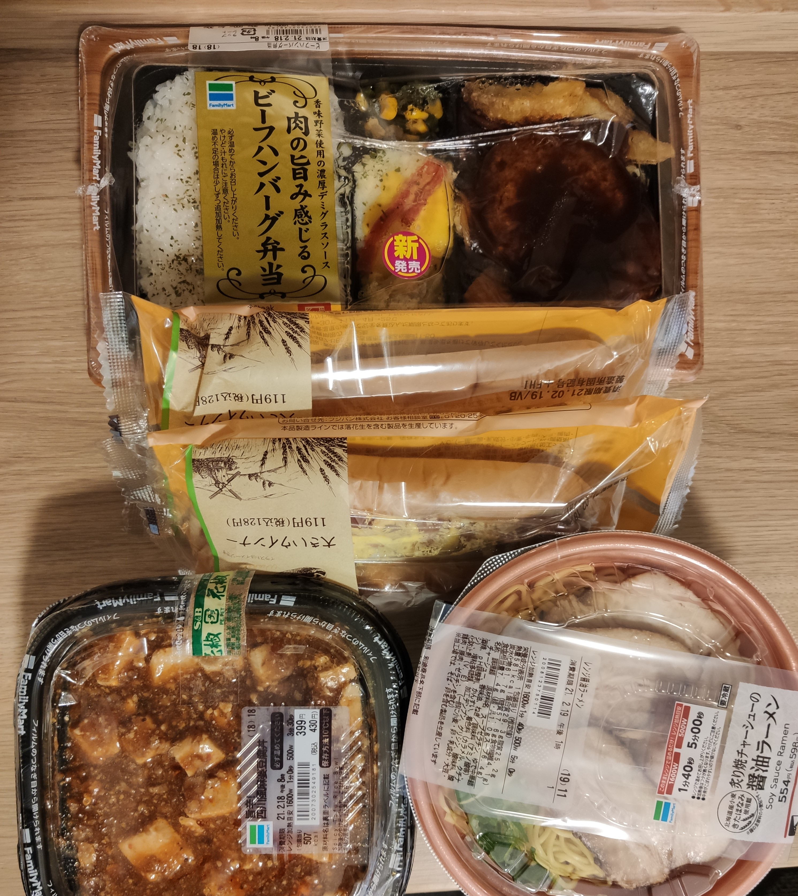
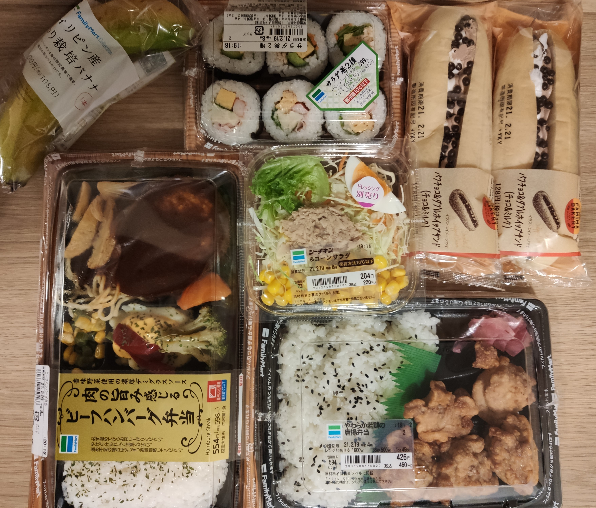
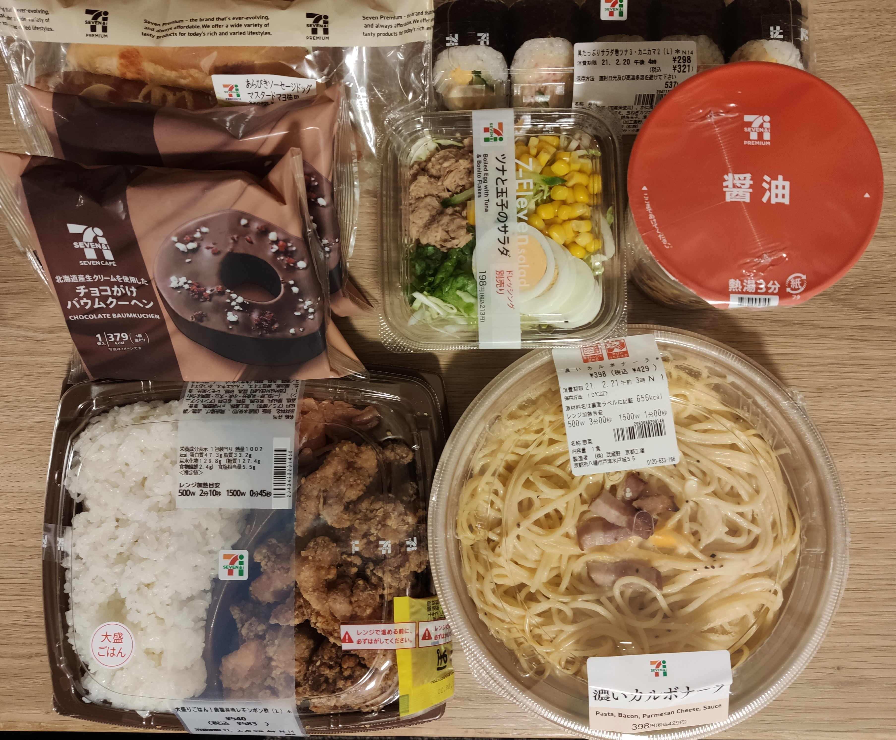
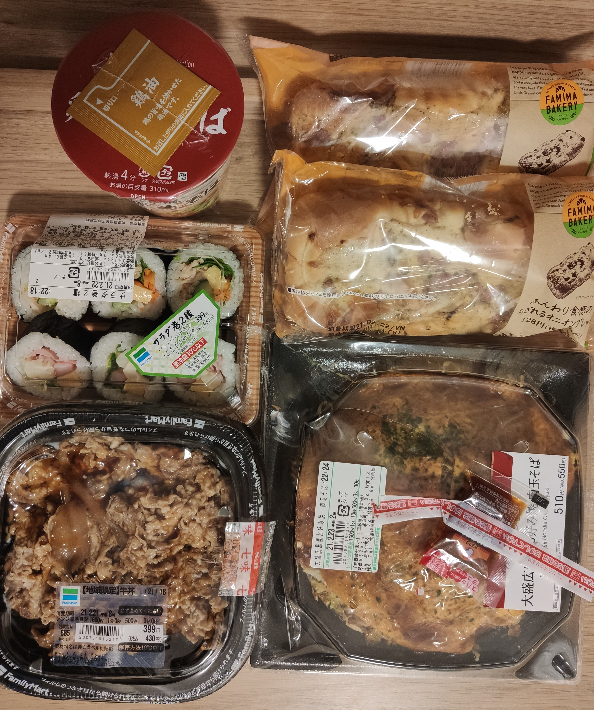

# 大阪隔离记录（在留卡再入国）
## 1 入境前准备
### 1.1 资料准备
* [x] 在留卡、护照等必要证件
* [x] 72小时内核酸证明 [1]（**中英版本** **必须鼻咽拭子** 咽拭子不可以 标本类型也最好写着英文版的鼻咽拭子）
* [x] 核酸证明的誓约书（日本国驻华大使馆官网）

### 1.2 预定准备
* [x] 航班预定（最好定**中国航司直航** 转机有很高的被取消风险）
* [x] 酒店预定 [2]（**共15晚** 官方说法是14天不包括入境单天）
* [x] 接机预定 [3]（携程上关西机场到大阪市区接机要700人民币左右）

### 1.3 一些解释
[1] 截止写文之日，日本多个县还处于紧急状态之中，入境日本的人仅包括日本人、在留卡再入国以及永驻，不包括新签证以及之前谈好的商务签相关通道。
[2] 入境日本需要在不使用公共交通的前提下，在入境时报告的逗留地址或自己的住址自主隔离14天，期间避免乘坐公共交通，避免三密。因此若没有方法乘坐私车前往住址，则只能选择在酒店隔离。因为最近一直处于紧急状态，旅游业淡季，实际上大阪市内现在有很多便宜酒店。
[3] 关西机场建立在一个人工岛之上，与内陆仅靠跨海大桥相连，行人无法步行通过。因此，想要离开机场前往酒店进行隔离不能依靠步行而只能依靠接机。否则只能选择步行关西机场内唯一的酒店进行隔离，价格比较昂贵。

## 2 入境当天流程
### 2.1 环境介绍
起飞：上海浦东国际机场
到达：大阪关西国际机场
航班：吉祥航空HO1333

### 2.2 入境流程
1. 值机前，工作人员会要求乘客填写日本入境要求填写的问卷，并生成二维码。该二维码需要截屏保存。
2. 值机前，工作人员还会要求乘客填写中国出境的健康申报书，并生成二维码。该二维码也需要截屏保存。
3. 值机前，工作人员会检查乘客的72小时内PCR证明以及相关证件确保乘客拥有日本政府要求的入境基本条件。
4. 值机办理托运后，海关离境前，工作人员会扫描2中要求的出境健康申报书，符合要求后才会进行出境相关手续的办理和盖章。
5. 登机、起飞（飞行过程中照例会要求填写报税的项目）、到达。
6. 到达机场后，会有很多会中文的中日工作人员帮助办理入境。
7. 入境前，排队按顺序领试管进行唾液的新冠检查（试管和资料上会写着编号）。
8. 入境前，扫描1中要求的二维码，提交核算证明原件及誓约书，填写新发的遵守隔离政策的誓约书，等待唾液检查的结果（大屏幕上会显示已经出结果的编号）。
9. 核酸阴性结果显示后，拿着手上的誓约书和其他资料换一张红色的纸片以表示核酸检查没问题，之后找行李并办理出境手续。
10. 联系接机并正常办理酒店入住（酒店并不会把你当成隔离人员特殊照顾）。

## 3 总结
因为前期查了很多资料，做了各种准备，这次紧急状态期间的入境总耗时实际上也只有一个多小时，最后也在天黑之前顺利到达酒店办理了入住。虽然结果是很轻松也很顺利，但实际上在没顺利通过日本海关之前，谁都没办法掉以轻心。希望这个流程记录能或多或少帮到你，也希望还没入境的大家都能顺利入境。

## 附：隔离期间的三餐 ~~便利店便当大赏~~
### Day 1
Family Mart含税价格：
* 汉堡肉便当@598日元
* 热狗 \* 2@128日元 \* 2
* 四川麻婆豆腐盖饭@430日元
* 酱油拉面@598日元

### Day 2
Family Mart含税价格：
* 🍌@108日元
* 🍣卷@430日元
* 奶油巧克力豆夹心🍞 \* 2@138日元 \* 2
* 汉堡肉🍱@598日元
* 金枪鱼🥗@220日元
* 炸鸡块🍱@460日元

### Day 3
7-11不含税价格：
* 脆皮🌭 \* 2@150日元 \* 2
* 🍣卷@298日元
* 巧克力🍩 \* 2@178日元 \* 2
* 金枪鱼🥗@198日元
* 酱油方便🍜@128日元
* 炸鸡块🍱@540日元
* 培根芝士🍝@398日元

### Day 4
Family Mart含税价格：
* 鸡油方便🍜@149日元
* 培根🍞 \* 2@138日元 \* 2
* 🍣卷@430日元
* 牛肉盖饭@430日元
* 广岛风什锦烧@550日元

### Day X
基本就这几种，重复不发了。。。