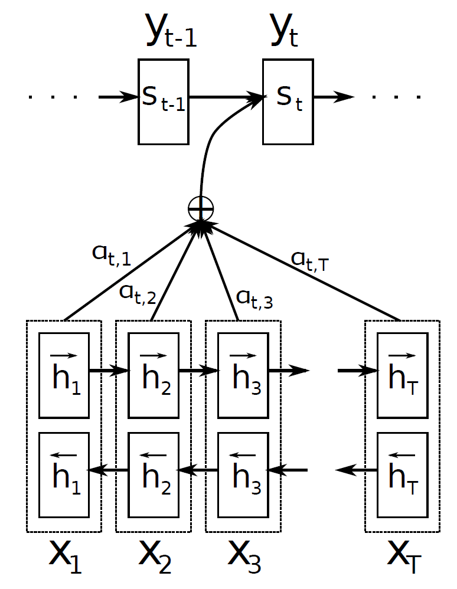
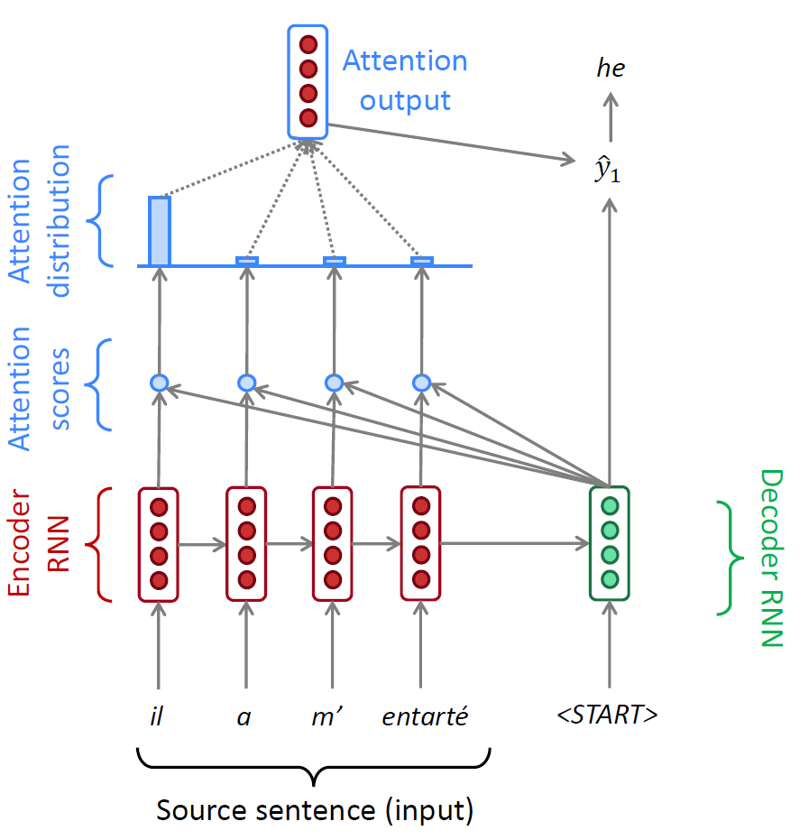
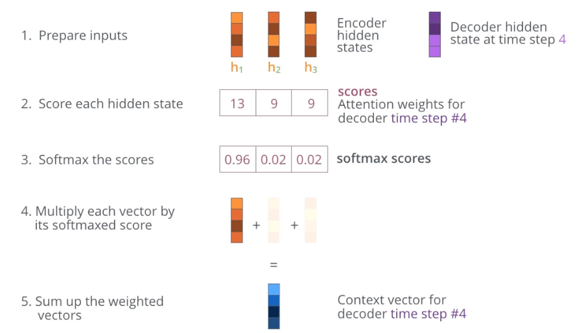
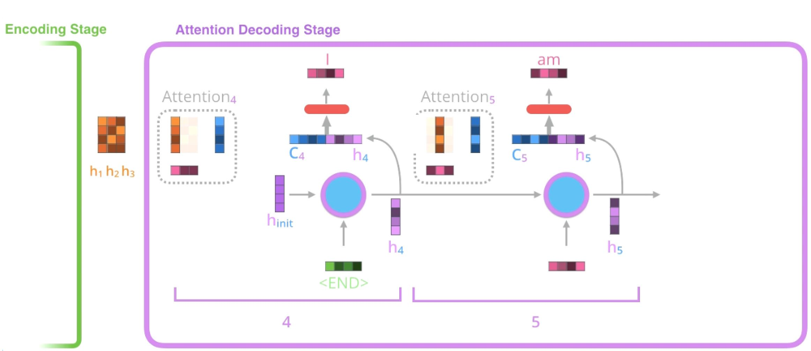

* 本文参考
\[1] [NEURAL MACHINE TRANSLATIONBY JOINTLY LEARNING TO ALIGN AND TRANSLATE](https://arxiv.org/abs/1409.0473)
\[2] [Visualizing A Neural Machine Translation Model](https://jalammar.github.io/visualizing-neural-machine-translation-mechanics-of-seq2seq-models-with-attention/)
\[3] [CS224n: Natural Language Processing with Deep Learning /Stanford](https://web.stanford.edu/class/archive/cs/cs224n/cs224n.1194)

# 1 如何理解Attention
## 1.1 什么是Attention
**Attention机制** 通常被认为始于ICLR2015的文章 [NEURAL MACHINE TRANSLATIONBY JOINTLY LEARNING TO ALIGN AND TRANSLATE](https://arxiv.org/abs/1409.0473)。

**图1.1 基于Bi-RNN encoder的Attention[1]**

**图1.1** 为原始文章[1]中的配图，描述了一个基于双向RNN Encoder-RNN Decoder的Attention模型。~~（（具体公式定义又没看懂）现在又稍微看懂点了）~~

符号理解：
1. X_T为输入句子的对应Token的Word Embedding。
2. h_T为双向RNN结构，用于Word Embedding的输入。
3. y_t为模型输出的预测单词。
4. s_t为单RNN结构，用于输出预测单词。
5. α为每个隐藏层的权重。

**图1.2 基于RNN encoder的Attention[2]**

**图1.2** 为CS224课程ppt的一张插图，该图描述了一个基于单向RNN的Attention模型，相比论文的配图 **图1.1** 更好理解。

两张图描述的模型有何区别：
1. 原文中输出函数以y_i-1，s_i，c_i作为变量经过函数输出y_i（应该是矩阵变换）。CS224课程ppt中采用的方法为现在常用的Concatenation方法，将c_i和s_i的矢量直接相连，之后经过神经网络（其实就是训练好的矩阵变换）得到y_i输出。

公式定义：
1. 计算Softmax后的Attention Score：

$$
\begin{equation}
e_{ij} = h_j \cdot s_i
\end{equation}
$$

$$
\begin{equation}
a_{ij} = \frac{exp(e_{ij})}{\sum_{j=1}^{J}exp(e_{ij})} 
\end{equation}
$$

2. 计算Context Vector（Attention Output）：

$$
\begin{equation}
 c_i = \sum_{j=1}^{J}a_{ij}⋅h_{j}
\end{equation}
$$

3. Concatenation：

$$
\begin{equation}
o_i = [c_i; s_i]
\end{equation}
$$

4. 计算输出：

$$
\begin{equation}
y_i = f(o_i)
\end{equation}
$$

\* 其中，i表示Decoder部分第i个隐藏状态，j表示encoder部分第j个隐藏状态，**⋅** 表示点乘。f( )为一个神经网络，输入为级联向量o_i，输出为y_i。

具体示意图如下所示：

**图1.3 Attention Weights的计算[3]**

**图1.4 Context Vector的计算与Decoder的传播[3]**

## 1.2 Attention机制的优缺点
优点：
1. 通过打分机制确定输出，让模型能够在训练时自己学会句子的对齐方式。
2. 在单次输出时，整个Encoder的Token都会参与贡献，一定程度消除了长距离依赖的问题，让句子的每个部分都可以参与到输出，而不是仅限于最后一个hidden state。

缺点：
1. 我不知道有啥缺点，现在的大部分模型都是基于Attention机制的延伸提高模型性能。

## 1.3 More general definition of attention
Definition：
* Given a set of vector values (h_t), and a vector query (s_i), attention is a technique to compute a weighted sum of the values, dependent on the query.

在机器翻译中，根据Query（Decoder隐藏层信息），通过权重确定Value（Encoder隐藏层信息），而学习到的对齐方法（Query-Value匹配）。

## 1.4 不同的Attention计算方法
三种主要的注意力计算方法：
1. 点乘Attention：

$$
\begin{equation}
e_{ij} = s_i^{T}h_j 
\end{equation}
$$

2. 加权的点乘Attention：

$$
\begin{equation}
e_{ij} = s_i^{T}Wh_j
\end{equation}
$$

3. 加法Attention：

$$
\begin{equation}
e_{ij} = v^{T}tanh(W_1h_{j} + W_2s_{i})
\end{equation}
$$

\* 其中，W；v，W1，W2均为权重矩阵。