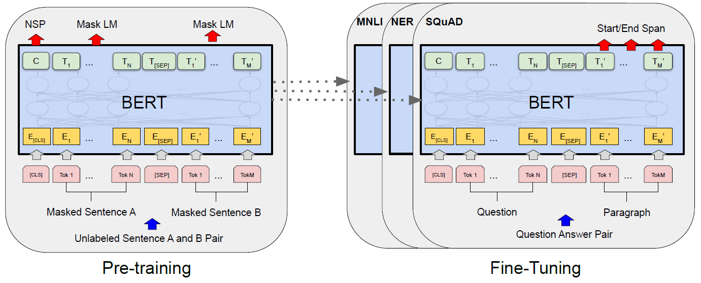
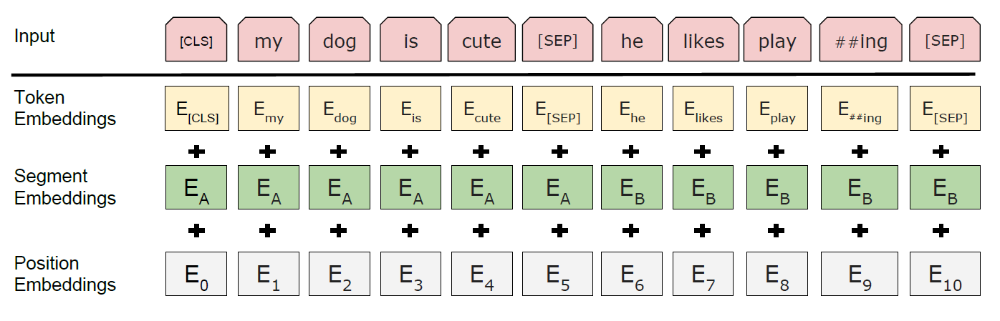
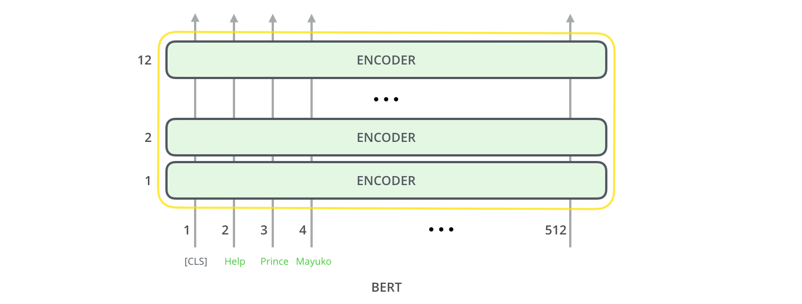

* 本文参考
\[1] [BERT: Pre-training of Deep Bidirectional Transformers for Language Understanding](https://arxiv.org/abs/1810.04805)
\[2] [The Illustrated BERT, ELMo, and co. \(How NLP Cracked Transfer Learning\)](https://jalammar.github.io/illustrated-bert)
\[3] [图解BERT模型：从零开始构建BERT](https://cloud.tencent.com/developer/article/1389555)

# 1 如何理解BERT
## 1.1 什么是BERT

**图1.1 BERT的Pre-training和Fine-Tuning[1]**

**图1.2 BERT的内部Embedding结构[1]**

标题理解：
BERT：Bidirectional Encoder Representations from Transformers
1. Bidirectional：该模型的双向性体现在Masked LM
部分。该部分通过Mask掉部分Token，再重新预测这些Token，实现模型对于上下文的学习。故称模型具有双向性。
\* 开始我以为BERT引入了类似Bi-LSTM的结构，但实际上这个双向性是通过Pre-training中的Masked LM获得的上下文理解。
原文[1]：*In order to train a deep bidirectional representation, we simply mask some percentage of the input tokens at random, and then predict those masked tokens.*

2. Encoder Representation：该模型的本质是一个用来生成Representation的Encoder。
3. Transformer：该模型基于Transformer架构进行搭建。

符号理解：
1. Token Embedding：经过Word2Vec或其他模型生成的Word Embedding。
2. Position Embedding：详见 [如何理解 Transformer 1.2.1 Positional Encoding](/posts/2020-07-03-如何理解-transformer/#1-2-1-Positional-Encoding)
3. Segment Embedding：用于区分Token的不同句子所属。
4. Input Representation：最终的输入向量将会是Token Embedding + Position Embedding + Segment Embedding。
5. [CLS] Token：位于输入始端的向量，用于表征整个输入，可用于Classification任务。
6. [SEP] Token：位于句子结尾的向量，用于指示一个句子的结束，Separate两个句子。

## 1.2 模型架构

**图1.3 BERT的模型架构[2]**

如 **图1.3** 所示，在经过了外部对Token Embedding + Position Embedding + Segment Embedding相加得到Input Representation后，将其输入到N层Transformer的Encoder中得到输出结果。

BERT官方最开始Release了两个BERT版本：
1. BERT_BASE(L=12, H=768, A=12, Total Parameters=110M)
2. BERT_LARGE(L=24, H=1024, A=16, Total Parameters=340M

符号解释：
1. L（Layer）：指Transformer的Encoder层数。
2. H（Hidden Size）：等同于输入输出以及中间变量的维度。实际指代前馈神经网络中的神经元数量，原文中将所有前馈神经网络的神经元数量都设置为4H。
3. A：指Transformer的Multi-Head Attention中Head的数量。
4. Total Parameters：模型中所有可训练参数数量之和。

## 1.3 Pre-training部分
预训练部分主要阐述了模型如何合理运用Transformer进行自监督学习。个人认为该部分包含了BERT模型的核心思想。
### 1.3.1 Masked LM
目的：使模型学会deep bidirectional representation。

**表1.1 Token的Mask规则**

||15%的Token用于预测||-|85%的Token|
|:-:|:-:|:-:|:-:|:-:|
|80%|10%|10%|-||
|替换为[MASK]|替换为随机Token|保持不变|-|保持不变|

实现方法：（如 **表1.1** 所示）
1. 首先，随机选取15%的Token用于Mask以及之后的预测。
2. 由于Token的缺失，Pre-training（Token缺失）以及Fine-tuning（Token全部保留）将出现一个Mismatch的Gap。
3. 为了削弱这个Gap，文章将所选的15%再随机分为80%、10%、10%三部分。其中，80%的Token用[MASK]Token替换；10%的Token用随机Token替换；另10%的Token保持不变。

### 1.3.2 Next Sentence Prediction (NSP)
目的：使模型学会句子之间的关系。

**表1.2 NSP的训练规则**

|50%|-|50%|
|:-:|:-:|:-:|
|B是A的下一句话|-|B不是A的下一句话|

实现方法：（如 **表1.2** 所示）
1. 该任务使用句子对A和B进行训练。
2. 50%的时间，B是A的下一句话，标注为IsNext。
3. 50%的时间，B为文章中随机抽选的一句话，并非A的下一句话，标注为NotNext。

## 1.4 Fine-tuning部分
该部分原文中并没有提及太多。
我的理解是：
1. 与Pre-training阶段不同，Fine-tuning阶段是监督学习阶段，需要模型在实际任务的数据集上进行进一步学习。
2. BERT的Pre-training为后面提供了一个接口，在Fine-tuning阶段，我们只需要调用这个强大的语言理解接口并对他的输入输出稍作修改就可以适应不同的语言学习任务。
3. BERT自带的[CLS]Token可以很好的表征整个输入向量，可以用于分类任务的输出代表整个文本。
4. 在实际使用中，我发现很多论文在Fine-tuning之前会在已经Pre-training好的BERT模型上，使用任务数据集再进行Pre-training。这样相比直接在任务数据集上进行Pre-training，我认为既省时间（对于相同语言，大部分特征是相似的，从头开始预训练会消耗大量时间），效果又好（Google给出的预训练模型本身就使用了大量的数据集进行预训练，在此基础上再进行与训练可以采百家之长）。