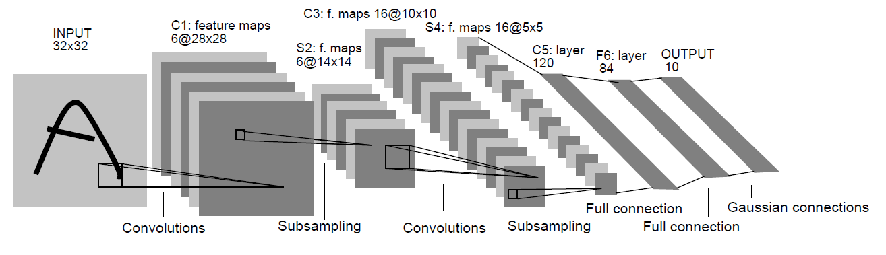
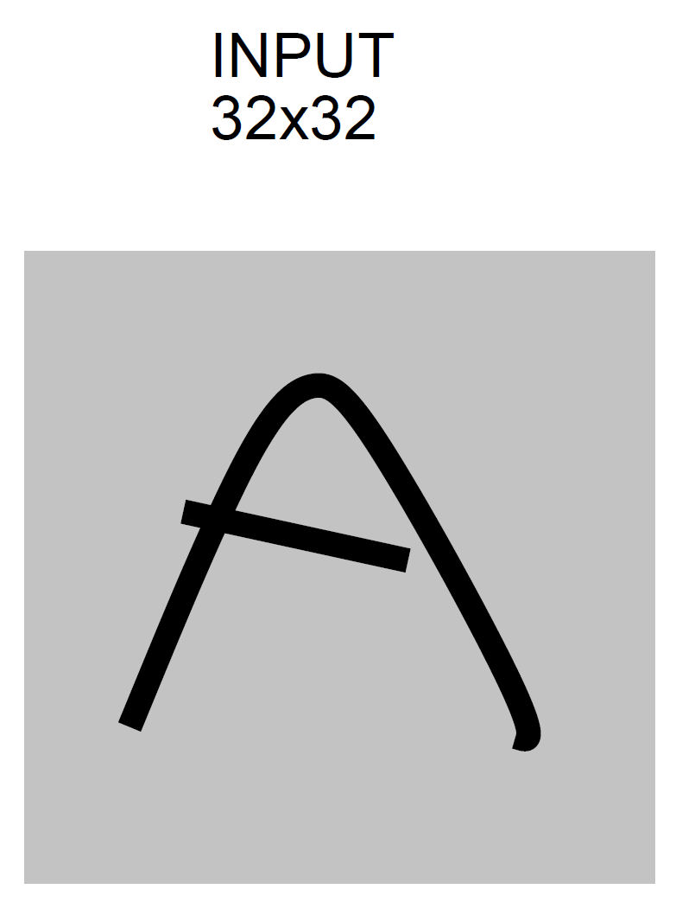
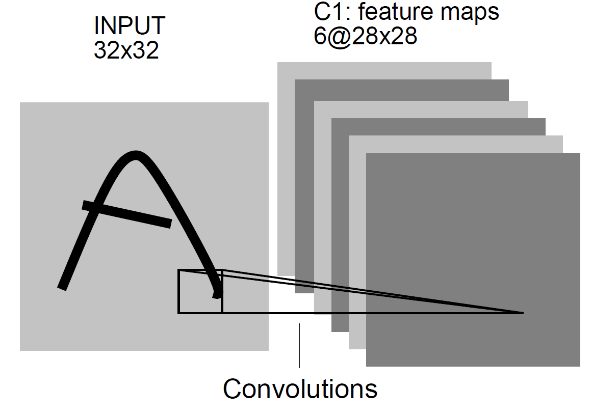
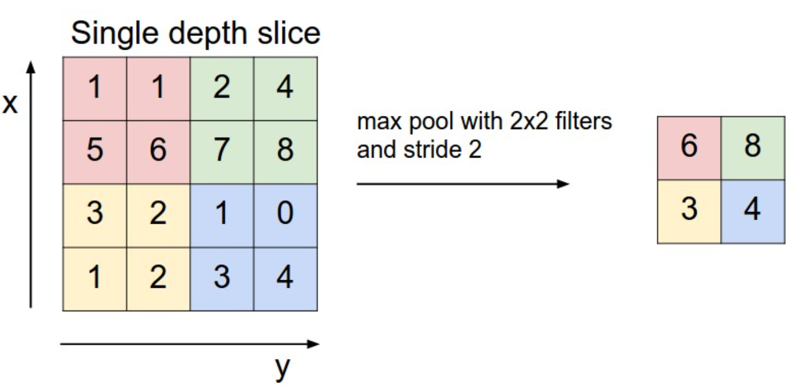
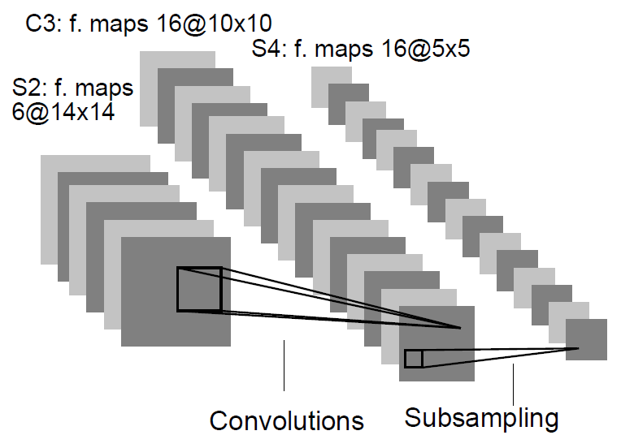
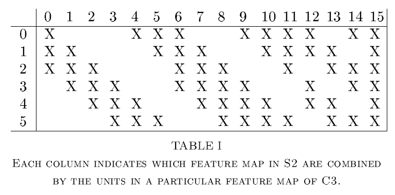
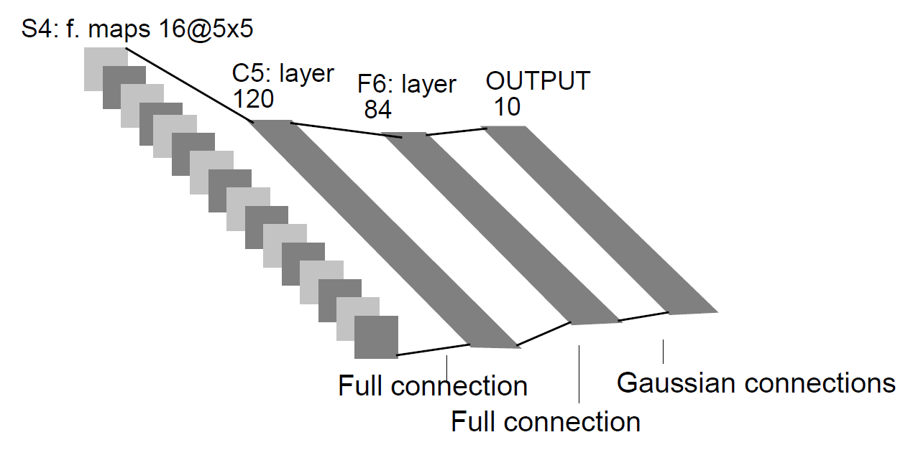

* 本文参考
\[1] [Gradiant-Based Learning Applied to Document Recognition](http://yann.lecun.com/exdb/publis/pdf/lecun-98.pdf)
\[2] [CS231n Convolutional Neural Networks for Visual Recognition /Stanford](https://cs231n.github.io/)

# 1 如何理解CNN
## 1.1 什么是CNN
**CNN模型** 通常被认为始于Yann LeCun在1998年发表的文章 [Gradiant-Based Learning Applied to Document Recognition](http://yann.lecun.com/exdb/publis/pdf/lecun-98.pdf)，该模型通常被称为 **LeNet**。

**图1.1 LeNet的模型结构[1]**

**图1.1** 为原文[1]中的配图，描述了一个两层卷积的CNN模型。

CNN（Convoolutional Neural Network）：
1. CNN，卷积神经网络，是一种使用卷积层提取图像特征，再经过池化层保留重要特征的深度学习模型。
2. 模型通常用于图像处理，能够很好的提取图像特征。

符号理解：
1. INPUT：输入图像是一个32\*32的图像。虽然图像显示的是个A，但原文写的是Digits Recognition。
2. Convolutions：将32\*32的输入图像经过一个5\*5的卷积核得到28\*28的输出图像。这个卷积核即为传统神经网络中的参数矩阵，在该模型中第一层卷积共有6个经过初始化的卷积核。卷积核的概念可以参考数字图像处理算法中的滤波器，类似滤镜，例如 [高斯滤波](/posts/2020-02-12-opencv边缘检测-c-实现/#3-5-高斯滤波)。
3. Feature Maps：经过卷积核得到的中间输出图像被称为特征图，模型希望通过多个特征图来获取不同的特征。个人感觉该机制与Multi-Head Mechanism中的Multi-Head很相似。
4. Subsampling：下采样，减少输出维度，在该领域主要体现为Pooling，即池化。个人理解池化的目的是用于保留并突出重要信息，下文将详细说明池化的实现。
5. Full connection：全连接层，多称为Fully Connected Layer。用于将高维张量映射为向量，最终经过高斯分布得到对应每个Digits的概率。

## 1.2 LeNet的模型架构
### 1.2.1 图像输入

**图1.2 LeNet的输入图像[1]**

将32\*32的原始图像输入到模型中。

### 1.2.2 第一层卷积

**图1.3 LeNet的第一层卷积[1]**

第一个卷积层将输入的32\*32的原始图像经过6个5\*5的初始化的卷积核分别得到6个28\*28的特征图C1。卷积的本质我认为就是element-wise的加权求和。

### 1.2.3 第一层下采样

**图1.4 LeNet的第一层下采样[1]**

下采样在该模型上的体现即为池化。池化也可以理解为是卷积的一种，只不过池化有时候可能不存在有意义的卷积核（广义的卷积），比如最常用的池化方法max-pooling，如图1.5所示：

**图1.5 max-pooling示意图[2]**

在max-pooling中，上一层28\*28的特征图C1将被分为14\*14个2\*2的block，模型将选出每个block中的最大值，并将最大值作为这个block的结果输出到下一层中，最终生成下一层14\*14的特征图S2。

池化方法有很多种：
1. max-pooling（取block最大值）
2. mean-pooling（取block平均值，即经过一个平均卷积核）
3. 高斯池化（经过一个高斯模糊卷积核）
4. 可训练池化（经过一个可训练的初始化的卷积核）

但在Le-Net中，原文提到：
The four inputs to a unit in S2 are added, then multiplied by a trainable coefficient, and added to a trainable bias ...... Layer S2 has 12 trainable parameters ...... 

即LeNet在下采样部分并没有使用现在流行的所谓pooling方法，而是将block内的像素值相加后乘上参数w再加上偏置b。最终针对6个不同的特征图将会有6对(w, b)的组合，即12个可训练参数。

我想这也可以算是可训练池化的一种。

### 1.2.4 第二层卷积与下采样

**图1.6 第二层卷积与下采样[2]**

在第二轮的卷积中，模型通过一定的规则将经过第一轮卷积池化的6个特征图S2映射为16个特征图。

**表1.1 第二层卷积的映射关系[2]**

在LeNet中，原文提到这样映射的原因以及如何映射：
1. **Why not** connect every S2 feature map to every C3 feature map?
**The reason** is twofold. **First**, a non-complete connection sheme keeps the number of connection **within reasonable bounds**. **More importantly**, it forces **a break of symmetry** in the network. 
**Different feature maps are forced to extract different(hopefully complementary) features because they get different sets of inputs.**
2. The rationale behind the connection sheme in the table Ⅰ is the followings.
**The first six** C3 feature maps take inputs from **every contiguous subsets of three** feature maps in S2. **(Column 0-5)**
**The next six** take input from **every contiguous subset of four**. **(Column 6-11)**
**The next three** take input from some **discontiiguous subsets of four**. **(Column 12-14)**
**Finally the last one** takes input from **all S2** feature maps. **(Column 15)**
3. Layer C3 has 1516 trainable parameters ......

即LeNet在第二层卷积中：
1. 没有使用6张S2特征图到16张C3特征图的全映射，而是使用了 **表1.1** 的映射规律。
2. 映射规律中，**列0-5** 使用了循环连续的三连特征图（理解为tri-gram），**列6-11** 使用了循环连续的四连特征图（理解为qua-gram），**列12-14** 使用了循环不连续的四连特征图（理解为两个bi-gram），**列15** 使用了S2全部特征图。
3. 对于每个特征图到特征图的映射，需要一个5\*5的初始化的卷积核，故共需要 25 \* (3\*6 + 4\*6 + 4\*3 + 6) + 16 = 1516 个参数。
其中，25是每个卷积核的参数量，16是16个列每列对应偏置的参数量。

在第二层下采样中，采取了和第一层C1-S2相同的池化方式。通过选取无重叠的2\*2block的最大值对C3进行max-pooling，将10\*10的C3特征图池化为5\*5的S4特征图。

### 1.2.5 第三层卷积以及全连接层

**图1.7 第三层卷积以及全连接层[2]**

第三层池化将第二层卷积池化后5\*5的S4特征图再通过一定的规则经过5\*5的卷积核卷积后得到120个1\*1的特征图。

**表1.2 第三层卷积的映射关系**

|  | 0 | 1 | ... | 120 |
| :-: | :-: | :-: | :-: | :-: |
| 0 | X | X | ... | X |
| 1 | X | X | ... | X |
| ... | ... | ... | ... | ... |
| 16 | X | X | X | X |

在 **图1.7** 中，S4-C5下方的注释将这个过程称为全连接。而在LeNet原文中是这样描述的：
C5 is labeled as a convolutional layer, instead of a fully-connected layer, because if LeNet-5 input were made bigger with everything else kept constant, the feature map dimension would be larger than 1\*1.
即C5在 **图1.7** 中表现为全连接只是一个巧合，实际情况当 [1.2.1](/posts/2021-02-10-如何理解-cnn/#1-2-1-图像输入) 的输入图像像素量变大时，可能会出现C5为X\*X。

C5经过一个全连接层将120维的向量转换为84个（似乎是为了与ASCII匹配），在经过一个高斯连接层（还没来得及搞明白这层）映射为一个10维向量（与10个数字匹配）。

## 1.3 待续

# 2 TextCNN
待续。。。