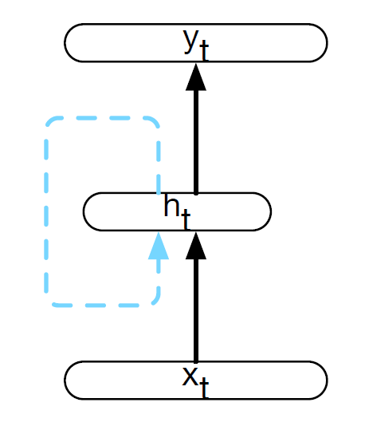
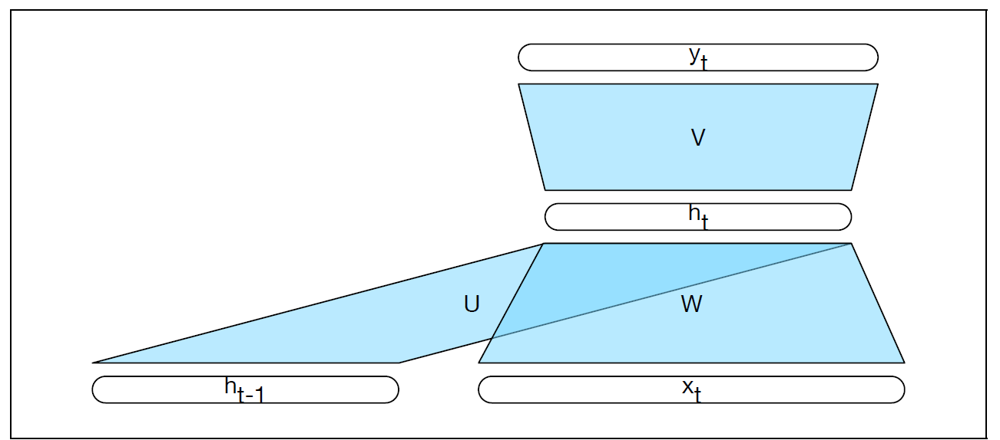
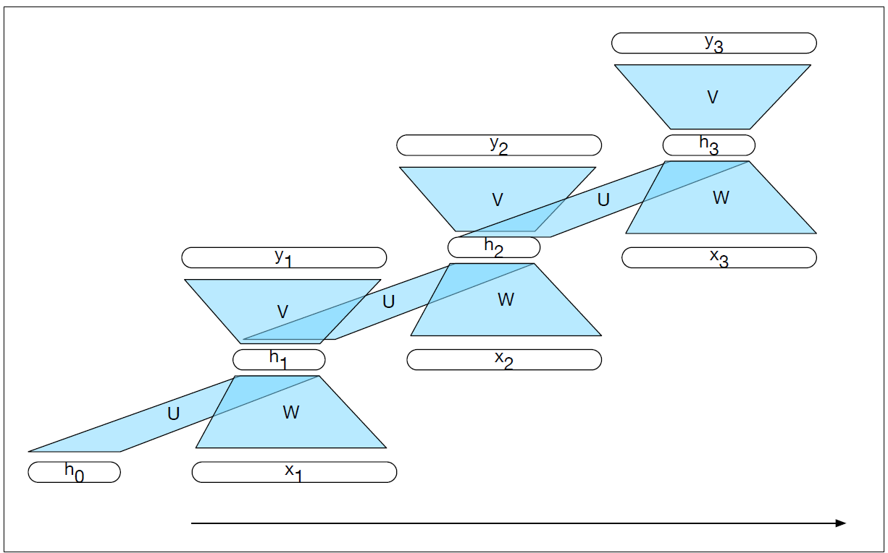
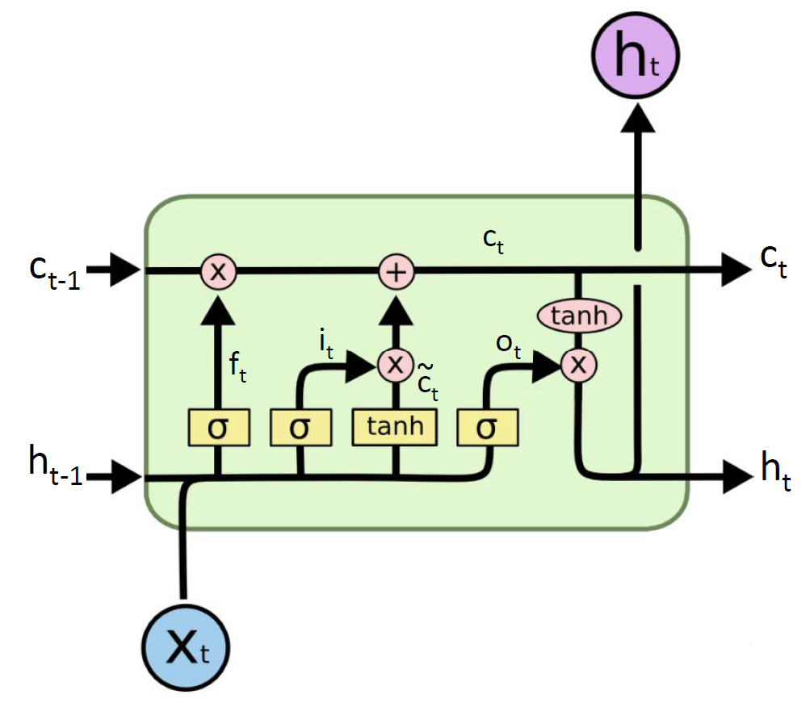
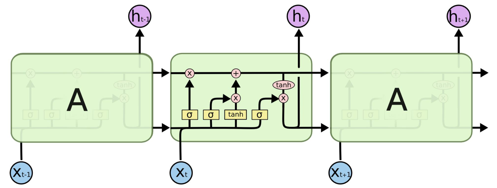

* 本文参考
\[1] Dan Jurafsky和James H. Martin合著的[Speech and Language Processing第三版](https://web.stanford.edu/~jurafsky/slp3/)
\[2] 知乎专栏 [深入理解RNN与LSTM](https://zhuanlan.zhihu.com/p/108276255)
\[3] 知乎问答 [谁能用比较通俗有趣的语言解释RNN和LSTM？](https://www.zhihu.com/question/314002073)
\[4] [CS224n: Natural Language Processing with Deep Learning /Stanford](https://web.stanford.edu/class/archive/cs/cs224n/cs224n.1194)

# 如何理解RNN和LSTM
## 1 如何理解RNN
### 1.1 什么是RNN

**图1.1 单层RNN[1]**

**图1.1** 为单层RNN的图示表示。很多教材、课程、博客都会给出这个~~浅显易懂的~~图，然而这图虽然简洁但并不容易理解。~~（反正我没看懂）~~

符号理解：
1. x_t为时间顺序文本序列，通常一个x_t为一个Word Embedding。
2. h_t为时间t的隐藏状态，是x_t和h_t-1输入信息的中间层输出。
3. y_t为输出结果，是h_t输入信息的最终输出。
4. 蓝色箭头的循环意思是同一层RNN的参数矩阵不变。

### 1.2 RNN的前向传播 

**图1.2 单层RNN的前向传播[1]**

**图1.2** 同为单层RNN，理解上要比 **图1.1** 好很多。

公式定义：
1. 隐藏状态：

$$
\begin{equation}
h_t = g(Wx_t + Vh_{t-1} + b)
\end{equation}
$$

2. 最终输出：

$$
\begin{equation}
y_t = f(Uh_t)
\end{equation}
$$

* 其中，g( )，f( )为激活函数，通常为softmax函数；W，V，U为参数矩阵；b为偏置。

**图1.3 单层RNN的时间序列表示[1]**

**图1.3** 在 **图1.2** 基础上进行了时间轴方向的拓展。可以看到尽管时间序列输入x_t以及隐藏状态h_t会根据时间变化而改变，但参数矩阵在单次前向传播的过程中不会改变。

### 1.3 RNN的反向传播
数学不好就不BP了。

### 1.4 RNN的优缺点
优点：
1. 相比传统神经网络，由于引入了基于时间t的隐藏状态，能够理解时间序列文本的前后位置关系。
2. 相比传统神经网络，单次前向传播的所有隐藏状态均使用同一参数矩阵降低了参数矩阵的规模。

缺点：
1. 梯度消失（Gradient Vanishing）问题，反向传播误差随着文本长度的增加而变弱，使得参数矩阵不能很好地学习到文本的长距离依赖。
2. 由于RNN时间序列间的前后依赖特性，在长文本情况下训练不能并行化导致效率降低。

## 2 如何理解LSTM
### 2.1 什么是LSTM

**图2.1 单层LSTM[2]**

符号理解：
1. x_t为t时刻输入的文本序列。
2. c_t为t时刻的cell state，负责存储记忆信息，受t时刻输入x_t和t-1时刻隐藏状态h_t-1控制。
3. h_t为t时刻的隐藏状态，受t时刻输入x_t和c_t控制。
4. f_t为遗忘门输出，负责控制记忆信息的遗忘和保留。
5. i_t为输入门输出，负责控制输入信息写入cell state。
6. o_t为输出门输出，负责控制cell state信息写入新的隐藏状态。

### 2.2 LSTM的前向传播

**图2.1 单层LSTM[2]**

公式定义：
1. 遗忘门：

$$
\begin{equation}
f_t = g(W_fh_{t-1} + U_fx_t + b_f)
\end{equation}
$$

2. 输入门：

$$
\begin{equation}
i_t = g(W_ih_{t-1} + U_ix_t + b_i)
\end{equation}
$$

3. 输出门：

$$
\begin{equation}
o_t = g(W_oh_{t-1} + U_ox_t + b_o)
\end{equation}
$$

4. New Cell Content：

$$
\begin{equation}
\tilde{c_t} = tanh(W_ch_{t-1} + U_cx_t + b_c)
\end{equation}
$$

5. Cell State：

$$
\begin{equation}
c_t = f_t \otimes c_{t-1} + i_t \otimes \tilde{c_t}
\end{equation}
$$

6. 隐藏状态：

$$
\begin{equation}
h_t = o_t \otimes tanh(c_t)
\end{equation}
$$

* 其中，g( )通常选用sigmoid函数，⊗表示元素逐项相乘。

**图2.2 LSTM的时间序列表示[2]**

### 2.3 LSTM的反向传播
数学不好就不BP了。

### 2.4 LSTM的优缺点
优点：
1. 通过引入Cell State作为记忆，一定程度削弱了传统RNN的梯度消失问题，相比RNN能够更好的学习长文本的长距离依赖。

缺点：
1. 非要说缺点就是，现在，LSTM在某些任务上的性能指标表现不如Transformer。

### 2.5 LSTM需要注意的几个点
1. LSTM使用sigmoid作为门限，sigmoid输出在(0, 1)区间，是为了进行数据的选择；使用tanh，是为了记忆的long term保存。
2. LSTM不是解决了梯度消失问题，而是通过自身机制**削弱了**梯度消失。
3. 还有个类似的GRU改天再看。