* 本文参考
\[1] [Attention Is All You Need](https://arxiv.org/abs/1706.03762)
\[2] [The Illustrated Transformer](https://jalammar.github.io/illustrated-transformer)

# 1 如何理解Transformer
## 1.1 什么是Transformer
**Transformer模型** 是在NIPS2017由谷歌发表 [Attention is All You Need](https://arxiv.org/abs/1706.03762)。

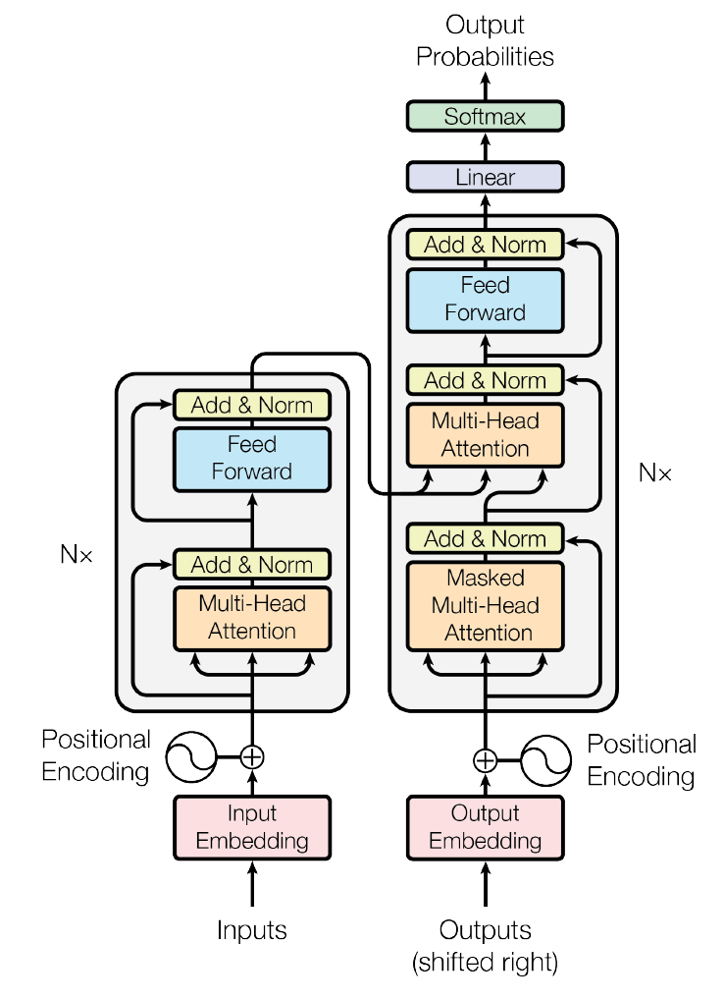

**图1.1 Transformer模型架构[1]**

**图1.1** 为论文原文[1]中的配图。

架构：
1. 模型分为左半侧的N个Encoder和右半侧的Decoder两部分。
2. 模型主要有几个主要模块：Multi-Head Attention、相加&标准化部分、前馈神经网络。

将分为Encoder和Decoder两部分进行理解。

## 1.2 Encoder部分

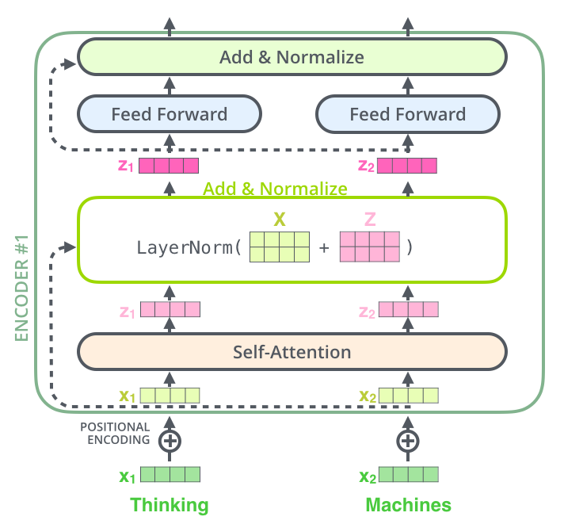

**图1.2 Encoder总览[2]**

**图1.2** 展示了Encoder部分的架构逻辑：
1. 将Token转化为Word Embedding。
2. 将经过位置编码的向量x输入到Multi-Head Attention模块中，得到输出z。
3. 将原始的x与z相加后经过Normalization，输出到前馈神经网络中。
4. 将前馈神经网络的输出与前馈神经网络的输入相加后经过Normalization，输出到下个Encoder中。

### 1.2.1 Positional Encoding

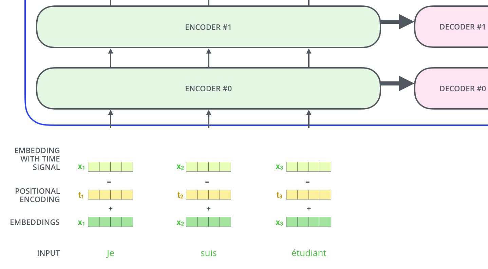

**图1.3 Positional Embedding[1]**

如 **图1.3** 所示，模型使用相同维度的Positional Encoding与Word Embedding相加进行位置编码。

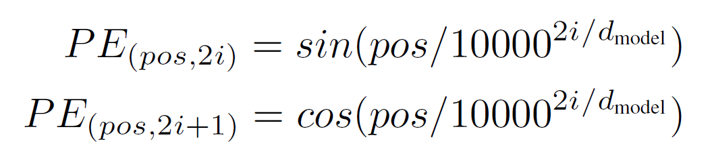

**图1.4 Positional Encoding计算方法[2]**

\* 其中，pos为Token位置，i为Positional Encoding的第i维的值，d_model为向量维度。

根据 **图1.4** 所示，对于第pos位置的Token的第i维Positional Encoding的值，使用三角函数进行计算。

### 1.2.2 Multi-Head Self-Attention

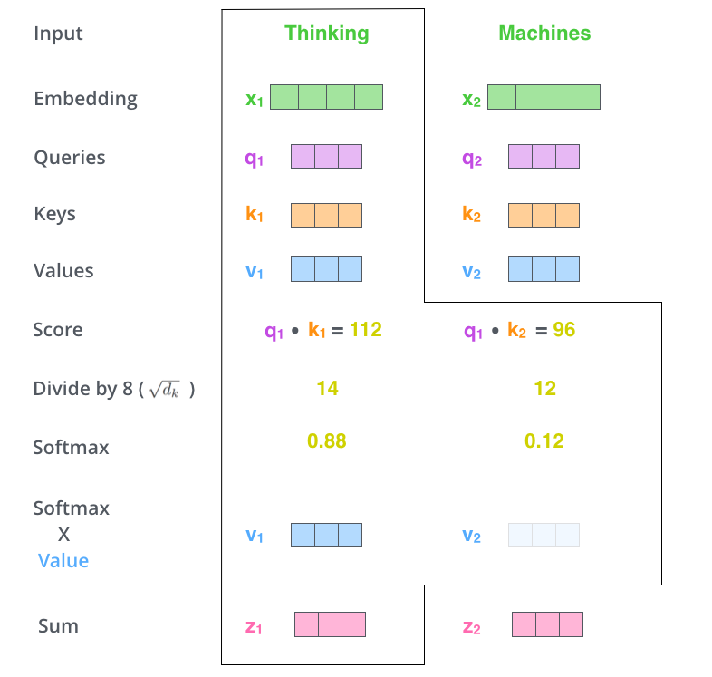

**图1.5 Transformer中的Self-Attention机制[2]**

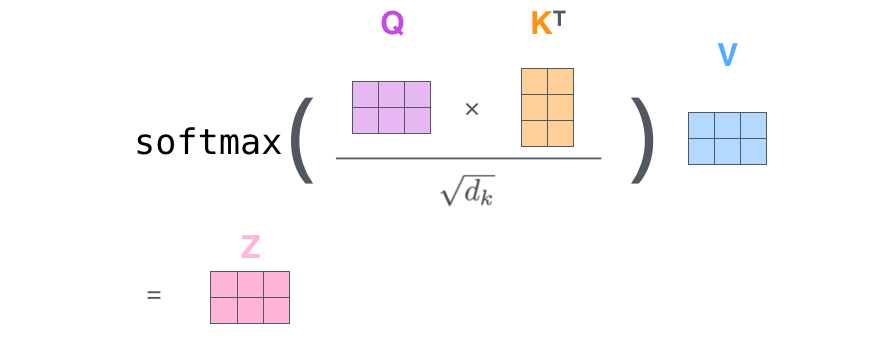

**图1.6 Self-Attention的直观定义[2]**

Self-Attention的公式定义：
* 

$$
\begin{equation}
z = softmax(\frac{QK^{T}}{\sqrt{d_k}})V
\end{equation}
$$

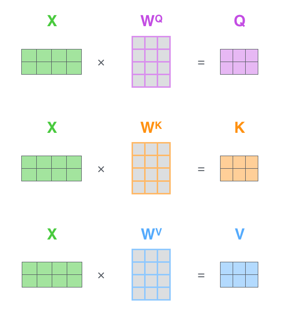

**图1.7 Q、K、V的来历[2]**

如 **图1.7** 所示，QKV可经由Position Encoding后的输入向量与可训练的权重矩阵相乘得到。

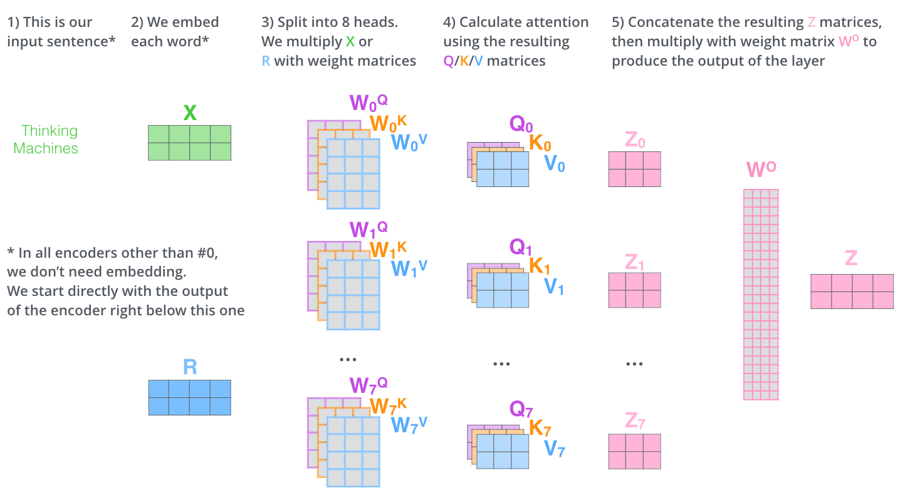

**图1.8 Multi-Head的Self-Attention[2]**

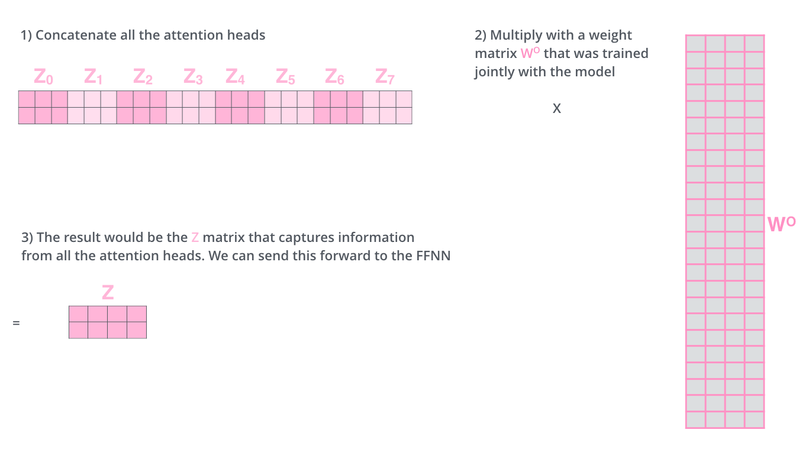

**图1.9 Multi-Head输出的Concatenation[2]**

如 **图1.8** **图1.9** 所示，Multi-Head的Self-Attention机制将会生成多个Attention，在输出时将所有输出Concatenate成一个高维度向量，并乘上一个可训练的参数矩阵W，最后输出一个和输入向量同维度的向量Z。

### 1.2.3 剩下的部分

**图1.2 Encoder总览[2]**

在得到了Multi-Head Self-Attention模块的输出之后：
1. 将该模块的输入和输出向量相加并进行Normalization，得到Add&Normalize的输出。
2. 将上一层结果输入到一个position-wise fully connected feed-forward network中。
3. 将该前馈神经网络的输入和输出相加并进行Normalization，得到该Encoder的输出。

Position-wise Feed-Forward Networks的公式定义：
* 

$$
\begin{equation}
FFN(x) = max(0, xW_1 + b_1)W_2 + b_2
\end{equation}
$$

至此，Encoder部分的结构结束，Encoder部分通常会Stack多个Encoder。

## 1.3 Decoder部分

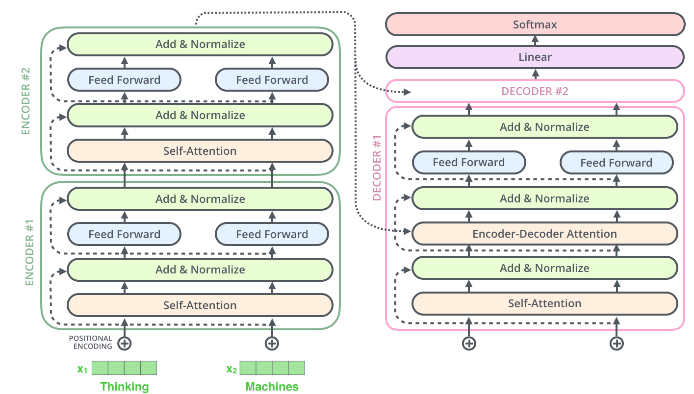

**图1.10 Decoder总览[2]**

**图1.10** 展示了Decoder部分的架构逻辑：
1. Decoder是时序输入的，而不像Encoder是并行输入运算的。
2. 首先将Previous Output经过Positional Encoding输入到Decoder中，经过一个Mask掉Future Position的Multi-Head Self-Attention，得到输出并进行Add&Normalize。
3. 将上一层的输出输入到Encoder-Decoder连接的Multi-Head Self-Attention中，得到输出并进行Add&Normalize。
4. 将上一层的输出输入到下一个Decoder中。

### 1.3.1 Mask掉Future Position的Multi-Head Self-Attention

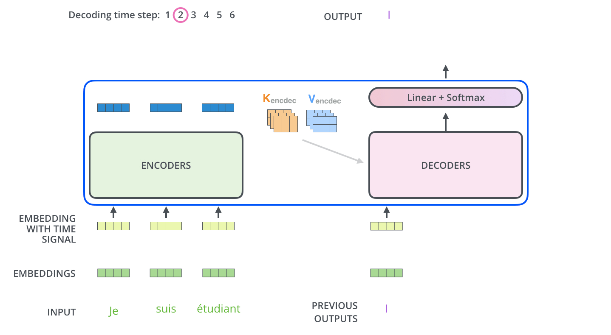

**图1.11 Decoder的时序过程[2]**

如 **图1.11** 所示，每个Decoder需要重复Token个数的Decode过程。每次Decode只有Previous Output是实际输入进Decoder的，而剩下的Word Embedding及其相对应的QKV在Mask掉Future Position的Multi-Head Self-Attention中都是被Mask掉的（设置为Inf）。

### 1.3.2 Encoder-Decoder连接的Multi-Head Self-Attention

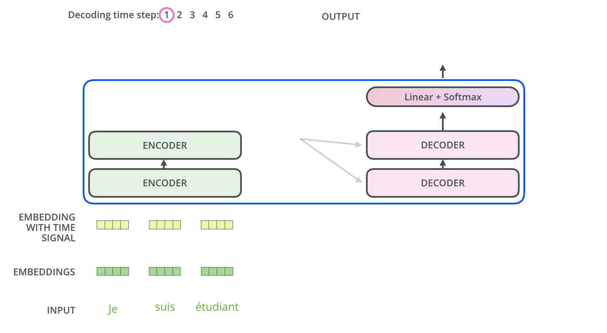

**图1.12 Encoder-Decoder之间的参数传递[2]**

如 **图1.12** 所示，Encoder-Decoder连接的Multi-Head Self-Attention的KV是由前面的Encoder传递过来的KV，而Q矩阵则由Decoder中Mask掉Future Position的Multi-Head Self-Attention传过来。

## 1.4 最终线性层和Softmax层

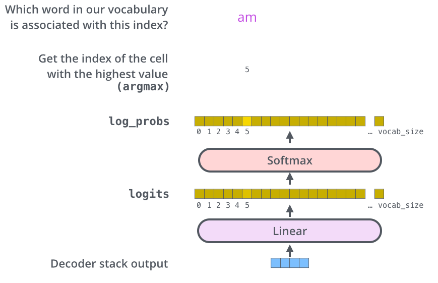

**图1.13 最终线性层和Softmax层[2]**

如 **图1.13** 所示，在得到Docoder Stack的输出后，向量先经过一个线性层Map到和Vocabulary想同维度的向量空间上，在经过一个Softmax计算概率，最终得到概率最高为本轮输出的单词。

## 1.5 Transformer的优缺点
优点：
1. 脱离了RNN、LSTM的束缚，仅使用Attention机制完成了模型的构建。这使得模型具有了一定程度的并行计算能力，适用于现代的GPU、TPU，大幅提升训练效率。
2. ~~编不出来了。~~

缺点：
1. ~~编不出来，它在当时的结果就是好。~~