# Data Augmentation

主要参考：
1. https://arxiv.org/pdf/2105.03075.pdf
2. [A Visual Survey of Data Augmentation in NLP](https://amitness.com/2020/05/data-augmentation-for-nlp/)

## Rule-Based Techniques

### Overview

**词汇替换：**

1. 基于同义词词典（WordNet）替换近义词

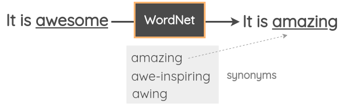

2. 基于 TF-IDF 替换低信息词汇

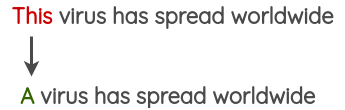

3. 基于 Unigram 出现频率替换单词

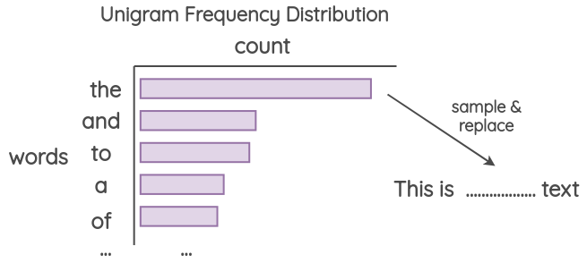

4. 缩写扩展收缩

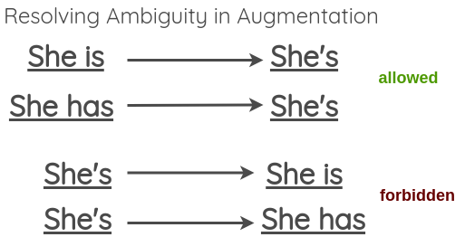

**随机引入噪声：**

1. 主动拼写错误

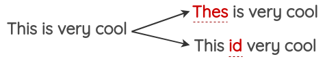

2. 被动拼写错误

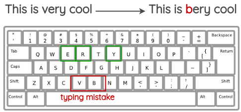

3. 随机单词删除（符号替换 / 完全删除）

4. 随机位置变换（句子 / 词汇）

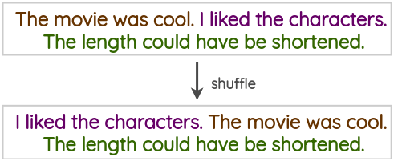

5. 随机单词的近义词插入

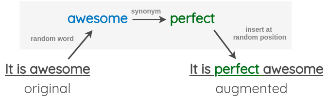

**语法解析：**

https://arxiv.org/abs/1812.04718

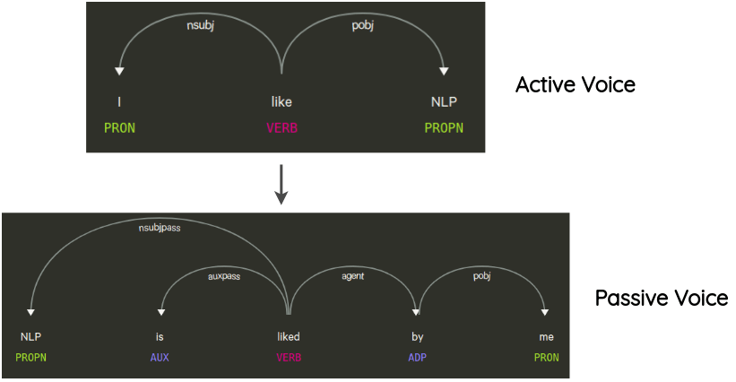

### EDA (EMNLP2019, NLP)

**论文链接：**https://aclanthology.org/D19-1670.pdf

**评价方式 / 数据集**：

1. SST-2: Stanford Sentiment Treebank (Socher et al., 2013)
2. CR: customer reviews (Hu and Liu, 2004; Liu et al., 2015)
3. SUBJ: subjectivity/objectivity dataset (Pang and Lee, 2004)
4. TREC: question type dataset (Li and Roth, 2002)
5. PC: Pro-Con dataset (Ganapathibhotla and Liu, 2008)

**扩增方法：**

1. Synonym Replacement
Randomly choose n words from the sentence that are not stop words. Replace each of these words with one of its synonyms chosen at random. 
2. Random Insertion
Find a random synonym of a random word in the sentence that is not a stop word. Insert that synonym into a random position in the sentence. Do this n times. 
3. Random Swap
Randomly choose two words in the sentence and swap their positions. Do this n times. 
4. Random Deletion
Randomly remove each word in the sentence with probability p. 

其中，n与文本长度正相关$n=\alpha \cdot l$，p为手动设置的概率。

**结果：**

1. EDA能够帮助多个模型在文本分类数据集上得到可观的性能提升。

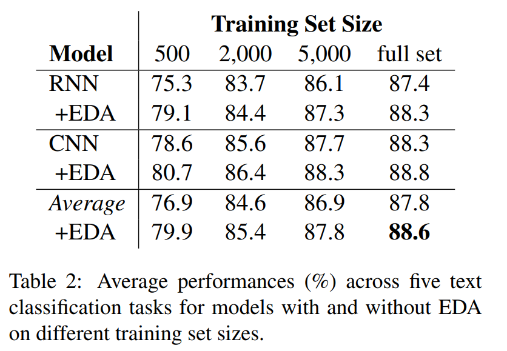

2. 相比训练数据充足的情况，EDA能够在训练样本较少的时候给模型带来更多的性能提升。

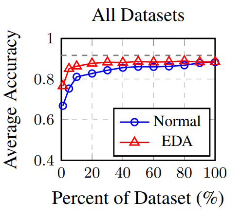

### UDA(NeurIPS2020, CV & NLP)

**论文链接：**https://proceedings.neurips.cc/paper/2020/file/44feb0096faa8326192570788b38c1d1-Paper.pdf

**评价方式 / 数据集：**

1. Image Classification：CIFAR-10、SVHN
2. Text Classification：IMDb、Yelp-2、Yelp-5、Amazon-2、Amazon-5、DBpedia

**模型Overview：**

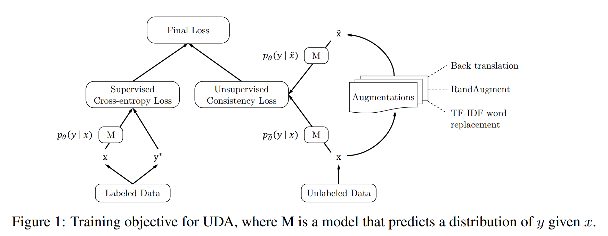

1. 有监督侧：
计算模型预测结果和实际结果的cross-entropy loss。
2. 无监督侧：
计算原始数据输入时模型预测结果和扩增数据输入时模型预测结果的consistency loss。

**扩增方法：**

1. RandAugment for Image Classification (inspired by AutoAugment)
对图像做随机变换，如亮度、大小、角度调节。
2. Back-translation for Text Classification
将语言A文本$Text_A$翻译为语言B得到$Text_B$，再将语言B文本$Text_B$翻译回语言A得到$Text'_A$。

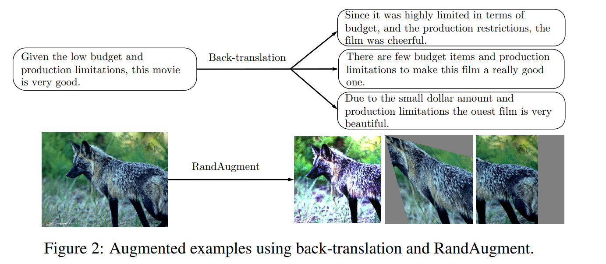

3. Word replacing with TF-IDF for Text Classification
通过TF-IDF过滤低分的低信息单词，留下高分单词。

**训练技巧：**

1. Confidence-based masking
将预测结果中最高预测概率小于某个阈值的样本标注出来。
2. Sharpening Predictions
将预测结果锐化得到近似的 one-hot 结果。
3. Domain-relevance Data Filtering
收集到用于数据扩增的 out-of-domain unlabeled 数据后，用 in-domain 的 baseline 模型预测 out-of-domain unlabeled 数据是否 in-domain，并挑选 confidence 高的数据作为扩增候选。

**结果：**

1. CV：UDA能够帮助多个模型大幅度降低在图像分类上的错误率。

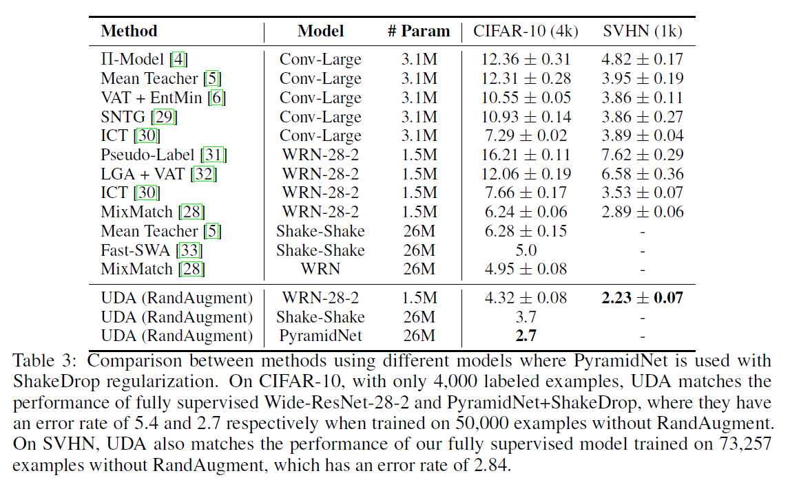

2. NLP：半监督情况下，UDA能帮助BERT大幅度降低在文本分类上的错误率。

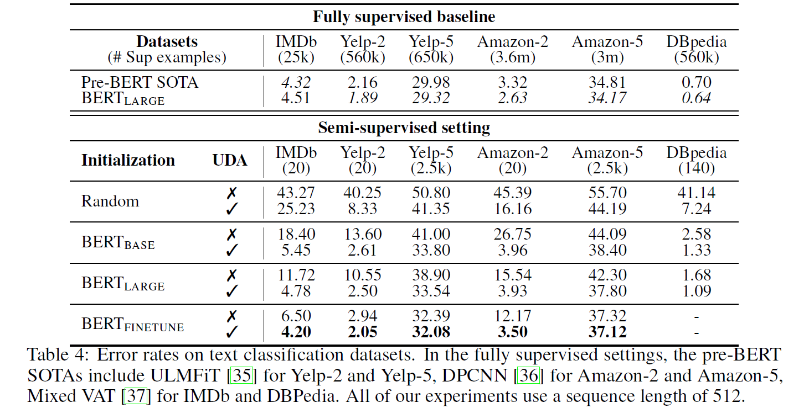

## Example Interpolation Techniques

### Overview

1. Image Mixup

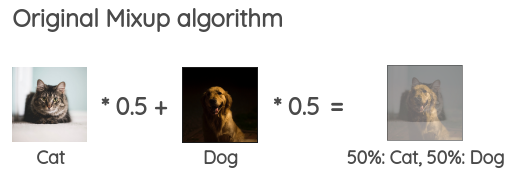

2. Word Mixup

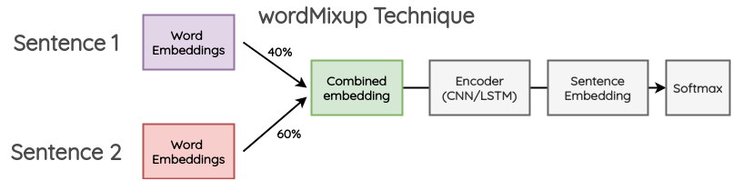

3. Sentence Mixup

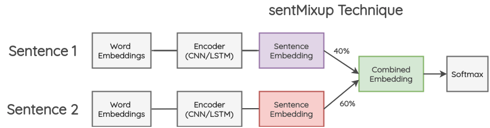

### MIXUP(ICLR2018, CV)

**论文链接：**https://openreview.net/pdf?id=r1Ddp1-Rb

**评价方式 / 数据集：**

1. Image Classification：CIFAR-10、CIFAR-100

**扩增方法：**

1. 将随机抽取的两个图像和对应图像类别分别加权求和得到新的一个样本。
$$
\widetilde x = \lambda x_i + (1-\lambda)x_j
$$
$\widetilde y = \lambda y_i + (1-\lambda)y_j$
其中，$\lambda \sim Beta(\alpha, \alpha) \in [0, 1] $。

**结果：**

1. MIXUP能够帮助多个模型有效降低在图像分类上的错误率。

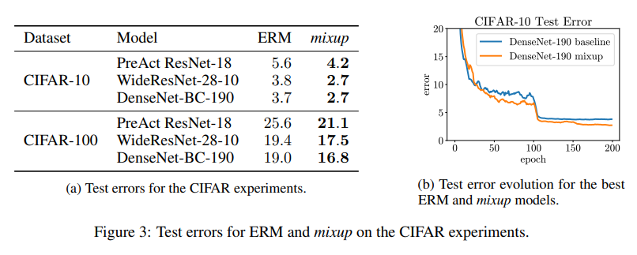

### MixText(ACL2020, NLP)

**论文链接：**https://aclanthology.org/2020.acl-main.194.pdf

**评价方式 / 数据集：**

1. Text Classification：AG News(Zhang et al., 2015), BPpedia (Mendes et al., 2012), Yahoo! Answers (Chang et al., 2008) and IMDB (Maas et al., 2011). 

**模型Overview：**

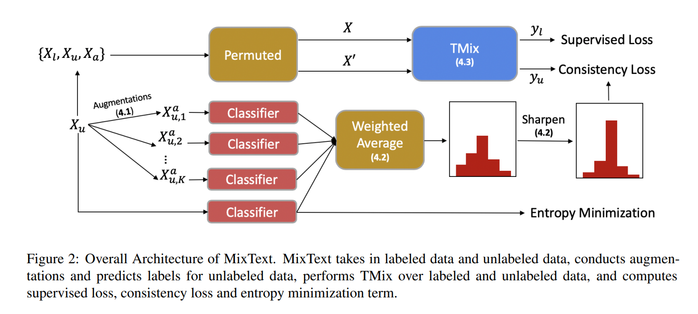

1. Data Augmentation
通过回译得到K个扩增样本作为无标签数据。
2. Label Guessing
将原始样本和扩增样本（K+1个）加权后得到猜测的 consistent 的分类概率向量作为标签。为避免结果过于平滑，使用一个锐化函数突出最高分类概率的值。
3. TMix on Labeled and Unlabeled Data
在训练阶段，在 $X = [X_l, X_u, X_a]$ 集合中随机挑选两个样本 $x, x' \in X$。
使用 TMix 得到其混合预测输出：
$$
p(TMix(x, x'))
$$
用 mix 函数得到其混合真值输出：
$$
\widetilde y = mix(y, y') =λy + (1 − λ)y'
$$
计算两者的 KL-divergence 作为 Loss：
$$
L_{TMix} = KL(mix(y, y')||p(TMix(x, x'); φ)
$$
当 $x \in X_l$ 时，我们称之为 Supervised loss；当 $x \in [X_u, X_a]$ 时，我们称之为 Consistency loss。

**扩增方法：**
1. 通过 mix 两段文本中间状态输出的 Embedding 实现文本的混合，将两段文本真实标签的加权混合作为混合真值。

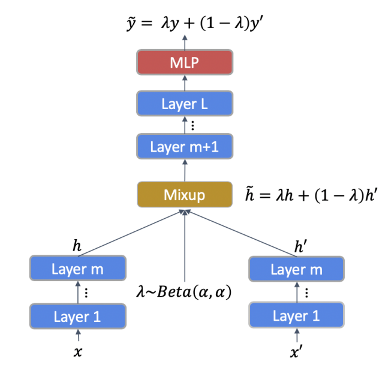

**结果：**

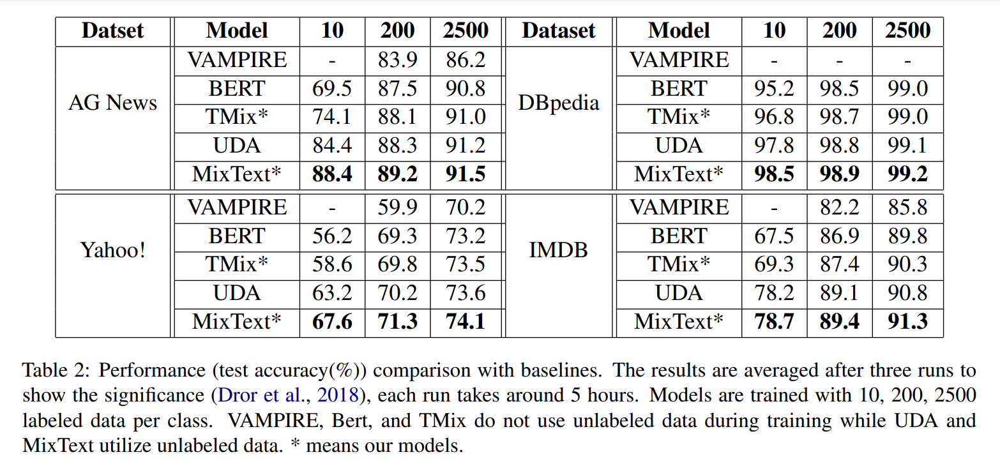

1. MixText 在4个文本分类数据集上 10-shot 的效果远超BERT。
2. MixText 在4个文本分类数据集上明显优于其他数据扩增方法。

## Model-Based Techniques

### Overview

**词汇替换：**

1. 基于 Word Embedding 替换近义词（word2vec）

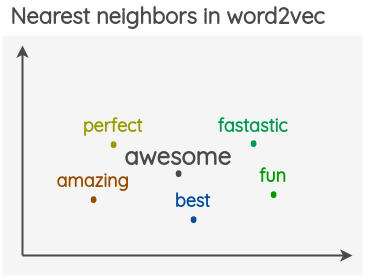

2. 基于上下文预测替换近义词（Language Model）

**语义替换：**

1. 根据关键词替换并生成新的与关键词语义相近的句子成分（生成式模型）

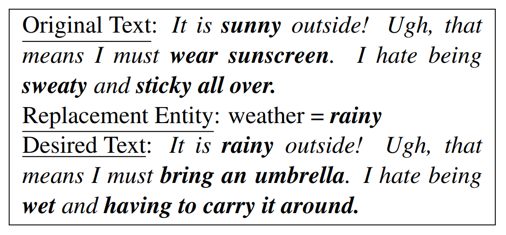

**句子生成：**

1. 回译（机器翻译模型）

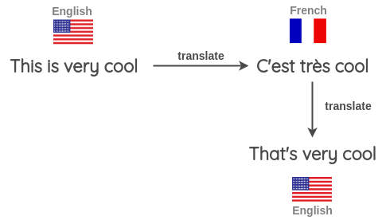

2. 训练生成式模型并根据标签生成句子（生成式模型）

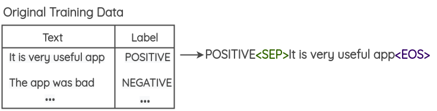

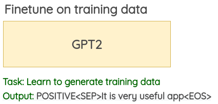

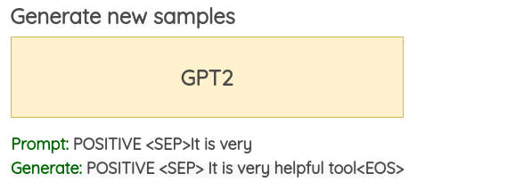

### Back Translation(ACL2016, NLP)

**论文链接：**https://aclanthology.org/P16-1009.pdf

**评价方式 / 数据集：**

1. Machine Translation：WMT 15、IWSLT 15。

**扩增方法：**

1. Dummy Source Sentences (Language Modeling)
2. Synthetic Source Sentences (Back Translation)

**结果：**

1. 两种扩增方法都能够帮助模型在机器翻译数据集上获得可观的性能提升。

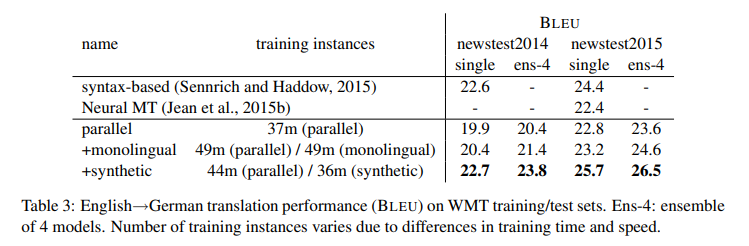

### Contextual Augmentation(NAACL2018, NLP)

**论文链接：**https://aclanthology.org/N18-2072.pdf

评价方式 / 数据集：

1. Text Classification：STT5、STT2、Subj、MPQA、RT、TREC。

**扩增方法：**

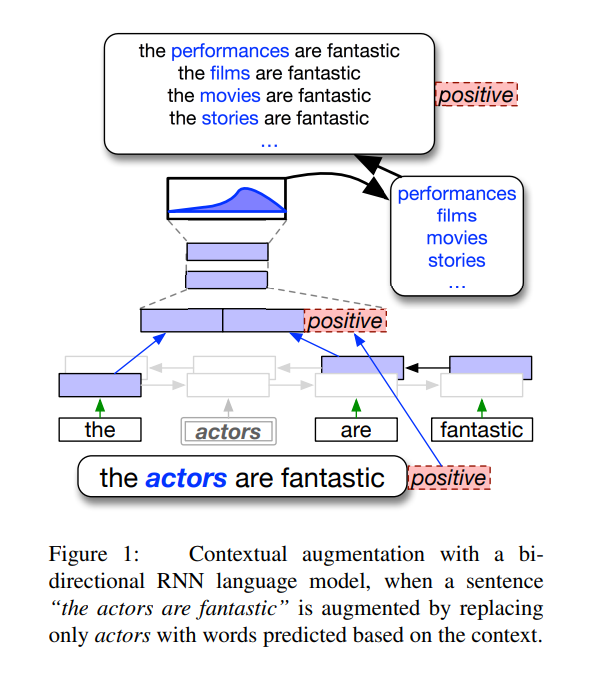

1. Word Prediction based on Context
通过搭建一个 Bi-LSTM 的 Language Model ，基于上下文预测 Mask 的单词。将预测出的单词
2. Conditional Constraint
为了避免模型预测出的单词改变原句含义导致与标签不符，在 Language Model 训练过程中为目标函数加入标签信息，即最大化：
$$
p(word_{center}|word_{context}, label)
$$
**结果：**

1. 同义词替换并不能给模型带来可观提升。
2. 基于上下文预测单词进行数据扩增能够为模型带来一定的提升，但并不可观，作者没有给出在训练数据不足的情况下模型的提升幅度。
3. 基于上下文和标签预测单词进行数据扩增能够进一步提升模型效果，但结果也并非十分惊艳，仍不清楚该方法在训练数据不足情况下模型的提升幅度。

### SMERTI(EMNLP2019, NLP)

**论文链接：**https://aclanthology.org/D19-1272.pdf

**评价方式 / 数据集：**
1. Fluency：SLOR
2. Sentiment Preservation Accuracy：SPA
3. Content Similarity Score：CSS
4. Semantic Text Exchange Score：STES

**扩增方法：**

1. Entity Replacement Module (ERM)
使用 Stanford Parser 解析给定的 Replacement Entity 的词性及语法结构，并遍历输入文本$S$找到和 RE 具有相同或相似词性及语法结构的单词作为候选 Original Entity。使用 Universal Sentence Encoder 生成 Word Embedding 并计算 RE 及 每个候选 OE 的相似度，将相似度最高的作为选定的 OE。若 Stanford Parser 没有找到候选 OE，则使用 Universal Sentence Encoder 遍历计算输入文本中每个词和 RE 的相似度并选取相似度最高的作为 OE。最后，将 OE 替换为 RE 得到文本$S'$。
2. Similarity Masking Module (SMM)
遍历计算文本$S'$中所有单词与 OE 的相似度，并用 Masking Rate Threshold （MRT）将相似度较高的单词用 [mask] 替换（忽略包含 OE 的），得到$S''$。其中，连续的 [mask] 将会合并为一个。

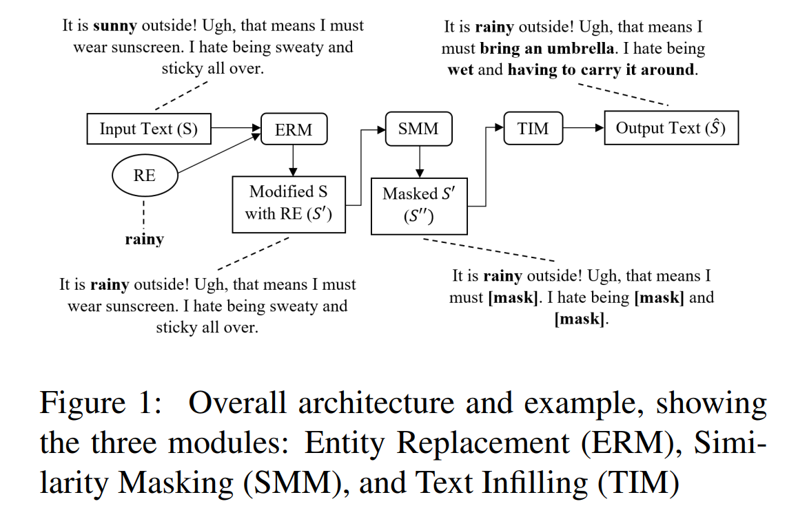

3. Text Infilling Module (TIM)
使用seq2seq模型预测 [mask] 的文本，文中使用了 Bi-GRU + Attention 以及 Transformer 模型生成文本。将每处 [mask] 的生成文本替换 [mask] ，得到$\hat S$作为新生成的文本。

**结果：**

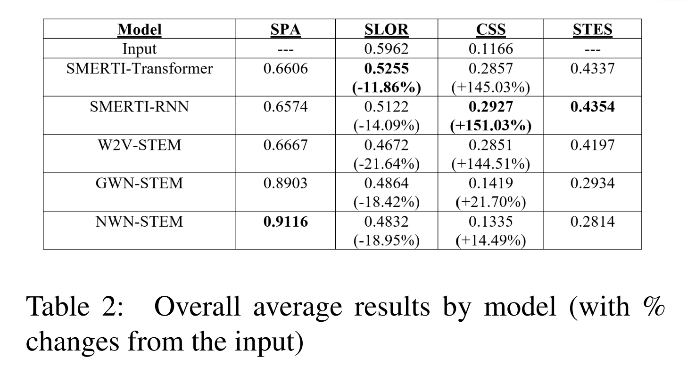

1. SMERTI模型在 SLOR、CSS、STES 三个数据集上都可以超过基于 WordNet、word2vec 的模型。
2. 基于 WordNet 的模型在 SPA 数据集上效果最好，这可能是因为 WordNet 模型只对动词和名词进行修改，这保留了大部分原文本。

### LAMBADA(AAAI2020, NLP)

**论文链接：**https://arxiv.org/pdf/1911.03118.pdf

**评价方式 / 数据集：**

1. Text Classification：

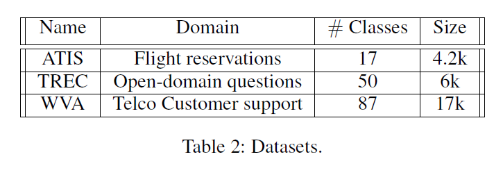

**扩增方法：**

1. Train baseline classifier
使用本地文本分类数据集$D_{train}$训练一个 baseline 分类器 $h$（论文中准备了三种分类器：SVM、LSTM、BERT）
2. Fine-tune language model
将预训练语言模型 GPT-2 在处理后的文本分类数据集上进行语言模型任务的微调，得到 $GPT-2_{Finetuned}$。数据集处理方式如下：
$$Label, [SEP], Text_1, [EOS]$$

$$Label, [SEP], Text_2, [EOS]$$

$$...$$

$$Label, [SEP], Text_n, [EOS]$$
3. Synthesize labeled data
对于给定标签输入$Label, [SEP]$，使用微调后的 $GPT2_{Finetuned}$ 继续预测直到预测出 $[EOS]$，将预测得到的句子及其标签整理成一个数据扩增候选数据集$D^\*$。
4. Filter synthesized data
使用第一步训练得到的 baseline 分类器 $h$对数据扩增候选数据集$D^\*$进行预测，保留每个类别中预测结果的置信度最高的 N 个样本，并将这些高置信度数据整理成一个数据扩增数据集$D_{synthesized}$。将原始数据集$D_{train}$和数据扩增数据集$D_{synthesized}$合成为一个新的数据集$D_{new}$。
5. Repeat
将$D_{new0}$作为新的${D_{train}}$，重复步骤1-4，得到新的$[{D_{new1}}, {D_{new2}}, ...]$。

**结果：**

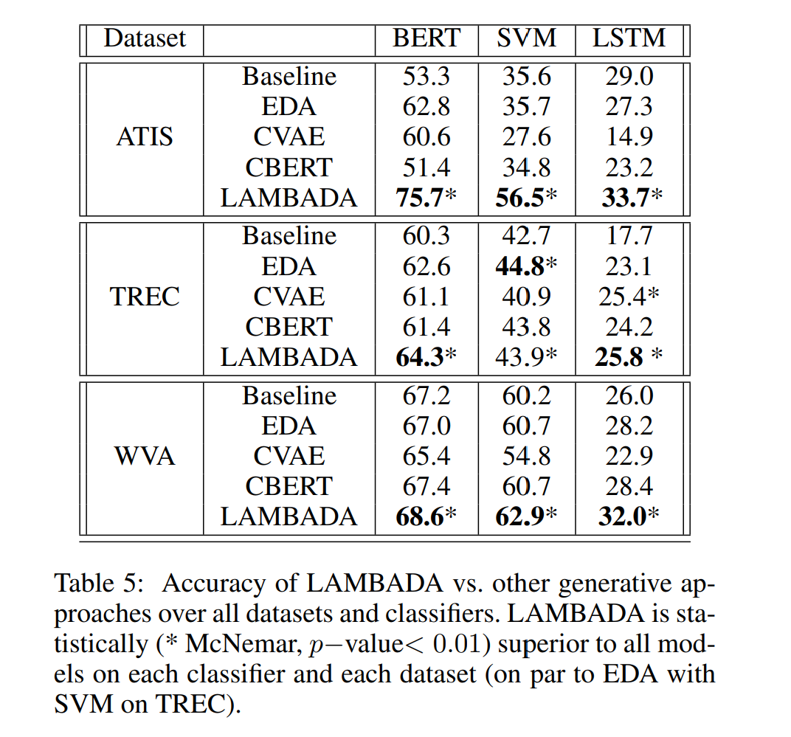

1. LAMBADA扩增方法在多种分类器上都能取得相比其他扩增方法较为可观的提升。
2. 生成的高质量样本帮助了分类模型进一步泛化。