# Text Matching

主要参考：

1. https://tech.meituan.com/2021/06/03/acl-2021-consert-bert.html
2. https://www.zhihu.com/column/c_1370341763794710528

## Definition & Overview
文本匹配任务可以用文本相似度量化。

对于给定文本 $ t_{target} $ ，找到文本集合 $ T=[t_1, ..., t_n] $ 中  $ t_i $ 与  $ t_{target} $ 相似度最高的文本。

该任务可以帮助模型学到词汇、句子级别的语义。**任务的本质 **是学习到可靠的句子表征。

文本相似度可以表现为：

1. 词汇重叠
2. 语义重叠

词汇重叠的评价方式：
1. 基于词汇重合：Jaccard矩阵、Rouge（n-gram）
2. 基于频率：tf-idf

语义重叠的评价方式：
1. 句向量的相似度 / 距离（Representation based）
2. 输入句子对的分类输出（Interaction based）

句向量的获取：
1. 直接获取（[CLS] Token、Paragraph Vector）
2. 词向量之和

句子对分类输出：
\[CLS] \[word1] \[word2] \[word3\] \[SEP] \[word1] \[word2] \[word3] \[word4] \[SEP]

## 有监督方法学习句子表征

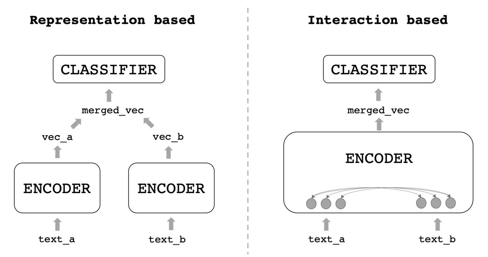

### Siamese结构（Representation based）

向量融合方法：

1. 拼接： $ (u; v) $
2. 求差： $ |u - v| $
3. element-wise dot: $ u*v $

### 交互结构（Interaction based）

\[CLS] \[sentence 1\] \[SEP] \[sentence 2] \[SEP]

## 无监督方法学习句子表征（预训练方法 + 迁移学习）

### 预训练方法

句向量预训练：

1. 句向量Token（Paragrapgh Vector / [CLS]）
2. 预测上下句（Skip Thought / Next Sentence Prediction）

### 迁移学习

借助语义推理数据集 如SNLI（[Stanford Natural Language Inference](https://nlp.stanford.edu/projects/snli/)）预训练。

## 句向量模型

### TF-IDF（doc-doc匹配）

$ corpus = [Sentence_1, Sentence_2] $
$ Sentence_1 = [I, like, apple, devices, very, much] $
$ Sentence_2 = [Apple, is, a, company, who, is, selling, high-tech, devices] $

$ Term Freq = \frac{词汇在当前文本中出现次数}{当前文本总词数} $
$ Inverse Document Freq = log\frac{语料库中文本总个数}{包含该词汇的文本个数DF} $
$ TF-IDF = TF * IDF $ 

$ Sentence_1 $

|   Term    | $WordCount$ |    $ TF_1 $     |     $ IDF_1 $      | $ TF-IDF_1 $ |
| :-------: | :---------: | :-------------: | :----------------: | :----------: |
|     i     |      1      | $ \frac{1}{6} $ | $ log\frac{2}{1} $ |     0.05     |
|   like    |      1      | $ \frac{1}{6} $ | $ log\frac{2}{1} $ |     0.05     |
|   apple   |      1      | $ \frac{1}{6} $ | $ log\frac{2}{2} $ |      0       |
|  devices  |      1      | $ \frac{1}{6} $ | $ log\frac{2}{2} $ |      0       |
|   very    |      1      | $ \frac{1}{6} $ | $ log\frac{2}{1} $ |     0.05     |
|   much    |      1      | $ \frac{1}{6} $ | $ log\frac{2}{1} $ |     0.05     |
|    is     |      0      |        0        | $ log\frac{2}{1} $ |      0       |
|     a     |      0      |        0        | $ log\frac{2}{1} $ |      0       |
|  company  |      0      |        0        | $ log\frac{2}{1} $ |      0       |
|    who    |      0      |        0        | $ log\frac{2}{1} $ |      0       |
|  selling  |      0      |        0        | $ log\frac{2}{1} $ |      0       |
| high-tech |      0      |        0        | $ log\frac{2}{1} $ |      0       |

$ Sentence_2 $

|   Term    | $WordCount$ |    $ TF_1 $     |     $ IDF_1 $      | $ TF-IDF_1 $ |
| :-------: | :---------: | :-------------: | :----------------: | :----------: |
|     i     |      0      |        0        | $ log\frac{2}{1} $ |      0       |
|   like    |      0      |        0        | $ log\frac{2}{1} $ |      0       |
|   apple   |      1      | $ \frac{1}{8} $ | $ log\frac{2}{2} $ |      0       |
|  devices  |      1      | $ \frac{1}{8} $ | $ log\frac{2}{2} $ |      0       |
|   very    |      0      |        0        | $ log\frac{2}{1} $ |      0       |
|   much    |      0      |        0        | $ log\frac{2}{1} $ |      0       |
|    is     |      2      | $ \frac{2}{8} $ | $ log\frac{2}{1} $ |    0.075     |
|     a     |      1      | $ \frac{1}{8} $ | $ log\frac{2}{1} $ |    0.038     |
|  company  |      1      | $ \frac{1}{8} $ | $ log\frac{2}{1} $ |    0.038     |
|    who    |      1      | $ \frac{1}{8} $ | $ log\frac{2}{1} $ |    0.038     |
|  selling  |      1      | $ \frac{1}{8} $ | $ log\frac{2}{1} $ |    0.038     |
| high-tech |      1      | $ \frac{1}{8} $ | $ log\frac{2}{1} $ |    0.038     |

$ Sentence_1 = [0.05, 0.05, 0, 0, 0.05, 0.05, 0, 0, 0, 0, 0, 0] $
$ Sentence_2 = [0, 0, 0, 0, 0, 0, 0.75, 0.38, 0.38, 0.38, 0.38, 0.38] $

$ Similarity = cos(Sentence1, Sentence2) $ 

TF对词频加权（频率越高权重越高），IDF对特殊性加权（单词越特殊权重越高）。

### BM25（1980-1990，query-doc匹配）

$ score(D, Q) = \sum_{i=1}^{n}IDF(q_i)\cdot R(D, q_i) $ 

$ IDF(q_i) = log \frac{N - DF_i + 0.5}{DF_i + 0.5}$

$ R(D, q_i)=\frac{f(q_i, D) \cdot(k_1+1)}{f(q_i, D)+k_1\cdot(1+b\cdot(\frac{Length_D}{Length_{avg}} - 1))} $

### Paragraph Vector（2014，无监督）

论文链接：https://arxiv.org/pdf/1405.4053.pdf

论文解读：

1. https://zhuanlan.zhihu.com/p/21242559
2. http://klausvon.cn/2019/11/21/%E3%80%90%E8%AE%BA%E6%96%87%E7%AC%94%E8%AE%B0%E3%80%91Distributed-Representations-of-Sentences-and-Documents/

句向量中的CBOW：

已知上文预测后文

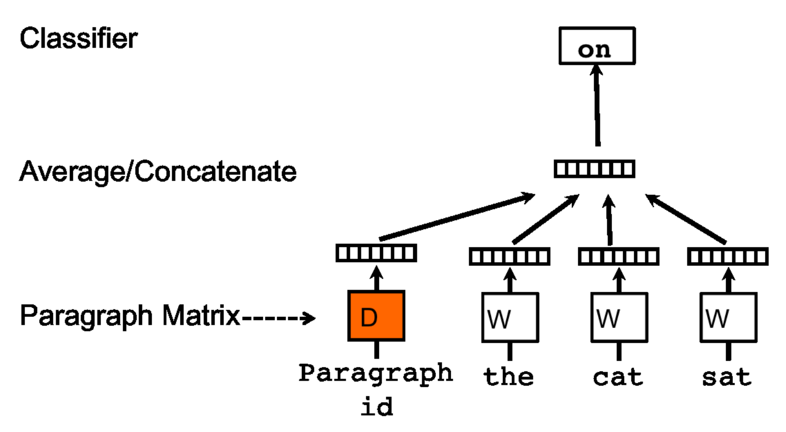

句向量中的skip-gram：

Another way is to ignore the context words in the input, but force the model to predict words randomly sampled from the paragraph in the output. In reality, what this means is that at each iteration of stochastic gradient descent, we sample a text window, then sample a random word from the text window and form a classification task given the Paragraph Vector.

另一种方法是无视上下文，让模型强行预测出段落中随机挑选的单词。在每次随机梯度下降中，采样得到一个文本窗口，将文本窗口中的随机单词作为分类任务的真值训练Paragraph Vector。

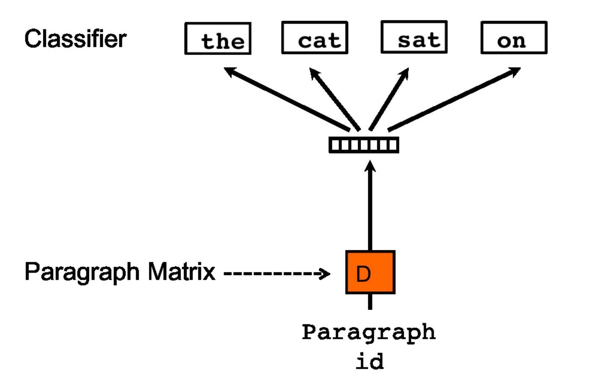

### Skip-Thought Vectors（NIPS2015，无监督）

论文链接：https://arxiv.org/pdf/1506.06726.pdf

论文解读：https://zhuanlan.zhihu.com/p/21259831

Input Sentence -> Encoder -> 2 direction

1. Decoder 1：预测前一句话的Token
2. Decoder 2：预测后一句话的Token

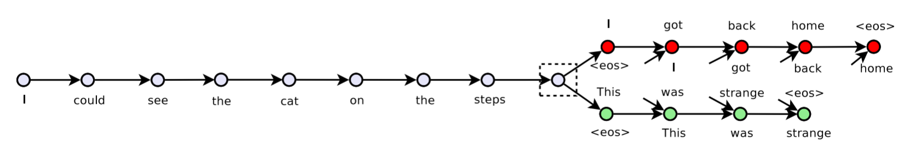

### Infersent（EMNLP2017，双塔，迁移学习）

论文链接：https://arxiv.org/pdf/1705.02364.pdf

论文解读：https://zhuanlan.zhihu.com/p/370619849

双塔结构 + SNLI数据集迁移学习

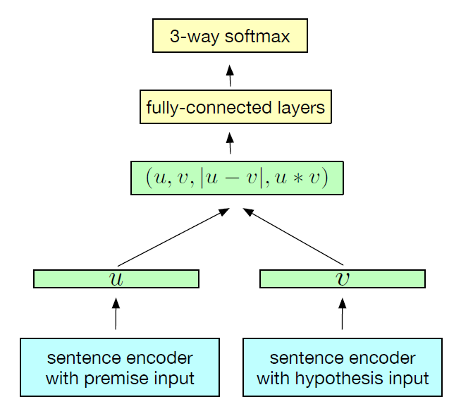

结论：迁移学习优于无监督的SkipThought。

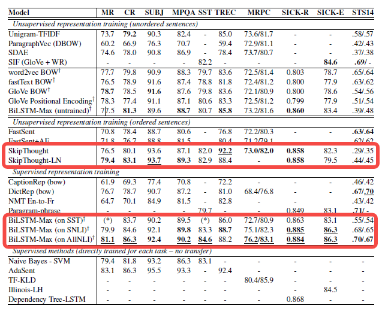

### BERT（NAACL2019，交互结构，无监督）

论文链接：https://arxiv.org/pdf/1810.04805.pdf

NSP：用前一句话预测下一句话是否与前一句话连续。

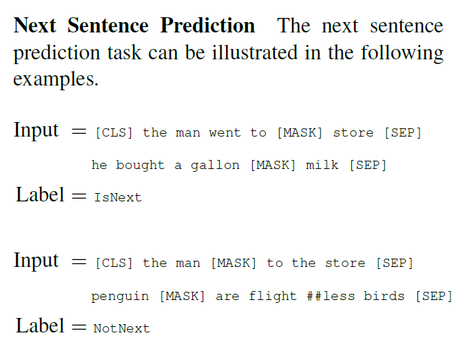

有监督：

\[CLS] Sentence 1 \[SEP] Sentence 2 \[SEP]

通过[CLS]接分类器判别句子是否相似。

### Sentence-BERT（EMNLP2019，双塔，迁移学习）

论文链接：https://arxiv.org/pdf/1908.10084.pdf

计算由共享参数的BERT生成的句子表征的相似度。

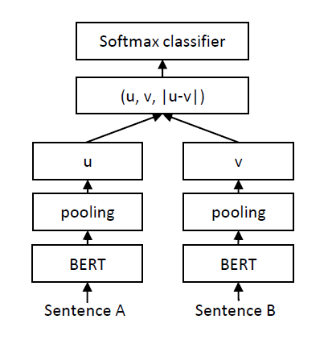

结论：双塔结构迁移学习后的SBERT优于BERT原有结构生成的句向量

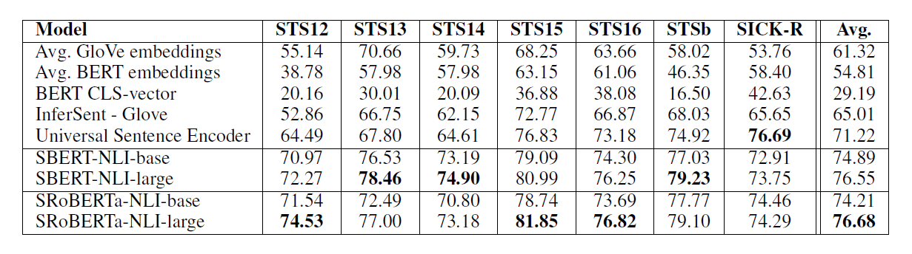

### Cross-Thought（EMNLP2020，无监督）

论文链接：https://arxiv.org/pdf/2010.03652.pdf

在BERT基础上添加多个上下文token，用MLM方法通过周边其他句子的表示预测当前句子的token_id。

结论：
1. 优于MLM
2. 计算上下文Token Representation算力消耗过大，带来的提升不可观

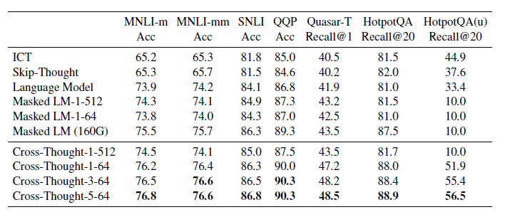

Skip-Thought知中间求两边，为Skip。

Cross-Thought将上下文每句话句向量都考虑在内，为Cross。

### SLM（EMNLP2020，自监督）

论文链接: https://arxiv.org/pdf/2010.16249.pdf

打乱sentence的position_id后，预测顺序。

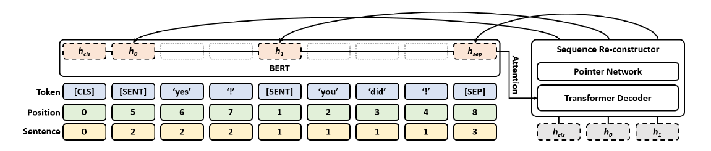

结论：
1. 优于MLM
2. 预测顺序算力消耗过大，带来的提升不可观

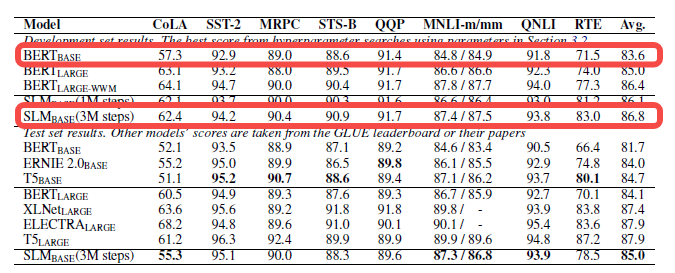

### BERT-flow（EMNLP2020，向量空间映射）

论文链接：https://arxiv.org/pdf/2011.05864.pdf
论文解读：
1. https://zhuanlan.zhihu.com/p/337134133
2. https://kexue.fm/archives/8069

BERT空间 -> 高斯空间（分布更加均匀）

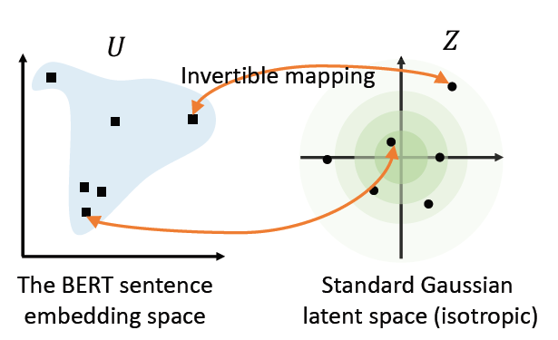

### BERT-whitening（2021，向量空间映射）

论文链接：https://arxiv.org/pdf/2103.15316.pdf
论文解读：https://kexue.fm/archives/8069

对参数进行白化操作，使得均值变为零，协方差矩阵变换成单位阵，获得一个更好的句向量空间。

### ConSert（ACL2021，无监督学习，数据增强）

论文链接：https://arxiv.org/pdf/2105.11741.pdf
论文解读：
1. https://zhuanlan.zhihu.com/p/378544839
2. https://tech.meituan.com/2021/06/03/acl-2021-consert-bert.html

通过多种数据增强方法生成正例，缩进正例之间的距离，增加反例句子之间的距离。

数据增强：
1. 对抗攻击（Adversarial Attack）：仅适用于有监督？
2. 打乱顺序：Shuffle Position ID。
3. 裁剪：将对应Token的Embedding置零 / 将Embedding的某个维度置零
4. Dropout：没有Token和Embedding维度的指定，随机置零。

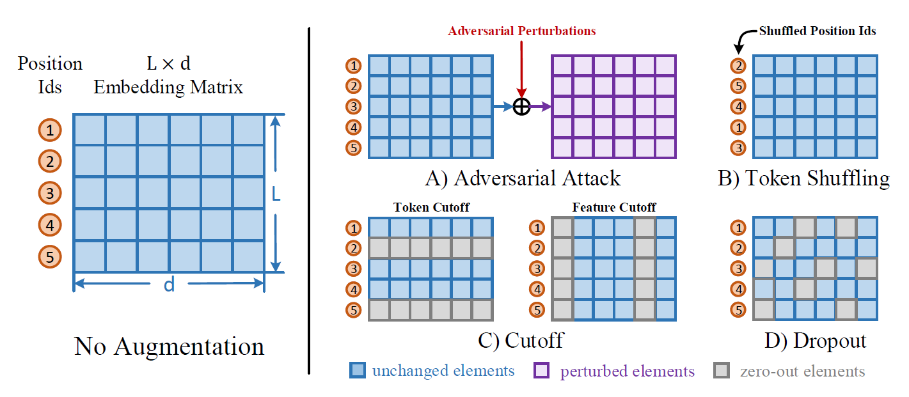

结论：
有提升但是不如SimCSE，这篇文章在SimCSE之前发表。

### SimCSE（EMNLP2021，无监督，对比学习）

论文链接：https://arxiv.org/pdf/2104.08821.pdf
论文解读：
1. https://blog.csdn.net/weixin_45839693/article/details/116302914
2. https://kexue.fm/archives/8348

通过dropout生成正例对，与其他句子生成反例对。本质是一种数据扩增。

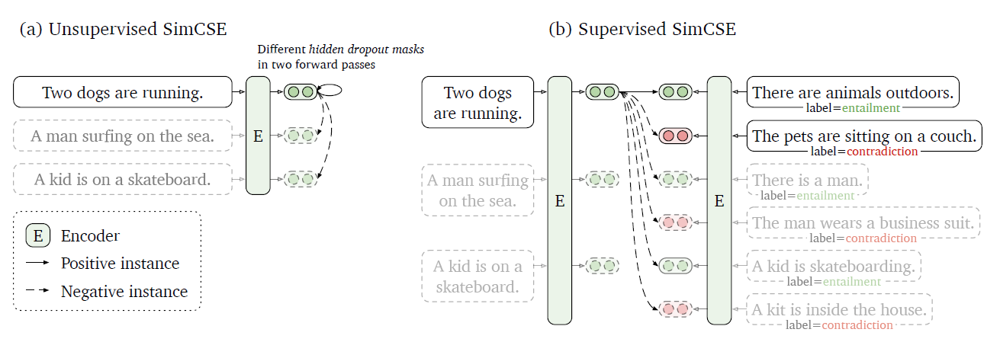

结论：
1. 自监督学习结果优于同量级有监督SBERT版本，对比学习很有效果。
2. 有监督学习结果优于同量级有监督SBERT版本，可能是数据集/损失函数选择问题。

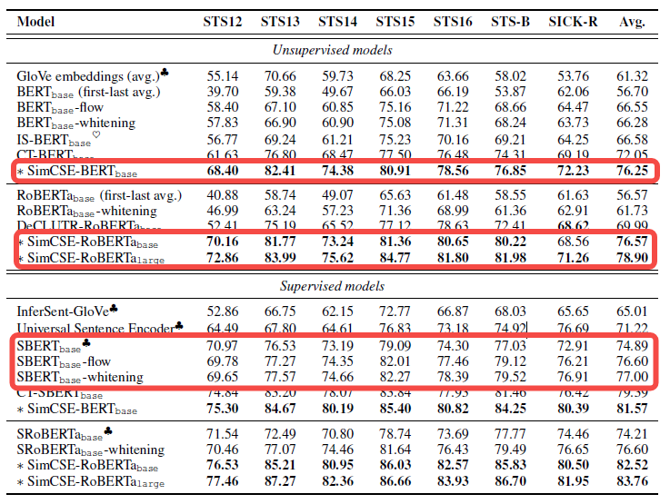

## 数据增强方法
文本级别的增强：
1. 回译：将文本翻译为另一种语言再翻译回来。
2. CBERT：将文本部分替换为[MASK]，并让BERT恢复这些词。
3. 意译（Paraphrase）：使用训练好的Paraphrase模型生成同义句。

Embedding级别的增强：
1. 对抗攻击（Adversarial Attack）：？仅适用于有监督？
2. 打乱顺序：Shuffle Position ID。
3. 裁剪：将对应Token的Embedding置零 / 将Embedding的某个维度置零
4. Dropout：没有Token和Embedding维度的指定，随机置零。

## 何为对比学习？
一种通过拉近正例拉远反例方法优化embedding空间的自监督预训练方法

# NLI 数据集
## OCNLI（5万对）
OCNLI，即原生中文自然语言推理数据集，是第一个非翻译的、使用原生汉语的大型中文自然语言推理数据集。 OCNLI包含5万余训练数据，3千验证数据及3千测试数据。除测试数据外，我们将提供数据及标签。测试数据仅提供数据。

简介：
1. https://github.com/CLUEbenchmark/CLUE
2. https://github.com/cluebenchmark/OCNLI

下载地址：https://storage.googleapis.com/cluebenchmark/tasks/ocnli_public.zip

## CMNLI（39万对）
CMNLI数据由两部分组成：XNLI和MNLI。数据来自于fiction，telephone，travel，government，slate等，对原始MNLI数据和XNLI数据进行了中英文转化，保留原始训练集，合并XNLI中的dev和MNLI中的matched作为CMNLI的dev，合并XNLI中的test和MNLI中的mismatched作为CMNLI的test，并打乱顺序。该数据集可用于判断给定的两个句子之间属于蕴涵、中立、矛盾关系。

简介：https://github.com/CLUEbenchmark/CLUE

下载地址：https://storage.googleapis.com/cluebenchmark/tasks/cmnli_public.zip

## ChineseTextualInference（42万对）
目前,关于文本蕴含的研究主要还是集中在英文,如评测中常常使用的SNLI数据集与MultiNIL:
1. The Stanford Natural Language Inference (SNLI) 是斯坦福大学NLP组发布的文本蕴含识别的数据集。SNLI由人工标注的，一共包含570K个文本对，其中训练集550K，验证集10K，测试集10K，一共包含三类entailment，contradiction，neutra，上节提到的例子就是出自此数据集
2. The Multi-Genre Natural Language Inference (MultiNLI)是一个众包数据集，包含433k个文本对。

简介：https://github.com/liuhuanyong/ChineseTextualInference
