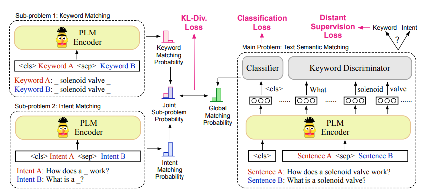
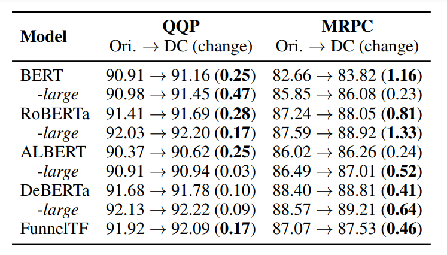

# 文献阅读 Divide and Conquer Text Semantic Matching with Disentangled Keywords and Intents

## 介绍

**链接：**https://arxiv.org/pdf/2203.02898.pdf

**题目：**Divide and Conquer: Text Semantic Matching with Disentangled Keywords and Intents

## 方法
**训练数据示例：**

1.  **Sentence A：**电磁阀怎么工作？

**Key A:** 电磁阀

**Intent A:** [MASK]怎么工作？

2.  **Sentence B：**电磁阀是什么？

**Key B:** 电磁阀

**Intent B:** [MASK]是什么？

3.  **相似度标签 = [0, 1] 不匹配**

  

### **一个假设**

1.  每个用户query都拥有一个关键词及一个意图，关键词匹配与意图匹配是独立的。

  

### **三个目标**

**Loss = Loss_sm + Loss_ds + Loss_dc**

1.  **Loss_sm (semantic matching)**：为了使 **句子匹配的结果** 逼近 **匹配相似度标签**，句子匹配的概率->相似度标签

BERT句子匹配概率 = [0.2, 0.8]
相似度标签 = [0, 1]
Loss_sm = cross_entropy(句子匹配概率分布, 相似度标签)
 
2.  **Loss_ds (distant supervision)**：为了在超平面使 **关键词的Representation** 和 **意图的Representation 彼此远离**，在 BERT 的 Representation 中提取 关键词Representation 之后的平均表示（mean pooling）经过一个分类器之后->1，提取 意图Representation 之后的平均表示经过同样分类器之后->0。

Loss_ds = cross_entropy(关键词分类概率，[0, 1]) + cross_entropy(意图分类概率，[1, 0])
 
3.  **Loss_dc (divide and conquer)**：为了让模型同时学习到关键词和意图是否匹配，关键词匹配概率与意图匹配的概率的联合概率分布->句子匹配的概率分布

匹配 概率分布 = [匹配概率, 不匹配概率]
 
**key匹配概率分布**（"电磁阀", "电磁阀"） = **[0.9, 0.1]**
**intent匹配概率分布**（"[MASK]怎么工作？", "[MASK]是什么？"） = **[0.1, 0.9]**
 
**key-intent联合匹配概率**（同时匹配） = key匹配intent匹配概率 = **0.9 \* 0.1** = **0.09**
**key-intent联合不匹配概率** （至少有一个不匹配）
= key匹配intent不匹配概率 + key不匹配intent匹配概率 + key不匹配intent不匹配概率
= **0.9 \* 0.9 + 0.1 \* 0.1 + 0.9 \* 0.1** = **0.91**
  
**key-intent联合匹配概率分布** = **[0.09, 0.91]**
**句子匹配概率分布**（"电磁阀怎么工作？", "电磁阀是什么？"）= **[0.2, 0.8]**
 
Loss_dc = KL(**key-intent联合匹配概率分布**, **句子匹配概率分布**)

## 总结
**结果：**

**优势：**
1.  将句子匹配的两个识别特征分开看（分治），降低了模型用一个目标函数同时识别两个特征点的难度。

**限制：**
1.  这种方法受限于关键词提取的方式和精度。
2.  原文用了Sogou knowledge graph（Knowledge graph construction and applications for web search and beyond）