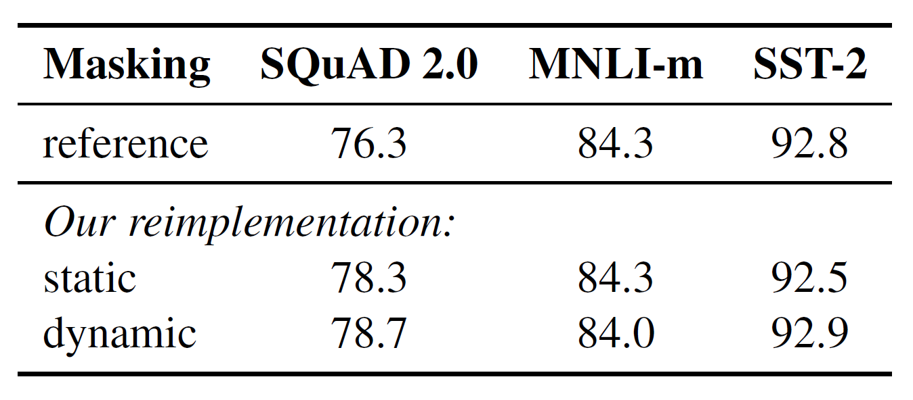
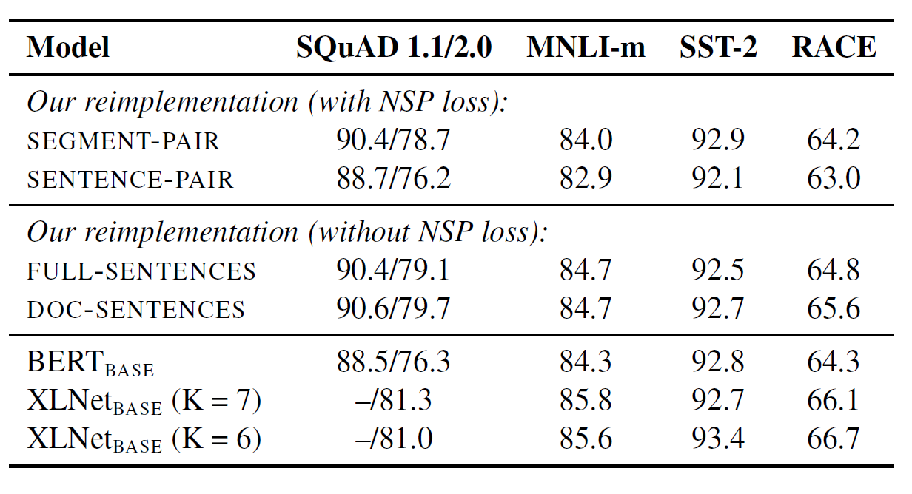
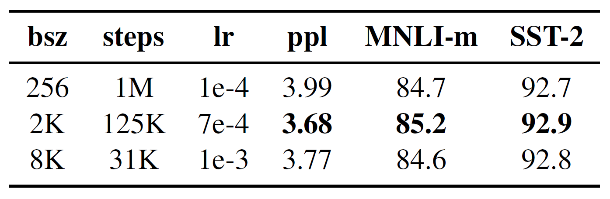
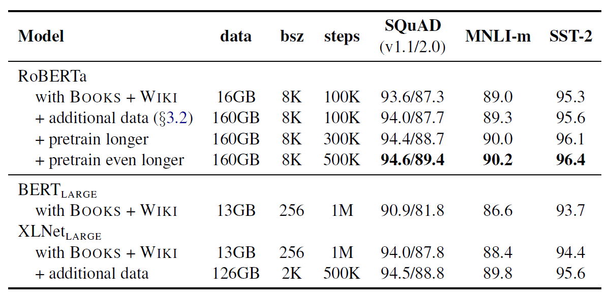

# 1 Introduction
**[1]** RoBERTa: A Robustly Optimized BERT Pretraining Approach
Link : [http://arxiv.org/abs/1907.11692](http://arxiv.org/abs/1907.11692)
Institute：University of Washington, Facebook AI
Code : [https://github.com/pytorch/fairseq](https://github.com/pytorch/fairseq)

## 1.1 Achievement
1. Present a replication study of BERT, carefully measuring the impact of many key parameters and training data size
2. Find that BERT can be further improved
3. Achieve state-of-the-art on GLUE, RACE and SQuAD

# 2 Method
For the detail of the original BERT model, visit [here](/posts/2020-07-10-如何理解-bert/). 
In the coming sections, the modification of their proposed model based on experiment will be introduced. 
## 2.1 Static vs. Dynamic Masking
**Table 2.1 Static vs. Dynamic Masking**

| BERT | Method 1 |
| :-: | :-: 
| Static Mask | Dynamic Mask |

BERT: (Static Mask)
1. Only mask once while data-preprocessing
2. Result in information loss

Method 1: (Dynamic Mask)
1. Mask in 10 different ways for 4 loops
2. Reduce the effect of information loss

**Table 2.2 Comparison between static and dynamic masking**

Result: 
1. Static masking performs similar to the original BERT model, and dynamic masking is comparable or slightly better than static masking. 
2. Finally choose dynamic masking for RoBERTa

## 2.2 Model Input Format and Next Sentence Prediction

Table 2.3 Several Training Format

| BERT | Method 1 | Method 2 | Method 3 |
| --- | --- | --- | --- |
| SEGMENT-PAIR+NSP | SENTENCE-PAIR+NSP | FULL-SENTENCES | DOC-SENTENCES |

BERT: (SEGMENT-PAIR+NSP)
1. Input with a pair of segments
\* Each segment can contain multiple sentences but the maximum token length of the input is 512. 
2. Train the model with NSP loss

Method 1: (SENTENCE-PAIR+NSP)
1. Input with a pair of sentences
\* They increase batch size to obtain a similar total number of tokens with BERT(SEGMENT-PAIR+NSP). 
2. Train the model with NSP loss

Method 2: (FULL-SENTENCES)
1. Input with full sentences sampled contiguously from different documents
\* The total length is at most 512. 
2. Add an extra separator token to indicate the end of one document and directly begin sampling the sentences of the next document
\* Deal with the boundary
3. Remove NSP loss

Method 3: (DOC-SENTENCES)
1. Input with full sentences sampled contiguously from different documents but boundary-crossing is not allowed
2. Input tokens may much shorter than 512 because of the cut-off near the boundary. 
3. Dynamically increase the batch size near the boundary to achieve a similar token number as Method 2(FULLSENTENCES) 
4. Remove NSP loss

Table 2.4 Comparison between Different Input Formating Methods

Result: 
1. Using individual sentences hurts performance on downstream tasks
\* They hypothesize that the model may not able to learn long-term dependency if using individual sentences. 
2. Removing the NSP loss matches or slightly improve the downstream task performance
3. Method 3(DOC-SENTENCES) performs slightly better than Method 2(FULL-SENTENCES). 
4. To avoid variable batch size, they finally choose Method 2(FULL-SENTENCES) for RoBERTa. 

## 2.3 Training with Large Batches
In this section, they try to get a better result by increasing the batch size. 

**Table 2.5 Comparison between Different Batch Size**

Result: 
1. It shows that training with large batches improves perplexity and end-task accuracy. 
2. Large batches can be easier to do parallelization. 

## 2.4 Text Encoding
In this section, they try to get a better result by using a larger byte-level BPE(Byte-Pair Encoding). 

# 3 RoBERTa

**Table 3.1 Comparison between RoBERTa, BERT_LARGE and XLNet_LARGE**

**RoBERTa**: (**R**obustly **o**ptimized **BERT** **a**pproach)
1. RoBERTa, a modification version of BERT model, is trained with dynamic masking(2.1), FULL-SENTENCES without NSP loss(2.2), large mini-batches(2.3), and a larger byte-level BPE(2.4). 
2. Experiment settings: 
2.1\. Based on BERT_LARGE(L = 24, H = 1024, A = 16, 355M parameters)
2.2\. Trained with 1024 Tesla V100 GPUs for about one day
3. Experiment Result: 
3.1\. Improve a lot over the original BERT
3.2\. The ultimate version achieves state-of-the-art, outperforming BERT and XLNet. 

# 4 Conclusion
What may improve the performance of BERT: 
1. Train the model for longer time, with bigger batches over more data
2. Remove NSP
3. Train on longer sequences
4. Dynamic masking