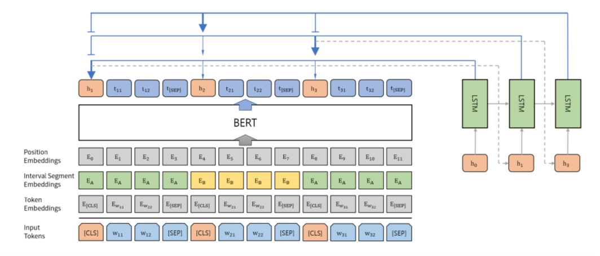
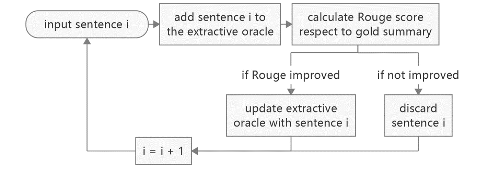

# 1 Introduction
Title : Summary Level Training of Sentence Rewriting for Abstractive Summarization
Link : [http://arxiv.org/abs/1909.08752 ](http://arxiv.org/abs/1909.08752 )
Author : Sanghwan Bae, Taeuk Kim, Jihoon Kim and Sang-goo Lee
Conference : Proceeding of the 2nd Workshop on New Frontiers in Summarization (held by EMNLP)

## 1.1 Achievement
1. Present a novel training signal that directly **maximizes** summary-level **ROUGE** scores through **reinforcement learning**
2. Obtains new **state-of-the-art** performance on both **CNN/Daily Mail** and **New York Times** datasets[1]

[1] Actually, the result of (Liu, 2019) is now state-of-the-art. 

# 2 Method
## 2.1 Extractor

**Requirement** : Input with **document sequence D** and output with the chosen **extractive sentence subset**

**Solution** : (**Sequence D** -> **BERTSUM (Encoder)** -> **LSTM Pointer Network (Decoder)**)
1. Input the **sentence vector** into **BERTSUM**[1] in which they use **BERT BASE**, a **small** version of **BERT LARGE**
2. Feed the **sentence representation vector H** into the **LSTM Pointer Network**[2] with **256 hidden size**

**Advantage** : 
1. Enable the **decoder** to consider the **previous** selected sentence
2. **Avoid information overlapping** between the selected sentences

[1] [Text Summarization with Pretrained Encoder, 2019](::)
[2] [Pointer networks, 2015](::)

## 2.2 Abstractor[1]
**Requirement** : Input with selected **extractive sentence subset** and output with the corresponding **paraphased sentence**

**Solution** : (**extractive sentence subset** -> **seq2seq model**)
1. Use **word2vec**[2] model of **128** dimensions
2. Feed **extractive sentence subset** modified by word2vec into **seq2seq**[3] model which use **copying mechanism**[4] for handling **out-of-vocabulary words**

[1] [Fast Abstractive Summarization with Reinforce-Selected Sentence Rewriting, 2018](::)
[2] [Distributed representations of words and phrases and their compositionality, 2013](::)
[3] [Neural machine translation by jointly learning to align and translate, 2015](::); [Effective approaches to attention-based neural machine translation, 2015](::)
[4] [Get to the point: Summarization with pointer-generator networks, 2017](::)

# 3 Training
## 3.1 Extractor Pre-training[1]

**Requirement** : **Selected sentences** should be the ones that **maximize the Rouge score** with respect to **gold summaries**

**Problem** : 
1. Most summarization corpora **only** contain human written **abstractive summaries** as **ground truth** (No extractive summary for training)
2. It is **computationally expensive** to find a **globally optimal subset** of sentences that maximizes the Rouge score

**Solution** : 
1. **Add the document sentence** to the **extractive oracles** until the remaining candidate **can't improve the Rouge score** with respect to **entire gold summary**
2. Train the extractive model with **cross-entropy**

[1] Summarunner: A recurrent neural network based sequence model for extractive summarization of documents, 2017

## 3.2 Abstractor Training
**Requirement** : Find the proper **paraphrased function** between **original sentence** and the **gold summary**

**Solution** : 
1. For **each ground truth** summary sentence, find the **most similar sentence** in the original document with **Rouge score**
2. Train the model as a usual seq2seq model with **cross-entropy**

## 3.3 Reinforcement Learning Optimization

**Requirement** : **Optimize** the **Rouge** metric

**Solution** : Assume **the extractor** as an **agent** in reinforcement learning paradigm

Not quite understand yet.

# 4 Result
Their Rouge score is worse than the score of (Liu, 2019) .

# 5 Comparison and Conclusion
In this paper : 
1. **Extractor** : **BERTSUM** (Encoder) + **LSTM** (Decoder)
2. **Abstractor** : **seq2seq**

In (Liu, 2019) : 
1. **Extractor** : **BERTSUM** (Encoder) + **Transformer** + **sigmoid classifier** (Decoder)
2. **Abstractor** : 6 layered **Transformer**

Conclusion : Seems that Transformer in (Liu, 2019) performs better than seq2seq in this paper