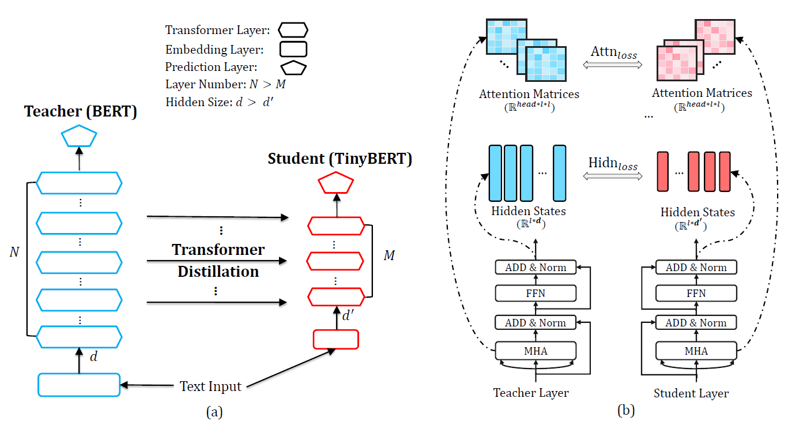
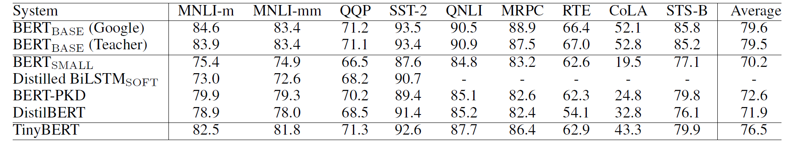
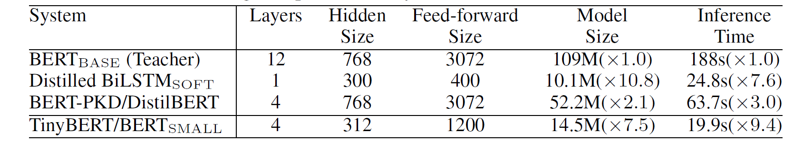

# 1 Introduction
**[1]** TINYBERT: DISTILLING BERT FOR NATURAL LANGUAGE UNDERSTANDING
Link : [http://arxiv.org/abs/1909.10351](http://arxiv.org/abs/1909.10351)
Institute：Huazhong University of Science and Technology, Huawei Noah's Ark Lab, Huawei Technologies Co., Ltd.
Code : [https://github.com/huawei-noah/Pretrained-Language-Model/tree/master/TinyBERT](https://github.com/huawei-noah/Pretrained-Language-Model/tree/master/TinyBERT)

## 1.1 Achievement
1. Propose a novel Transformer distillation method
2. Introduce a new two-stage learning framework.
3. Achieve 96% the performance of BERT_BASE while being 7.5x smaller and 9.4x faster on inference. 

# 2 Method
## 2.1 Transformer Distillation

**Figure 2.1: An overview of Transformer distillation[1]**

**Problem** : Original BERT is too big and need too much time for training. 

**Requirement** : Reduce the scale of BERT while maintaining almost the same performance. 

**Solution** : (Teacher-Student Framework)
1. Choose M layers (Layer Num. of Student Model) from N layers of the Teacher Model for *Transformer-layer distillation*
2. Use n = g(m) to denote the mapping function
3. For *embedding-layer distillation* and *prediction layer distillation*, the corresponding layer mappings are denoted as 0 = g(0) and N + 1 = g(M + 1). 
4. Loss Function: 

$$
\begin{equation}
L_{model} = \sum_{m=1}^{M+1}\lambda_mL_{layer}(S_m, T_{g(m)})
\end{equation}
$$

\* Where lambda_m is the hyper-parameter represents the importance of the m-th layer distillation, L_layer( ) is the loss function of a given layer pair. 
\* This formula calculate the total loss of every layer ranged from 0 to M+1. 

### 2.1.1  Transformer-layer Distillation
1. Use attention-based distillation to learn the matrices of multi-head attention in the teacher network
2. Attention-based Loss Function: 

$$
\begin{equation}
L_{attn} = \frac{1}{h}\sum_{i=1}^{h}MSE(A_i^S, A_i^T)
\end{equation}
$$

\* Where **h** is the **number of attention heads**, **A_i**(l\*l) is the **attention matrix of the i-th head**, **l** is the **length of the input text**, **MSE( )** is the **mean square error function**. 
\* It shows that A_i without softmax has a faster convergence rate and better performance. 
3. Use hidden states based distillation to learn the feature of hidden states in the teacher network
\* I think this part actually enable the student model to learn the feature of FNN in teacher model. 
4. Hidden States based Loss Function: 

$$
\begin{equation}
L_{attn} = MSE(H^SW_h, H^T)
\end{equation}
$$

\* Where **H^S** (l\*d') and **H^T** (l\*d) refer to the **hidden states** of **student** and **teacher**, **W_h**(d'\*d) is a **learnable linear transformation** mapping student network into the vector space of teacher network, **d'** and **d** refer to the **hidden sizes** of **student** and **teacher** network (Usually d' < d) .

### 2.1.2 Embedding-layer Distillation
1. Use learnable matrix W_e to map student model into the vector space of teacher model
2. Embedding-based Loss Function: 

$$
\begin{equation}
L_{embd} = MSE(E^SW_e, E^T)
\end{equation}
$$

\* Where E_S and E_T refer to the embedding matrix of student and teacher model, W_e is the learnable linear transformation. 

### 2.1.3 Prediction-Layer Distillation
1. Use soft cross-entropy loss: 

$$
\begin{equation}
L_{pred} = -softmax(z^T)log\\_softmax(z^S / t)
\end{equation}
$$

\* Where z^T and z^S refer to the logits vector output by teacher and student model, t is the temperature value. 
\* In the experiment, they find t = 1 performs well. 

### 2.1.4 Final Distillation Objective Function

$$
\begin{equation}
L_{layer}(S_m, T_{g(m)}) = \begin{cases} L_{embd}(S_0, T_0), & {m = 0}\newline L_{hidn}(S_m, T_{g(m)}) + L_{attn}(S_m, T_{g(m)}), & M \geq  m > 0\newline L_{pred}(S_{M+1}, T_{N+1}), & m = M+1 \end{cases}
\end{equation}
$$

## 2.2 TinyBERT Learning
They apply a two-stage learning framework: 
1. General Distillation: 
Help TinyBERT learn rich knowledge embedding and improve the generaliztion capability of TinyBERT
2. Task-specific Distillation: 
Use specified task to enable TinyBERT to learn task-specific knowledge

### 2.2.1 General Distillation
1. Use the original BERT without fine-tuning as the teacher and a large-scale text corpus of general domain as the training data
2. Perform the above mentioned transformer distillation to obtain a general TinyBERT which may have worse performance than BERT

### 2.2.2 Task-specific Distillation
1. Use fine-tuned BERT as the teacher and a domain-specific dataset as the training data
2. Perform transformer distillation on the  TinyBERT after general distillation

### 2.2.3 Discussion about Two-stage Learning Framework
*The above two learning stages are complementary to each other:*
*1. The general distillation provides a good initialization for the task-specific distillation. 
2. The task-specific distillation further improves TinyBERT by focusing on learning the task-specific knowledge. 
3. Finally, although there is a big gap between BERT and TinyBERT in model size, by performing the proposed two-stage distillation, the TinyBERT can achieve competitive performances in various NLP tasks.*
\* From the original paper

# 3 Experiment Result

**Table 3.1: Results of GLUE official benchmark[1]**

**Table 3.2 The model sizes and inference time for baselines and TinyBERT[1]**

*The experiment results demonstrate that:*
*1. There is a **large performance gap** between 
**BERT_SMALL** and **BERT_BASE** due to the big **reduction in model size**. 
2. **TinyBERT** is consistently **better than BERT_SMALL** in all the GLUE tasks and **achieves a large improvement of 6.3% on average**. This indicates that the **proposed KD learning framework** can effectively **improve the performances of small models regardless of downstream tasks**. 
3. **TinyBERT** significantly **outperforms the state-of-the-art** KD baselines (i.e., BERT-PKD and DistillBERT) by a margin of **at least 3.9%**, even **with only 28% parameters and 31% inference time** of baselines. 
4. **Compared** with the teacher **BERT_BASE**, **TinyBERT** is **7.5x smaller and 9.4x faster** in the model efficiency, while maintaining competitive performances.*

\* From the original paper

# 4 Conclusion
1. Introduce a new KD(Knowledge Distillation) method for transformer-based distillation
2. Propose a two-stage framework for TinyBERT learning
3. Achieves competitive performance while reducing the model size and the inference time