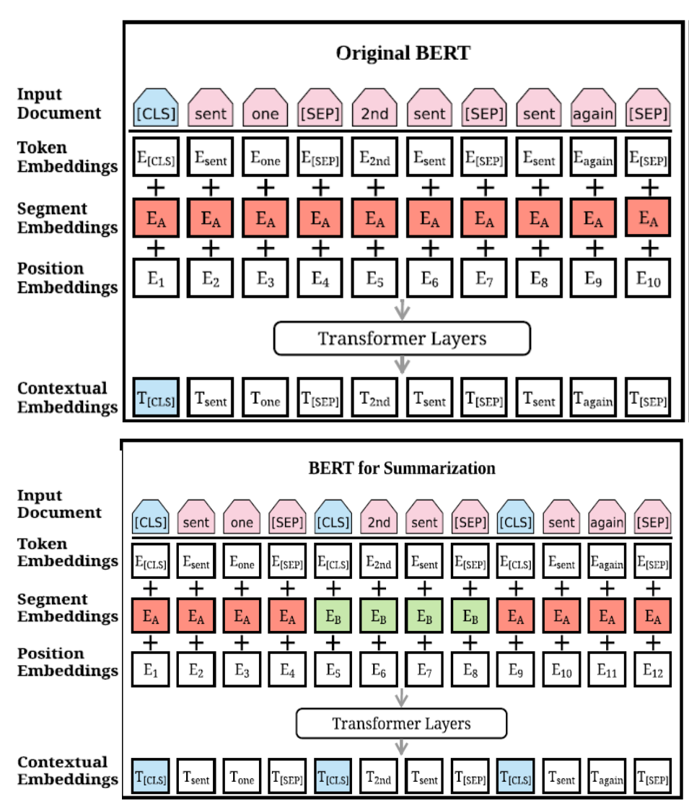
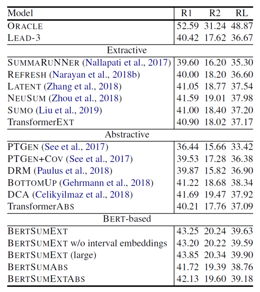
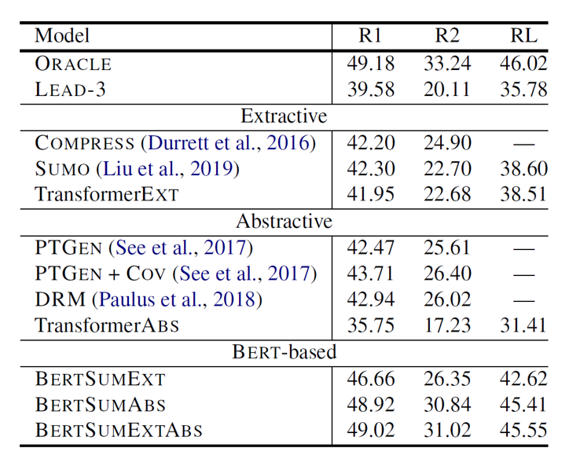

# 1 Introduction
Title : Text Summarization with Pretrained Encoder
Link : [http://arxiv.org/abs/1908.08345 ](http://arxiv.org/abs/1908.08345 )
Author : Yang Liu, Mirella Lapata
Conference : Accepted by EMNLP2019
Code : [https://github.com/nlpyang/PreSumm](https://github.com/nlpyang/PreSumm)

## 1.1 Achievement
1. Test the **feasibility** of BERT in text summarization
2. Build a general framework with **extractive** model and **abstractive** model
3. Propose a **two-stage fine-tuning** approach

# 2 Method
## 2.1 BERTSUM

**Problem** : **Original BERT**[1] can only apply to **single sentence**/**sentence-pair** input

**Requirement** : Input with **multiple sentences** and output the **contextual embeddings**

**Solution** : (**Modified BERT**)
1. Insert [CLS] tokens at **the start of every separate sentence** to **collect** the feature of the **following**[2] sentence
2. Use **crossing segment embeddings**[3] EA and EB to **distinguish** multiple sentences in a document

[1] [BERT: Pre-training of Deep Bidirectional Transformers for Language Understanding, 2019](::)
[2] In the original BERT, [CLS] symbol only appear at the start of the document for text classification. In this paper, the author said *[CLS] is used for collecting the feature of the **preceding** sentence*. However, it seems that the [CLS] symbol is actually used for collecting the feature of the **following** sentence. 
[3] In the original BERT, EA and EB are also used but limited by one sentence-pair. In this paper, EA and EB are expanded to the whole word embedding. 

## 2.2 BERTSUMEXT[1]
**Requirement** : Input with **sentence representation** and output the chosen **extractive summary subset**

**Solution** : (**BERTSUM** -> **Transformer** -> **Sigmoid Function**)
1. Use the **contextual embedding** of the [CLS] symbol as the **sentence representation**
2. Use a L-th layer **Transformer** to collect **document-level features** for extracting summaries (L = 2 performs best)
3. Output the **binary** result {0, 1} (1 for included) with a **sigmoid function** at the end

[1] [Attention is all you need, 2017](::)

## 2.3 BERTSUMABS[1]
**Requirement** : Input with **sentence representation** and output with **abstractive summary**

**Solution** : (**BERTSUM** -> **Transformer**)
1. Use the **contextual embedding** of the [CLS] symbol as the **sentence representation**
2. Use a 6-layered **Transformer** as the decoder to generate the **abstractive summary**

[1] [Get to the point: Summarization with pointer- generator networks, 2017](::)

## 2.4 BERTSUMEXTABS[1][2]
**Requirement** : Input with **sentence representation** and output with **abstractive summary**

**Solution** : (**BERTSUM** -> **Extractor Transformer** -> **Abstractor Transformer**)
1. Use the **contextual embedding** of the [CLS] symbol as the **sentence representation**
2. Use a L-th layer **Transformer** to collect **document-level features** for extracting summaries (L = 2 performs best)
3. Output the **binary** result {0, 1} (1 for included) with a **sigmoid function** at the end
4. Use a 6-layered **Transformer** to paraphrase the extracted sentence into the **abstractive summary**

**Advantage** : 
1. **Extractive summary** can **boost** the performance of **abstractive summarization**
2. This **two-stage approach** with extractor and abstractor can **share the information** between them

[1] [Bottom-up abstractive summarization, 2018](::)
[2] [Improving neural abstractive document summarization with explicit information selection modeling, 2018](::)

# 3 Experiment Result
## 3.1 CNN/DailyMail[1]

[1] Using the split of [Teaching machines to read and understand, 2015](::)
## 3.2 NYT[1]

[1] Following [Learning-based single-document summarizationwith compression and anaphoricity constraints, 2016](::)

# 4 Conclusion
1. Apply pre-trained BERT in text summarization
2. Introduce document-level encoder (BERTSUM)
3. Propose a framework for extractive and abstractive summarization (BERTSUMEXTABS)
4. Achieve state-of-the-art on dataset