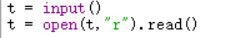
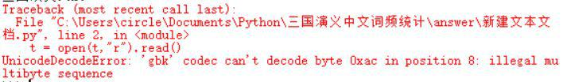
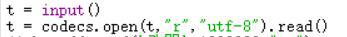
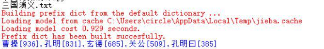
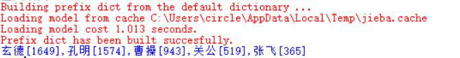

# 关于python jieba库的应用
作者：Yuk1n0
链接：https://www.lofter.com/lpost/1e94581f_d566a55
来源：LOFTER
时间：2016-12-16

>近期在做python的一些题目，其中有一道是用jieba库对《三国演义》进行分词，并统计其中人名的词频。

* 题目：
《三国演义》是一本鸿篇巨著，里面出现了几百个各具特色的人物。每次读这本经典作品都会想一个问题，全书这些人物谁出场最多呢？一起来用Python回答这个问题吧。
人物出场统计涉及对词汇的统计。中文文章需要分词才能进行词频统计，请使用jieba库。《三国演义》文本保存为：三国演义.txt。

* 输入：
三国演义.txt，请使用input()函数方式获得文件名输入。

* 输出：
打印输出全书出现次数最多的5个人物名字，名字采用逗号（,）分隔，每个名字后面用中括号标注改名字出现次数。例如：曹操[123], 刘备[110]。

## 1.1 打开文件的问题
上来第一步，打开文件就出了问题，由于题目要求打开文件必须为中文名“三国演义.txt”，在编码上不符合python的默认编码模式。





之前就遇到过这样的问题，中文的“gbk”编码出了问题，用codecs库转码成utf-8就行了。



## 1.2 分词
根据官方文档的说法，用jieba中的posseg函数就能实现将文本分词并给每个词智能识别词性。分词后的每个词x = x.word + / + x.flag，会有x.word = 原单词 以及 x.flag = 词性 两个属性

```python
words = jieba.posseg.cut(t) #分词并识别词性
num = {} #建立一个字典用来对应key（词语）和value（出现次数）
for word in words: #开始遍历所有的分词结果
    if word.flag == "nr": #判断词性是否为“nr”（人名）
        num[word.word] = num.get(word.word,0) + 1 #num.get(word.word,0)表示如果字典num中word的对应value值为空，则返回一个默认值0
```
 
 ## 1.3 排序 打印
分词后我们已经有了“人名：次数”的一个字典，接下来我们需要根据key值降序排列这个字典

```
order = list(num.items()) #list(num.items)返回一个每个元素为（key，value）元组的列表
order.sort(key = lambda x:x[1], reverse = True) #以列表中的第一列即value的一列为key进行reverse排序
for i in range(5):
    print(str(order[i][0])+"[%d]"%int(order[i][1]),end = "")
    if i == 4:
        break
    print(",",end = "")
```

## 1.4 打印后的结果



蜜汁尴尬，jieba库直接把孔明曰当成了人名，当然还有很多的曹操曰，玄德曰也会被当成人名处理，因此我们需要改进一下算法或者利用jieba库自身的功能来避免这个现象。

我先看了一下讨论群里大家的反应，有些人说可以通过增加“孔明”“曹操”等词的词频来让系统只识别孔明和曹操，不识别曰，有人说可以直接把孔明曰加到孔明里，是系统自己识别不够智能，我们也没办法。可是我总觉得这两种方法都太low了，我想要从根本上解决这个问题。

## 1.5 试图解决“孔明曰”
出现这种情况的根本原因是系统本身不够智能，将“孔明曰”识别成了人名。讨论群里有个人说可以用jieba.cut(t, cut_all = True)的方式来避免这个bug。我为此查看了官方文档对这个函数的解释。

```python
import jieba
seg_list = jieba.cut("我来到北京清华大学", cut_all=True)
print("Full Mode:", "/ ".join(seg_list))  # 全模式
seg_list = jieba.cut("我来到北京清华大学", cut_all=False)
print("Default Mode:", "/ ".join(seg_list))  # 精确模式
seg_list = jieba.cut("他来到了网易杭研大厦")  # 默认是精确模式
print(", ".join(seg_list))
#output
【全模式】: 我/ 来到/ 北京/ 清华/ 清华大学/ 华大/ 大学
【精确模式】: 我/ 来到/ 北京/ 清华大学
【新词识别】：他, 来到, 了, 网易, 杭研, 大厦    (此处，“杭研”并没有在词典中，但是也被Viterbi算法识别出来了)
```

也就是说用jieba.cut(t, cut_all = True)的时候，系统会把可以识别的所有词汇都列出来，那么“孔明曰”就不会直接被识别为“孔明曰”而会被识别为“孔明”和“孔明曰”，这样一来就给了我们统计所有孔明出现次数的机会。

但是，与此同时，另一个问题困扰了我，上文中用到的posseg函数能够实现词性识别，而这个jieba.cut函数却不能识别词性，那么我们怎么统计人名呢？
我首先想到的设计一个cut，posseg函数并行的算法，然后通过将cut后的结果遍历posseg的结果来判断词性，但是显然的，这样做需要双重循环，十分复杂。

```python
import codecs
import jieba
import jieba.posseg as pseg
t = input()
t = codecs.open(t,"r","utf-8").read()
words = list(jieba.cut(t, cut_all = True))
ws = pseg.cut(t)
num = {}
for word in words:
    for w in ws:
        if word == w.word and w.flag == "nr":
            num[word] = num.get(word,0) + 1
order = list(num.items())
order.sort(key = lambda x:x[1], reverse = True)
for i in range(10):
    print(str(order[i][0])+"[%d]"%int(order[i][1]),end = "")
    if i == 9:
        break
    print(",",end = "")
```

十分尴尬的是，我运行了20分钟也没出结果，看来这双重循环确实不实用。

那就换个方法呗，之后我想的方法是先跑一遍cut，然后再把cut后的每个词跑一遍posseg判断一下词性，再排序。
于是就有了：

```python
import codecs
import jieba
import jieba.posseg as pseg
t = input()
t = codecs.open(t,"r","utf-8").read()
words = jieba.cut(t, cut_all = True)
num = {}
for word in words:
    if len(word) < 2: #发现系统会把单字识别为任命我就加了长度限制
        continue
    else:
        num[word] = num.get(word,0) + 1
x = list(num.keys())
for i in x:
    ws = pseg.cut(str(i))
    for w in ws:
        if w.flag != "nr":
            num[w] = 0
order = list(num.items())
order.sort(key = lambda x:x[1], reverse = True)
for i in range(10):
    print(str(order[i][0])+"[%d]"%int(order[i][1]),end = "")
    if i == 9:
        break
    print(",",end = "")
```

结果让我快崩溃了,因为不用全文posseg所以跑得很快，几秒出结果。


真的快哭了好吗。。。

## 1.6 关于试图解决“孔明曰”的反思
在两次失败后我仔细思考了一下从根本上解决这一问题的可行性，发现这似乎不能够从根本上解决。如果我们开启全分词，系统不但会把”孔明曰“分为“孔明”和”孔明曰“，同时还会智障的把“司马懿”分为“司马”和”司马懿“，然后再名字判断的时候还会将这两个都判断为“nr”，即名字。但一旦我们不开启全分词，那么系统就会智障地把“孔明曰”当成一个名字，也不行。所以怎么着都不能直接从根本上解决这一问题。最好的方式就是建立一个包含三国各个人名的字典，然后让系统在文章中找这些词的出现次数，这样才能准确无误地统计。但是由于我们的题目的输入项只是一个”三国演义.txt“,所以想要这样解决显然是不行的。

## 1.7 向AI的智障低头
在打了一晚上无用码之后，身心俱疲，为了更好的输出效果，我最终采取了讨论组中那个增加”孔明“、”曹操“等词的词频的方法，虽然我当时并不像采用这个很low的方法，但是迫于现实的残酷性，我只有向AI低头了。

```python
import codecs
import jieba.posseg as pseg
import jieba
t = input()
t = codecs.open(t,"r","utf-8").read()
jieba.add_word('孔明',100000,"nr")
jieba.add_word('玄德',100000,"nr")
jieba.add_word('曹操',100000,"nr")
jieba.add_word('刘备',100000,"nr")
jieba.add_word('关羽',100000,"nr")
jieba.add_word('关公',100000,"nr")
jieba.add_word('张飞',100000,"nr")
words = pseg.cut(t)
num = {}
for word in words:
    if word.flag == "nr":
        num[word] = num.get(word,0) + 1
order = list(num.items())
order.sort(key = lambda x:x[1], reverse = True)
for i in range(5):
    print(str(order[i][0])[:-3]+"[%d]"%int(order[i][1]),end = "")
    if i == 4:
        break
    print(",",end = "")
```



这种暴力增加词频的方法让系统在识别”孔明曰“的时候直接将其识别为”孔明“和”曰“。虽然我依然觉得很low，但在解决这一问题时，这确实不失为一种实用的方法。