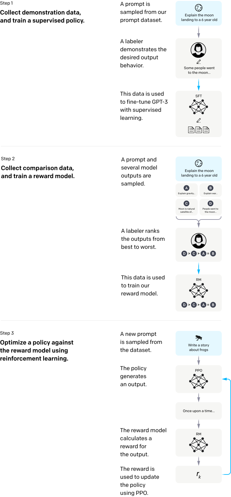
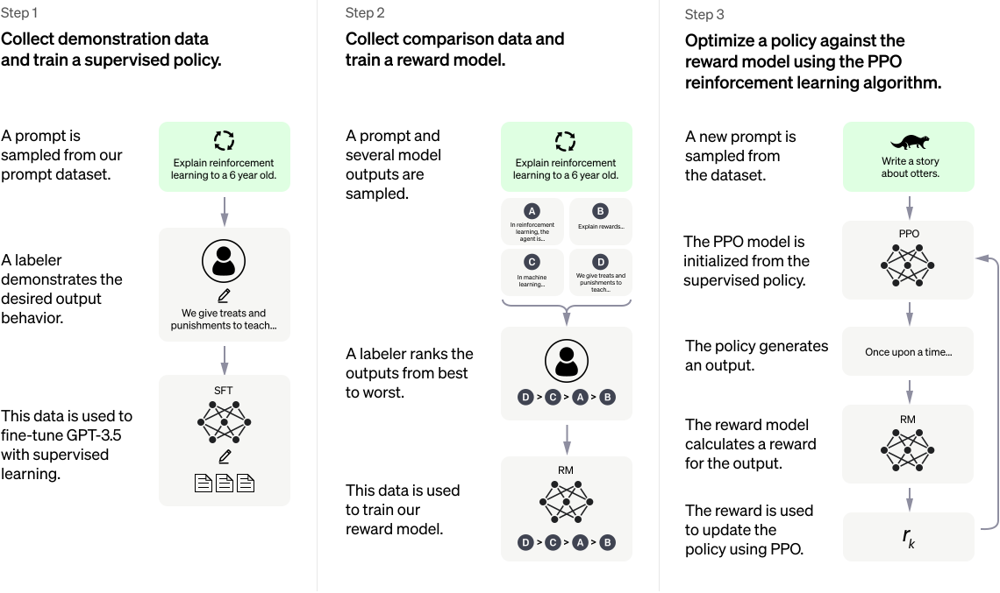

# 背景
2022年底，随着OpenAI的对话应用ChatGPT的火爆，以生成式模型为主的LLM（Large Language Model）大型语言模型的应用进入了各行各业的视野中。本文将从技术演进为主线记录生成式模型的发展，聚焦于模型（数据、建模）、Prompt工程两个维度。

# Model: Before 2022
* 将参考 [Generalized Language Models | Lil'Log (lilianweng.github.io)](https://lilianweng.github.io/posts/2019-01-31-lm/)及相关paper陆续补充
# Model: GPT Series
## InstructGPT (2022.03)
Keywords:
1. InstructGPT: 
	1. Paper: https://arxiv.org/pdf/2203.02155.pdf
	2. Blog: [Aligning language models to follow instructions (openai.com)](https://openai.com/research/instruction-following)
2. RLHF (Reinforcement Learning from Human Feedback): [Learning from human preferences (openai.com)](https://openai.com/research/learning-from-human-preferences)
3. RM (Reward Model)
4. PPO (Proximal Policy Optimization): [Proximal Policy Optimization (openai.com)](https://openai.com/research/openai-baselines-ppo)
5. SFT (Supervised Fine-Tuning)

### Method

步骤：
1. 通过人工标注数据，训练一个 有监督模型A。
	1. 采样一条Prompt数据
	2. 人工标注 期望输出，得到 **Prompt - 期望输出**
	3. SFT（Supervised Fine-Tuning）：通过这条 **Prompt - 期望输出** 的文本对微调GPT-3，得到 有监督模型A。
2. 通过收集模型A的输出，训练一个 奖励模型B。
	1. 采样一条Prompt数据
	2. 通过 有监督模型A 输出n个结果 **[输出1, 输出2, 输出3, 输出4]**，人工标注 输出的好坏，得到 **Prompt - [输出4, 输出3, 输出1, 输出2]**。（表示 输出4 效果最好，输出2 效果最差）
	3. RM (Reward Model): 通过输出结果的好坏顺序，训练一个评判输出效果好坏的打分模型，得到 奖励模型B。
3. 通过 奖励模型B 的反馈结果，基于 强化学习 优化 有监督模型A。
	1. 采样一条Prompt数据
	2. 通过 有监督模型A 输出1个结果
	3. 通过 奖励模型B 对输出结果进行打分，并将奖励结果反馈给 有监督模型A。
	4. PPO (Proximal Policy Optimization): 通过 奖励模型B 的奖励结果，优化 有监督模型A，得到 最终模型C。

### Reference
> To train InstructGPT models, our core technique is [reinforcement learning from human feedback (RLHF)](https://openai.com/blog/deep-reinforcement-learning-from-human-preferences/), a method we helped pioneer in our earlier alignment research. This technique uses human preferences as a reward signal to fine-tune our models, which is important as the safety and alignment problems we are aiming to solve are complex and subjective, and aren’t fully captured by simple automatic metrics.

> We first collect a dataset of human-written demonstrations on prompts submitted to our API, and use this to train our supervised learning baselines. Next, we collect a dataset of human-labeled comparisons between two model outputs on a larger set of API prompts. We then train a reward model (RM) on this dataset to predict which output our labelers would prefer. Finally, we use this RM as a reward function and fine-tune our GPT-3 policy to maximize this reward using the [PPO algorithm](https://openai.com/blog/openai-baselines-ppo/).

> One way of thinking about this process is that it “unlocks” capabilities that GPT-3 already had, but were difficult to elicit through prompt engineering alone: this is because our training procedure has a limited ability to teach the model new capabilities relative to what is learned during pretraining, since it uses less than 2% of the compute and data relative to model pretraining.

> A limitation of this approach is that it introduces an “alignment tax”: aligning the models only on customer tasks can make their performance worse on some other academic NLP tasks. This is undesirable since, if our alignment techniques make models worse on tasks that people care about, they’re less likely to be adopted in practice. We’ve found a simple algorithmic change that minimizes this alignment tax: during RL fine-tuning we mix in a small fraction of the original data used to train GPT-3, and train on this data using the normal log likelihood maximization.[D](https://openai.com/research/instruction-following#fn-D) This roughly maintains performance on safety and human preferences, while mitigating performance decreases on academic tasks, and in several cases even surpassing the GPT-3 baseline.

## ChatGPT(2022.11)
Keywords：
1. ChatGPT：[Introducing ChatGPT (openai.com)](https://openai.com/blog/chatgpt)
### Method

### Reference
> We trained this model using Reinforcement Learning from Human Feedback (RLHF), using the same methods as [InstructGPT](https://openai.com/blog/instruction-following/), but with slight differences in the data collection setup. We trained an initial model using supervised fine-tuning: human AI trainers provided conversations in which they played both sides—the user and an AI assistant. We gave the trainers access to model-written suggestions to help them compose their responses. We mixed this new dialogue dataset with the InstructGPT dataset, which we transformed into a dialogue format.

> To create a reward model for reinforcement learning, we needed to collect comparison data, which consisted of two or more model responses ranked by quality. To collect this data, we took conversations that AI trainers had with the chatbot. We randomly selected a model-written message, sampled several alternative completions, and had AI trainers rank them. Using these reward models, we can fine-tune the model using [Proximal Policy Optimization](https://openai.com/blog/openai-baselines-ppo/). We performed several iterations of this process.

> ChatGPT is fine-tuned from a model in the GPT-3.5 series, which finished training in early 2022. You can learn more about the 3.5 series [here](https://beta.openai.com/docs/model-index-for-researchers). ChatGPT and GPT-3.5 were trained on an Azure AI supercomputing infrastructure.

## GPT-4 (2023.03)

# Model: Open Source LLMs
## LLaMA (2023.02)
Keywords: 
1. LLaMA: 
	1. Paper: https://arxiv.org/pdf/2302.13971v1.pdf
	2. Code: [GitHub - facebookresearch/llama: Inference code for LLaMA models](https://github.com/facebookresearch/llama)

### Data
### Method
### Conclusion

## Alpaca (2023.03)
Keywords:
1. Alpaca:
	1. Blog: [Stanford CRFM](https://crfm.stanford.edu/2023/03/13/alpaca.html)
	2. Code: [GitHub - tatsu-lab/stanford_alpaca: Code and documentation to train Stanford's Alpaca models, and generate the data.](https://github.com/tatsu-lab/stanford_alpaca)
### Data
### Method
### Conclusion
## Vicuna (2023.03)

Keywords:
1. ## Vicuna: 
	1. Blog: [Vicuna: An Open-Source Chatbot Impressing GPT-4 with 90%* ChatGPT Quality | LMSYS Org](https://lmsys.org/blog/2023-03-30-vicuna/)
	2. Code: [GitHub - lm-sys/FastChat: An open platform for training, serving, and evaluating large languages. Release repo for Vicuna and FastChat-T5.](https://github.com/lm-sys/FastChat)

### Data
### Method
### Conclusion

# Prompt:  